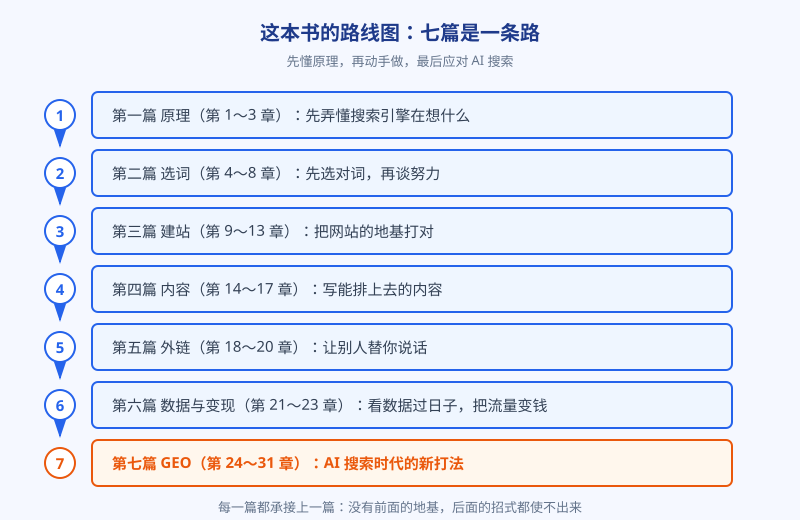
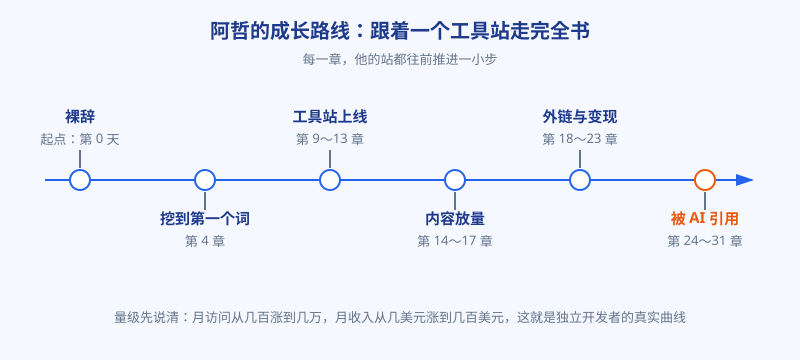

# 前言：流量不是玄学

## 先说一个尴尬的场景

你把一个产品做出来了。功能完整，界面顺眼，自己用着挺满意。然后你打开后台数据：今天的访问量是三，其中两个是你自己，剩下一个不知道是从哪儿误入的。

这不是产品的问题，这是绝大多数独立开发者都会撞上的一堵墙：东西做好了，没人来。

找人的办法当然有。投广告，按点击付钱，钱包瘦得比流量快；去各个社区发帖，效果全看运气，还容易被当成广告删掉；等口碑发酵，道理都对，就是慢得让人心慌。相比之下，搜索流量有个很朴素的好处：用户是自己找上门来的。他在搜索框里敲下那个词的时候，需求已经摆在明面上了，你要做的只是在他需要的那一刻，出现在他眼前。

这件事有个专门的名字，叫 SEO，说白了就是：想办法让搜索引擎愿意把你的页面，排在搜索结果的前面。

## 为什么这一课最该由会做产品的人补

很多人对 SEO 有两个误解。第一个误解是，SEO 是营销人员的事，和做产品的人没关系。恰恰相反，搜索引擎看一个网站的方式，和用户看一个产品的方式高度一致：你到底在解决什么问题，内容靠不靠谱，用起来顺不顺手。选什么词、做什么页面、页面怎么组织，这些全是产品决策，只不过决策的依据换成了用户亲口说出的需求。

第二个误解是，SEO 是玄学。黑话确实多，张嘴就是权重、收录、沙盒、算法更新，听得人头皮发麻。再加上这个行业里混着不少卖焦虑的人，今天说某个技巧失效了，明天说某个秘籍能七天上首页，越发显得水深。其实把黑话剥掉，底层的逻辑意外地朴素：搜索引擎是一家公司，它的产品是回答问题，它要把饭碗端稳，就得把每个问题答得又准又快。你帮它把问题答好，它分你流量，天经地义。这本书要讲的，就是这套朴素逻辑，以及它派生出来的全部打法。

还有一层原因绕不开：搜索正在被 AI 改写。越来越多的人先问 ChatGPT 和各类 AI 助手，再决定点不点链接。老打法没有作废，但牌桌上多了一位新玩家，第七篇会专门讲这件事。原理懂了，变化来了你才不慌。

## 这本书的读法

全书分七篇，是一条完整的路：先弄懂搜索引擎在想什么，再学选词，然后是建站、内容、外链、数据与变现，最后讲 AI 搜索时代的 GEO。建议按顺序读，前面的概念会反复在后面出现。当然，每个人情况不同，这里给三条捷径：站还没上线的，先读第一篇和第二篇，选词比什么都优先；站已经跑了一阵子的，可以从第六篇的数据开始倒着读，边查边补；只想先弄清 AI 搜索是怎么回事的，直接看第七篇，但其中引用的相关性、权威性概念出自第 3 章，最好先扫一遍。

图：全书的路线图。七篇不是七个孤立的话题，而是一条从原理到实战、再到应对变化的完整路径。

每章的结构是固定的：先用大白话讲清一个概念，再看贯穿案例里的阿哲怎么用它，然后复盘一个翻车现场，最后是要点回顾和三道 Kata。Kata 不是摆设，这一行的手艺全在手上，光看不练，等于没学。每道题都不大，短则十分钟，长则一个周末，认真做完，收获会完全不一样。

## 先把丑话说在前面

有四句话得先说清楚，免得你带着错误的期待读下去。

第一，SEO 是慢生意。它以月为单位见效，一篇文章发出去，几周后才开始被收录、被验证、慢慢往上爬，这是常态。指望它救火的人基本都会失望；它更像种树，前期默默扎根，后期才有荫凉。

第二，这本书不承诺任何排名和收入。排名取决于你、对手和市场三方，收入更是如此。书里能给的是判断方法和真实的量级感，让你少走弯路，而不是一张中奖彩票。

第三，书里的案例和数字，口径都克制。SEO 圈最不缺的就是暴富故事，缺的恰恰是能复制的普通经验。以后你再看到任何惊人数字，都请自动在心里问一句：这是花了多久、多大盘子才做出来的？

第四，这本书写的是原理和判断，不是某个平台今年的按钮位置。工具会换，界面会改，算法会更新，但用户带着问题来搜索、搜索引擎一心想把问题答好这条主线，多年没变过。学会判断的人，比背下一百个技巧的人活得久。

## 认识一下阿哲

贯穿全书的人叫阿哲，前大厂程序员，写了八年代码，刚刚裸辞，准备靠一个小工具站养活自己。他要做的是一个图片处理工具站：压缩图片、转换格式这一类，英文站，面向海外用户。这个品类毫不起眼，竞争者多如牛毛，但正因为如此，它是观察 SEO 最好的样本：没有品牌光环，没有预算砸广告，每一滴流量都得靠真本事挣。

图：阿哲在全书中的推进路线。前三章里他还在打地基，工具站要到第三篇才真正上线。

为什么选这个品类？阿哲的理由很实在：需求是现成的，每天都有海量的人在搜这类词；技术对他来说没有门槛，一个人就能做完；变现的路也清楚，广告和付费版都接得上。换句话说，这是一个把胜负手几乎全押在流量上的品类：产品做出来只算入场，流量做不出来，一切归零。他接下来要补的这一课，也就是你手里这本书的全部内容。

需要先说明的是，阿哲是虚构的，但他踩的坑、算的账，都是独立开发者圈子里天天在发生的事。他不会一夜爆红，也不会月入十万。他的曲线是克制的那种：访问量从几百慢慢涨到几万，收入从几美元慢慢涨到几百美元。如果你想要的是暴富故事，这本书会让你失望；如果你想知道一个普通人靠搜索流量把小生意做成的真实过程长什么样，那我们对上眼了。

本章，阿哲刚刚递交辞职申请，工具站连一行代码都还没有。他带着八年写代码攒下的常识，准备先花几周把一件事弄明白：流量到底是怎么来的。这也是第一篇要陪你走完的路。先别急着学技巧，我们先去看看，那个天天给你派流量的图书管理员，脑子里到底在想什么。

这本书也不必一口气读完，它更适合放在手边：做站时翻到对应的篇，遇到问题时按图索骥。

临走前再交代一句：书里凡是提到数据和研究的地方，都尽量标了出处和年份。这个行业变化快，数字会旧，但判断的方法不会旧。以后看到任何惊人结论，包括这本书里的，都先问一句出处在哪儿，这是你在这行活下去的护身符。

现在，让我们从阿哲裸辞后的第一周开始。
