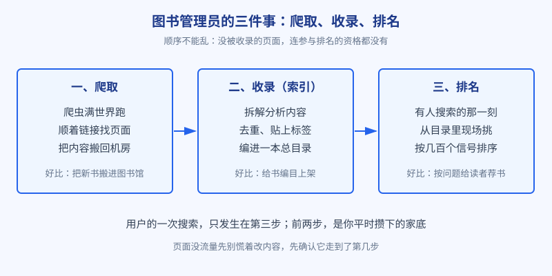
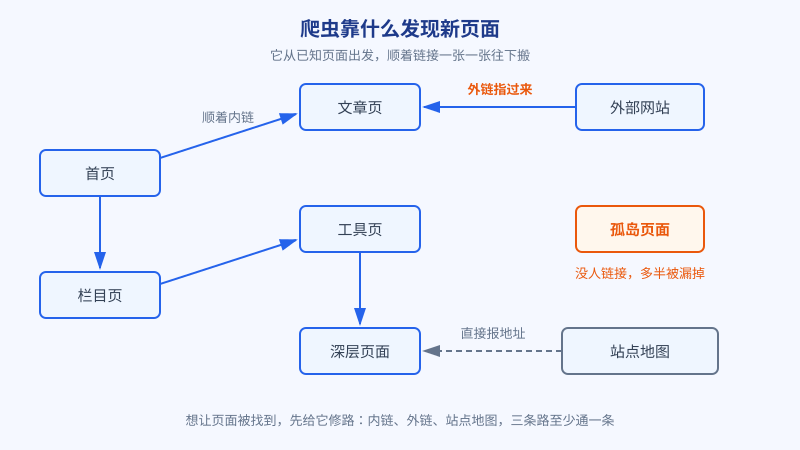

# 第 1 章 搜索引擎是个图书管理员

## 白话讲解

### 先把互联网想成一座图书馆

理解 SEO 的第一步，是理解搜索引擎到底在干什么活。别把它想成什么高深莫测的人工智能，先把它想成一座图书馆，一座大得离谱、而且每分每秒都在疯狂扩建的图书馆。

全世界的网站就是这座图书馆里的书和散页。麻烦在于，这些书不是整整齐齐送上门的，它们散落在几十亿个角落里，每天还有海量的新页面诞生、旧页面消失。你是这座图书馆的管理员，读者随时会走进来问问题，你的任务是：在几秒钟之内，从这堆散页里找出最能回答他问题的那几张，排好顺序递过去。

搜索引擎干的活，拆开看就是这个管理员的三件事：第一，把散落各处的页面搬回来；第二，给搬回来的页面编目，让它们能被快速检索；第三，读者提问时，从目录里挑最合适的排好递过去。这三件事有个对应的术语说法，叫爬取、收录、排名。全书后面所有的技巧，都是在伺候这三件事里的某一件。先把这张总图装进脑子，你就不会在后面的细节里迷路。

图：搜索引擎工作的三个环节。顺序是固定的，任何一页想拿到流量，都得先过前两关。

### 第一件事：爬取，派人把页面搬回来

搜索引擎派出去搬书的员工，叫爬虫，你可能听过它的英文名字：Googlebot。它是一个不知疲倦的程序，一天到晚在互联网上转悠，把看到的页面内容下载回搜索引擎自己的机房。

爬虫是怎么找到新页面的？它没有全网的户口本，主要靠顺藤摸瓜：一张页面上会有很多链接，指向别的页面，爬虫就顺着这些链接一张一张往下爬。所以一个新页面想被发现，要么有别的页面链接到它，要么网站主人主动去报备。报备的办法有两种，一种是把站点地图提交给搜索引擎，站点地图相当于你把自家书房的清单直接递到管理员手里；另一种是在搜索引擎的站长平台里手动提交网址。

图：爬虫发现页面的三条路：站内链接层层相连，别的网站给你外链，再加上站点地图直接报地址。哪条路都不通的页面，就是图中的孤岛页面。

顺带认识一个文件：robots.txt。它放在网站的根目录下，是网站写给爬虫的一张字条，写明哪些区域欢迎来、哪些区域请绕行。要注意，它是君子协定而不是门锁，管的是守规矩的正牌爬虫，而正牌爬虫进门之前都会先看一眼这张字条。本章翻车现场那个事故的源头就是它，先在这里埋个钉子。

还有一个容易被忽略的细节：爬虫的腿脚是有限的。搜索引擎给每个网站分配的抓取量大致有个谱，业内叫抓取预算。大站页面多，预算也多；小站不用操心这个。但如果你的服务器又慢又爱出错，或者网站里塞满了重复和无意义的页面，就等于让管理员在一堆废纸里翻找正经书，再有耐心也会减少来的次数。

### 第二件事：收录，把页面编进目录

页面被搬回来，不等于进了目录。管理员还要做编目这一步：把页面拆开看，理解它在讲什么，去掉重复的，给它贴上各种标签，最后编进一个巨大的索引库。这一步在术语里叫索引，你平时听到的收录，指的就是页面进了这个索引库。

这一步会刷掉不少页面。内容重复的，可能只留一份；内容太单薄、拼凑痕迹明显的，可能直接不收；页面自己声明了不参与（比如代码里写了 noindex 标签），那就按意愿不收。后果很直白：一页没有被收录，它在搜索结果里出现的概率就是零。用户不管搜什么词，都不可能翻到它，就像图书馆里压根没有这本书，你把目录翻烂也找不到。

索引库的组织方式，可以想成一本工具书后面的名词索引，只不过规模大到离谱：正着查，是看一页讲了什么；反着查，是拿着一个词，直接翻出所有提到它的页面和位置。你搜任何词，系统能在一秒不到的时间里交出答案，靠的就是这本提前编好的反查目录。所以页面被收录，本质上就是被写进了这本反查目录的一个个条目底下。

这里要纠正一个流传很广的说法：提交网址不等于收录。提交只是告诉管理员这里有新书，收不收是管理员编目之后决定的。同理，收录了也不等于有排名，收录只是拿到了参赛资格，仅此而已。

### 第三件事：排名，读者提问时现场排座次

前两件事是搜索引擎平时闷头做的准备工作，排名则发生在用户敲下回车的那一瞬间。系统拿着用户的这句话，去索引库里捞出一批相关的候选页面，再用几百个信号给它们打分排序，最后把前十名左右摆上第一页给你看。整个过程不到一秒。

理解这一环有个关键点：排名不是一张发给页面的奖状，而是每次提问现场评出来的结果。同一个页面，换个问题问，可能排第一，也可能连前一百名都进不去。所以谈排名必须带着问题谈，脱离了某个具体的词去说我的网站排名第几，是没有意义的。

还有一个常识要建立：搜索结果页最上方那几条带广告字样的，是花钱买的位置，和本章讲的自然排名是两套系统。本书只讲自然排名，也就是不花钱、靠页面本身挣来的位置。

再补两个小常识。一是位置就这么多：第一页大约十个自然结果，绝大多数点击集中在前三名，排到第二页和不存在的差距，没有想象中那么大，这也是后面大家拼得头破血流的原因。二是你在自己电脑上搜到的名次，未必是别人搜到的：系统会结合你所在的城市、过往的搜索记录做微调。所以别拿自己搜到第一这件事自我感动，站长平台里的平均排名数据才作数。

### 把三件事串成一条时间线

最后把视角切换到一个新页面身上，看它完整的一生：一篇新文章发布，先要有路让爬虫找到它（内链、外链或站点地图），爬虫来访并下载内容，系统分析后决定收不收录，收录之后才有资格在相关搜索里参与排序，排得靠前才有点击，有了点击和真实的用户反馈，又会反过来影响它之后的排名。你以后遇到的每一个流量问题，都可以先拿这条线对一遍：我的页面卡在哪一步了？卡在爬取，多半是链接和服务器的问题；卡在收录，多半是内容质量和重复的问题；卡在排名，才轮到后面章节讲的那些功夫。

至于每一步要等多久，心里要有个谱：新页面被爬到，快则几小时，慢则几天；收录的决定通常在几天到两周内见分晓；排名则是一场长跑，新站的新页先在几十名开外待着，随着内容被真实用户验证、链接慢慢积累，几个月内爬进前列，都算正常节奏。把预期调到这个量级，你才不会在第二周就急着推翻重来，也不会把正常的等待误判成事故。

最后说一句掏心窝的话：这三件事里没有一件是技巧，全是搜索引擎的日常工作。你日后做的所有优化，本质上都是在给管理员行方便：让它更容易找到你，更容易看懂你，更容易相信把你排在前面是对读者负责。把这个心态立住，后面学什么都不会跑偏。

*本章对爬取、索引、排名机制的描述，以 Google Search Central 的公开文档为准。*

## 阿哲的站

阿哲的工具站还停留在纸上，但他手里有个现成的观察对象：三年前他心血来潮写过一个技术博客，前后攒了四十多篇文章，一直扔在那里没管。这周他突发奇想，想看看这些文章在谷歌眼里过得怎么样。

他注册了谷歌的站长平台 Search Console，把博客验证了一遍，点开收录报告，当场愣住：四十多篇文章，只有二十几篇的状态是已被编入索引，剩下的十几篇挂着一行字：已发现，尚未编入索引。翻译成人话就是，管理员知道有这些书，但一直没给它们编目上架。

他挨篇对照，很快找到了规律。出问题的文章有几个共同点：要么是从其他文章里点不过去的深层页面，全站没有任何一处链接指向它们；要么是当年随手记的短笔记，内容只有寥寥几行。他又试着搜了其中一篇文章的标题，一字不差地搜，结果里根本没有它，而几篇被收录的文章，搜标题第一条就是。

当晚他就动手补救：从已经收录的文章里，给几篇孤岛文章加上了指过去的链接，又把全站文章整理成一份清单，提交了站点地图。之后他每天去看一眼报告，大约十天里，那批页面陆续被编入索引。他没学到什么高深技巧，却用最笨的办法把本章的道理验证了一遍：路修通了，管理员才会来；来过了，才谈得上编目。

阿哲在当天的笔记里写下一句：写出来不等于存在，对搜索引擎来说，没被收录的页面就等于没写。这句话成了他做新站的第一条军规：网站上线的第一天，就要把路修好，让每一个重要页面都能被爬虫顺顺当当找到，并且值得被收录。至于怎么修路、什么样的页面才值得收，是后面几篇的事。

## 翻车现场

讲一个在创业团队里反复上演的翻车。有个团队花了两个月给官网改版，新站做得相当漂亮，动效流畅，图片精美，上线那天大家还开了瓶香槟。结果接下来整整一个月，来自搜索的自然流量几乎归零。团队的第一反应是：新站没权重，谷歌还在考察期，等等就好了。这一等，又是三周。

后来请了位懂行的人来看。对方没看设计，先做了两个动作：打开网站根目录下的 robots.txt 文件，再去站长平台看抓取状态。答案五分钟就揭晓了：新站上线时用的 robots.txt，是开发阶段测试环境的那一版，里面有一行 Disallow: /，意思是全站禁止爬虫进入。这本是测试期防止半成品被收录的常规写法，上线时本该换掉，结果谁都以为是对方在负责，它就这样原封不动地跟着上了线。等于图书馆门口挂了块牌子：闲人免进。管理员再勤快，也只能站在门外。

放行之后，团队又眼巴巴等了快三周，收录才慢慢恢复到改版前的水平，前后搭进去近两个月。这个坑最疼的地方在于，它和内容、权重毫无关系，纯粹是上线流程里漏了一项检查。由此提炼一条纪律，值得每个做站的人贴在显示器上：流量突然归零，先查技术封堵，再怀疑内容。具体的排查顺序，第 22 章会给一张完整的清单。

## 要点回顾

- 搜索引擎的活可以拆成三件事：爬取、收录、排名，顺序不能颠倒。
- 爬虫顺着链接发现页面；没有链接指向的页面，容易成为被漏掉的孤岛。
- 没被收录的页面，排名再好的词也轮不到它，收录是参赛资格。
- 排名是每次搜索现场评出的结果，必须带着具体的词来谈。
- 流量出问题先定位卡在哪一步：爬不到、没收录，还是排不上去。

## Kata

1. 如果你有自己的网站，用 site: 加你的域名在谷歌搜一遍，数一数被收录的页数，再和网站实际的页面总数对一下，差距有多大，差的是哪些页。
2. 随便打开一个你常用网站的 robots.txt（网址后面加 /robots.txt），试着读懂它：哪几行在放行，哪几行在限制，限制的是谁、哪部分。
3. 拿一张纸，画出你自己的站（或者你打算做的站）的链接草图：从首页出发，只点链接，三步之内能不能到达每一个重要页面？到不了的页，准备怎么给它修路？
