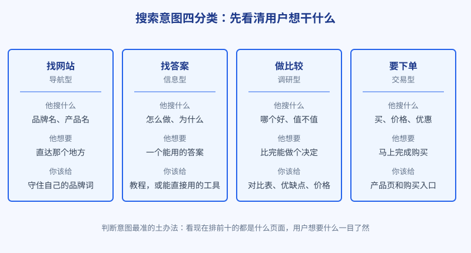
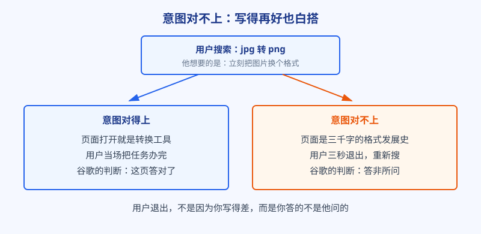

# 第 2 章 关键词的本质

## 白话讲解

### 关键词不是词，是用户亲口说出的需求

很多人一听关键词，第一反应是：不就是往文章里塞几个词吗？这正是新手最容易栽的跟头。在搜索引擎的世界里，关键词的真实身份是需求的口供。用户不会无缘无故打开搜索框，他敲下的每一个词，都是在把一件没办成的事、一处没解开的疑惑，原原本本地说给你听。

比如有人搜电脑蓝屏怎么办，他要的不是一篇计算机组成原理，他要的是今晚能把电脑救活的步骤。有人搜 jpg 转 png，他要的也不是图片格式的科普，他手头有一张图，现在、立刻、马上要换个格式。你听懂了这层意思，就会明白 SEO 的起点根本不是技术，而是听懂人话：用户这句话背后，到底想办成什么事。

### 先给意图分个类：四种人，四种招待法

用户想办的事五花八门，但归类之后大体就四种，业内叫搜索意图四分类。

图：四种搜索意图。先判断用户属于哪一种，再决定端出什么样的页面招待他。

第一种，找网站，学名导航型。用户心里已经有明确的目的地，比如搜某个品牌名、某个产品名，他只是把搜索框当快捷方式用。这类词的流量基本归目的地本身所有，旁人惦记也没用，你唯一要做的是别把自家的品牌词弄丢。

第二种，找答案，学名信息型。用户带着问题来，搜的多半是怎么做、为什么、哪个好用的变体。他想要一个能照着做、能帮他解惑的答案。这类词是内容型网站的主战场，教程、指南、工具说明都为它而生。

第三种，做比较，学名调研型。用户已经站在掏钱的门口，还差临门一脚的信心，于是搜 A 和 B 哪个好、某产品值不值这个价。他想看对比、看优缺点、看真实价格，看完好下决心。这类词离钱很近，是商家必争之地。

第四种，要下单，学名交易型。用户搜买、价格、优惠、订购，购买意愿已经拉满，只差一个下单的地方。招待他的必须是产品页、购买页，价格清楚，入口醒目，任何多余的绕弯子都会把他送走。

这四种意图像一条漏斗，从上到下离成交越来越近。一家网站健康的流量结构，是四种都有布局：用找答案的内容把人引进门，用做比较的内容帮他下决心，用要下单的页面把生意做成。

### 意图决定页面长什么样

分类不是为了考试背概念，它直接决定你该做什么样的页面。同一个产品，词不一样，页面就得完全两样。还是拿图片处理举例：搜图片压缩的人，前十名清一色是打开就能用的在线工具；搜图片为什么压缩后变模糊的人，前十名是清清楚楚的讲解文章。你拿一篇写得再好的文章去抢前一个词，或者拿一个光秃秃的工具去接后一个词，都是拿错了菜谱进了厨房。

为什么谷歌会把结果排成这种整齐的队形？因为它手里握着全网用户的真实行为数据。亿万用户用点击投票：哪个页面端上来的东西对胃口，大家停留、办完事、心满意足；哪个页面答非所问，大家点进去三秒就退出来重新搜。时间一长，系统自然学会了每个词背后的人到底想要什么，并把搜索结果调整成大多数人想要的样子。所以你看到的前十名队形，就是用户集体投票投出来的标准答案。

举个能立刻验证的例子。你现在就可以搜两个词对比着看：一个是订机票，出来的清一色是卖票的页面，连一篇游记都挤不进来，因为搜的人只想买票；另一个是第一次坐飞机要注意什么，出来的全是图文攻略，因为提问的人要的是安心。同一个行业，词变了，整个第一页的物种就全变了。这就是意图的力量，它先于一切技巧存在。

图：同样一个词，端对了菜和端错了菜，结局完全相反。差距不在文笔，在有没有听懂需求。

### 同一个词，可能藏着好几种意图

还要多说一层：有些词的意图是混杂的。同一批搜索者里，有人想找工具，有人想看教程，谷歌拿不准的时候，干脆把结果排成大杂烩：工具、文章、视频各来几个，看用户实际更爱点哪一类，再慢慢调整比例。混合意图的词对你来说是把双刃剑：机会在于队形还没定死，小站也有空位可占；风险在于你押注的那种页面形态，可能并不是主流。碰上这种词，最稳的做法是先用小成本试一版，盯着数据再决定是加码还是撤退，而不是一上来就把全部身家押进去。

### 判断意图最土、也最准的办法

说了这么多，怎么判断一个词的意图？工具会给你一些分类参考，但最土也最准的办法永远是：自己去搜一遍，看前十名。前十名里工具占多数，这个词就是要工具的；测评和对比文章占多数，这是调研型；视频占多数，说明用户更愿意看演示。照着前十名的队形做页面，你至少不会在形态上吃亏。

顺便掌握一个更重要的视角：先看前十，也是先看清对手是谁。你想打的词，前排站着的若全是耕耘多年的大站，你一个新站硬冲，多半是陪跑；若前排多是小站和零散页面，那才是给你留的门。这套判断到第 6 章会变成完整的打分方法，本章先把感觉建立起来。

还有一个辅助信号可以顺手看：结果页上的广告多不多。广告扎堆的词，说明商家在真金白银地抢，背后多半是离钱很近的意图；一个广告都没有的词，要么是纯找答案的，要么是商业价值还没被同行发现。这个信号不单独作数，但拿它和队形互相印证，判断会更稳。

### 词的尾巴越长，意图越明确

再教你看一个规律：词越长，意图往往越露骨。只搜图片压缩四字的人，可能还在随便逛逛；搜怎么把图片压缩到 200KB 以下还不变糊的人，问题具体到连约束条件都给你了，他要的就是一篇能照着做成的教程，或者一个能设定目标大小的工具。这类长长的词有个名字，叫长尾词。它们单个的搜索量不大，但意图清楚、竞争小、来的人更容易转化，是新站安身立命的命根子。第 5 章会专门给长尾算账，这里先把感觉种下：以后看到一个长词，别先嫌它量小，先看看它背后那个人，是不是已经把需求说得明明白白。

### 词有大小，但先别急着算账

最后提醒一句：每个词都有搜索量，有人搜一万次，有人搜十次。但搜索量只是词的一个属性，它值不值得做，还要看竞争有多强、离钱有多近，这是第 5 章和第 6 章专门要算的账。本章只立一条压舱的规矩：先对意图，再谈一切。意图错了，后面所有努力都是给错误的页面添砖加瓦。

最后一个要点，关乎眼界：词不是一成不变的。新产品、新功能、新热点冒头，就会诞生前所未有的新词，第一批搜索的人意图新鲜、竞争空白；老词也会随着使用习惯慢慢变味。所以选词不是开局做一次就交差的作业，而是一项要持续进行的侦察。第 7 章讲怎么追新词，第 8 章讲怎么分辨真假热度，都建立在本章这套意图框架之上。

*意图四分类源自 Broder 于 2002 年提出的搜索意图分类框架，后经行业普遍沿用和扩展。*

## 阿哲的站

这周阿哲还没写一行代码，他在做一件看起来很笨的事：列词，然后挨个搜。

他先把自己能想到的、和图片处理有关的词全写下来，列了二十多个：压缩图片、图片转格式、改图片尺寸、给图片加水印，等等。接着他把每个词都丢进谷歌，看第一页的队形，还认真记了笔记。记着记着，他品出味来了。

几个词的前十名清一色是工具站，页面打开就是一个上传框，连一句废话都没有。阿哲在这些词旁边标注：要打这种词，我的页面也必须一打开就能用，写文章没戏。另外几个带怎么、为什么的词，前十名是教程和问答，他标注：这些词用文章接，文章里再把人引到我的工具页。还有两个词他直接划掉了：一个是某知名修图软件的品牌词，搜的人全是去找人家的官网的；另一个前十名被几个大厂的产品页占满了，他自问现在没这个本事，先放着。

一周下来，阿哲的收获是一张表：二十多个词，每个词后面写清了三件事，用户想要什么、前十名是什么队形、我该拿什么页面去接。他后来说，这张表是他整个创业过程中性价比最高的一周：还没动手做产品，产品该长什么样、仗该怎么打，已经清楚了大半。顺序反过来的人他见得多了，东西先做出来，再满世界找词往上套，套不上就开始怀疑人生。

他还顺手验证了一件小事：把同一个词分别在电脑和手机上搜，前十名的队形大同小异，顺序略有出入。这提醒了他，判断意图看队形就够了，纠结某一名次的细微差别没有意义。他当时还不知道，这个不纠结的习惯，日后会帮他省下无数个跟数据较劲的深夜。

## 翻车现场

一个做简历模板的网站，曾经在这个坑里躺了大半年。他们盯上了一个大词：简历模板。这个词搜索量可观，意图也很明确，搜的人就是想找一份能直接用的模板。网站的打法是写长文：一篇八千多字的大文章，标题带着这个词，文里图文并茂地讲模板的分类、写简历的注意事项，顺带贴了几十张模板的截图。

文章写得不可谓不用心，可排名长期在三十名开外打转。更尴尬的是，就算偶尔有人点进来，也很快就走了：人家要的是能下载、能编辑的模板文件，你给他一篇只能看的文章，截图再漂亮，他也只能干瞪眼。流量白白漏过，转化几乎为零，团队却一直归因于文章还不够长、词埋得还不够多，准备继续加码写一万二千字。

后来复盘的人点破了窗户纸：错不在内容，在页面形态。这个词要的是仓库，不是说明书。改法是把页面拆成两页：模板列表页专门接这个词，打开就能按行业、风格筛选和下载；那篇长文改名换姓，去接怎么写简历这类找答案的词，在文中自然地把人引向列表页。改完两个月左右，列表页爬进了前十，下载量比原来翻了几倍；那篇文章挪到对的词下面，也开始稳定带来流量。两边都活了，靠的不是更努力，而是把菜端对桌。

## 要点回顾

- 关键词的本质是需求：用户在搜索框里，把没办成的事亲口说给你听。
- 搜索意图分四类：找网站、找答案、做比较、要下单，离成交越来越近。
- 意图决定页面形态：要工具的给工具，要答案的给教程，要下单的给产品页。
- 判断意图最准的土办法，是亲自去看前十名的队形，那是用户投票的结果。
- 词值不值得做还要看竞争和商业价值，但先对意图，是排在最前面的规矩。

## Kata

1. 挑三个你所在行业的词，逐个搜一遍，把前十名每个结果的页面类型（工具、文章、产品页、视频等）记下来，再给这个词判定意图，看你的判断和队形对不对得上。
2. 找一个你觉得意图对不上的页面：说清用户搜这个词想要什么、这个页面实际给了什么、换作是你会怎么改这个页面的形态。
3. 假设你来做阿哲的工具站，列出 10 个和图片处理有关的词，按四种意图分好组，并给每组写一句：我打算用什么页面接它。
