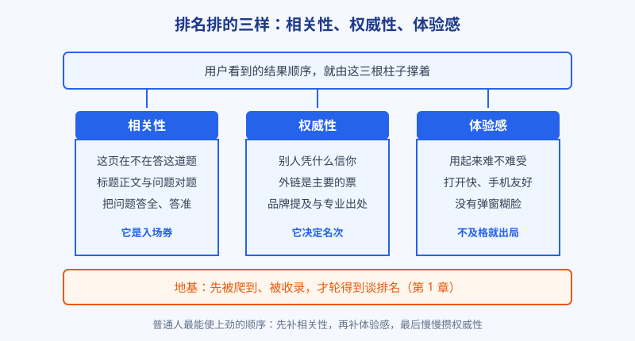
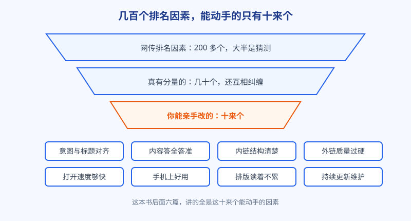

# 第 3 章 排名排的是什么

## 白话讲解

### 先给两百多个因素泼盆冷水

聊排名，绕不开一个流传甚广的数字：谷歌排名要看两百多个因素。这个数字来自很多年前的说法，谷歌从未公布过完整清单，更没公布过每一项占多大权重。于是市面上出现了各种排名因素大全，列得煞有介事，精确到小数点后一位。说句得罪人的话：这类清单看看就好，谁拿它当施工图，谁就离翻车不远了。

普通人真正需要的，不是背下两百个名词，而是把这团乱麻归成几类，看清哪一类在管什么、自己能动哪一类。归类的方法很多，本书用最朴素的一种：排名排的无非三样东西，相关性、权威性、体验感。几百个信号，绝大多数都能塞进这三个筐里。

图：排名三支柱。相关性是入场券，权威性决定名次，体验感不及格会直接被请出局。

### 第一根柱子：相关性，这页到底在答哪道题

相关性回答的问题是：这一页和用户搜的这句话，到底对不对题。它由几层东西共同决定。最表层的是字面对得上：用户搜的词，页面的标题、正文里有没有自然地出现。但字面对上只是起步，更重要的是内容对得上：用户这个问题牵扯的方方面面，这页有没有答全、答准。比如用户搜图片压缩后变模糊怎么办，光反复念叨图片压缩四个字没用，你得讲清压缩的原理、变模糊的原因、参数怎么调、什么情况无解，这叫把题答到点子上。

相关性还看整个网站的主题。一个常年只做图片处理的站，和一个今天卖鞋明天卖课的杂货铺站，同样写一篇图片压缩的文章，搜索引擎更愿意相信前者是内行。这就是为什么本书一直劝你把站点主题收窄：专卖店在它的地盘上，天生比杂货铺占便宜。

举个例子，帮你把这件事钉死。假设用户搜雨天开车注意事项：甲页面把雨天的刹车距离、轮胎排水、车灯用法、跟车距离讲得明明白白；乙页面标题对得严丝合缝，正文却在泛泛聊四季行车常识，还不厌其烦地重复了二十遍雨天开车。系统更愿意推甲，因为它把这道题的得分点答全了。相关性从来不是数某个词出现了多少次，而是数这道题被答对了多少。

在三根柱子里，相关性是入场券。它不及格，后面两根再粗也没用，因为系统压根不会把你的页面放进这道题的候选名单。

### 第二根柱子：权威性，别人凭什么信你

候选名单里站着一排对题的页面，先后怎么定？这时轮到权威性说话：这么多页都在答同一道题，搜索引擎凭什么把你的排在别人前面？它的答案是看口碑，而互联网上最硬的口碑凭证，是别人愿不愿意在自己的页面上提到你、链接到你。这就是外链，第五篇会专门展开，这里先建立概念：每一个正经外链，都相当于同行投出的一票。

除了外链，品牌的分量也在这一筐里：有多少人直接搜你的名字，有多少正经场合提到你，都在给系统递小纸条。当然，内容的专业程度也算，比如有没有写清作者是谁、数据有没有出处、说法和公认事实对不对得上。这些在行业里被归进一个叫 E-E-A-T 的框架，本质就是四个字：你像不像个可信的内行。

权威性的特点是攒得慢。它没法像改标题那样今晚动手明早见效，只能靠持续做出值得被引用的东西，一点点攒。这也正是新站最吃亏的地方：你和大站比内容未必输，比资历必然输。所以新站的正确姿势不是硬拼热门词，而是先去打那些大站懒得弯腰捡的长尾词，在小题里把资历攒起来。这套打法第 5 章细说。

### 第三根柱子：体验感，用起来难不难受

第三根柱子管的是用户体验：页面打开要等几秒，手机上字够不够大、按钮好不好点，内容排版清不清楚，有没有广告和弹窗糊在脸上。这些年搜索引擎把体验的权重越提越高，还给出了一组有明确名字的指标，叫核心网页指标，第 11 章会把它说透。

对体验感要有一个清醒的定位：它是门槛项，不是加分项。体验差的页面会被直接往下压，甚至请出前排；但体验好到极致，也不会让一个内容稀烂的页面排到前面去。就好比一家饭馆，卫生不及格会被关停，但卫生满分并不等于菜好吃。先保住不扣分，再谈别的。

这里还藏着一条作弊线，顺手提醒你别碰：有人为了让测速数据好看，先摆一个空架子把测速程序糊弄过去，回头再把广告和弹窗一层一层糊上。这种小聪明短期可能得逞，但用户不是傻子，点进来就走的行为，会把真相原原本本递回给系统。门槛项的正确用法只有一个：老老实实做到及格线以上，别在门槛上耍花样。

### 三根柱子的合力与轻重

实战里，三根柱子是同时在起作用的，不同词下面轻重还不一样：有的词拼的主要是内容深度，有的词拼的是谁的资历老。但对绝大多数普通网站，投入的顺序有个大致的最优解：先补相关性，因为它见效最快，全在你自己的页面上；再守体验感，把不该扣的分守住；权威性最急不得，列入长期工程慢慢攒。

还有一句话请记牢，能帮你省下很多焦虑：排名是相对的。你不需要把页面做到完美，你只需要在同一道题里，比排在你前面的那几页更好一点点。你的对手从来不是谷歌心中的标准答案，而是前十名里那几个活生生的页面。所以研究排名，落点永远是去看前排的页面强在哪、弱在哪，而不是对着空气优化。

图：排名因素的漏斗。从两百多个传说，筛到几十个真有分量的，最后落到你能亲手改的十来个上面。

### 一个提醒：你看到的排名，和别人看到的不一样

再补一个容易让人白忙活的常识：排名带有一定的个人色彩。同一个词，你在深圳搜和你的客户在北京搜，前排顺序可能不同；你天天点自家网站，系统还会把你的站往前挪几位，专门给你看。不少新手就是这样被自己的搜索结果骗了，以为已经排上去了，兴冲冲跑去报喜，其实那只是系统在照顾你这张熟脸。判断真实名次，要看站长平台统计的平均排名，或者用干净的浏览器环境去查。这个习惯看似不起眼，却能帮你过滤掉一大半虚假的安全感，和同样虚假的恐慌。第 1 章在排名那一节提过这件事，这里再钉一遍，因为它实在太容易让人栽跟头。

### 落地：你能动手的就这十来个

把三根柱子拆到可执行层面，普通人能亲手改的因素就十来个：意图和标题对齐、内容答全答准、内链结构清楚、外链质量过硬、打开速度够快、手机上好用、排版读着不累、内容持续更新维护，再加上第 1 章说的收录地基。一眼看去平平无奇，没有一个是秘籍，这正是真相所在：SEO 的功夫全是明牌，难的不是知道，是把每一件都做到位，还能坚持做下去。本书后面的六篇，就是把这张清单一项一项展开，讲清怎么做、怎么验、有哪些坑。

*“两百多个排名信号”是业内沿用多年的粗略说法，谷歌从未公布完整清单及权重；本章只取其中可归类、可操作的部分。*

## 阿哲的站

阿哲这一周把三根柱子用在了真刀真枪的地方：评估对手。他盯上的那个词，前十名里有八个是同类工具站。换作以前，他只会感慨一句竞争好激烈，现在他学了个新动作：拉一张表，给每个对手按三根柱子打分，一到五分，边用边打。

相关性一栏，八家全部拉满：打开就是工具，功能对题，这是这个词的入场券，没什么好说的。权威性一栏，他去查了各家的外链和品牌情况，发现普遍不强，多是和他一样的无名小站，有两家的外链数量甚至只有两位数。体验感一栏最有意思：他挨个用手机测了一遍，有两家打开要等四五秒，其中一家的上传按钮在手机上小得要点两次，还有一家满屏广告，工具藏在广告缝里。

表格拉完，阿哲心里有底了。这个词打得动：对手们赢在入场早，不赢在强。他的突破口也排好了顺序，页面打开就要快，手机上要顺手，功能把对手缺的补上。至于权威性，他认了，新站就是零，只能靠时间和外链慢慢攒，但这个词的门槛低，不等资历攒够也能先上场。他把这张三柱表存进了项目文件夹，后来发现，这正是他往后评估每一个词的固定动作，第 6 章会把它升级成一套完整的打分方法。

打完分他又多做了一个动作：把这张表原样存档，在文件名里写上日期。他说要看看几个月之后回头读，自己会不会笑出声。事实证明他真的笑了，不过那是后话。这个动作值得你抄作业：评估要留底，判断要落字，否则过段时间你根本分不清，到底是市场变了，还是自己当初压根就没想清楚。

## 翻车现场

有家做企业服务的网站，对排名因素的传说深信不疑。他们不知从哪儿弄来一份两百多项的优化清单，立项花了两周，逐项对着清单补课：关键词密度严格卡在百分之二，少了就往句子里塞，多了就删；每篇文章必须凑够字数，不够就车轱辘话来回说；图片的文件名、替代文字按公式批量改写；甚至专门安排人去研究传说中某个信号的最佳数值。

两周补完，团队满怀期待地等排名上涨。结果一个月过去，核心词的排名纹丝不动，还有两个原本排得不错的页面，因为正文里硬塞的关键词读起来别扭，被用户用脚投票，名次反而往下掉了。复盘时请来的人只问了一个问题：你们这一个月里，有没有哪怕一次，去看过排在你们前面的页面，到底比你们强在哪儿？会议室一片安静。他们对着清单忙了两周，却从没正眼看过对手。

真相后来很清楚：那个词的前排页面，赢在内容是真能解决问题的完整方案，还有好几家行业媒体的引用，而这家网站的文章，本质上是把同行内容换了个说法重新拼了一遍，无他，唯手熟尔。清单最大的危害，是给人一种虚假的勤奋感：每一项都打勾了，就以为功夫下到了。记住，因素清单是用来查漏的体检表，不是用来刷分的考试卷。功夫要下在三根柱子上，尤其是那根最难造假的相关性上。

## 要点回顾

- 排名因素别背清单，归成三根柱子看：相关性、权威性、体验感。
- 相关性是入场券：内容要真答对题，站点主题越专越占便宜。
- 权威性靠外链、品牌和专业度慢慢攒，是新站最吃亏、也最急不得的一项。
- 体验感是门槛项：差了出局，好也不会替内容加冕。
- 排名是相对的：你的对手是前十名那几个页面，不是想象中的标准答案。
- 能亲手动手的因素就十来个，本书后面六篇逐项展开。

## Kata

1. 选一个你想排上去的词，把前三名找出来，按相关性、权威性、体验感各打一到五分，再写一句：他们共同的短板在哪儿。
2. 给你自己的一个页面做一次三柱自检：每一柱给个分，最低分的那一柱，写下一条这周就能动手改的事项。
3. 回想你听过的三个排名秘诀，比如字数要够、密度要达标之类，逐个判断：它属于哪根柱子？是真有分量的因素，还是查无实据的玄学？
