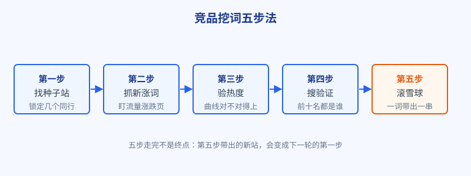
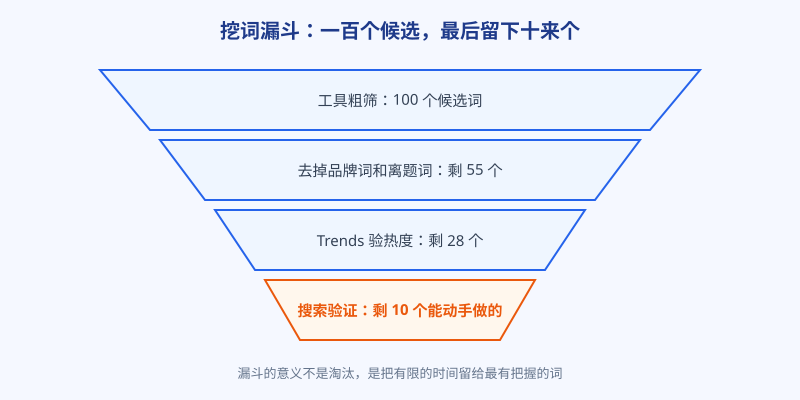

# 第 4 章 先看对手：竞品挖词五步法

## 白话讲解

做新站最难的不是写代码，是回答一个问题：先做哪些词？

自己坐在屋里想，想出来的多半是「我觉得用户会搜这个」。觉得归觉得，搜索引擎里每天真实发生的搜索，是另一回事。好在有一批人已经替你把答案试出来了：你的同行。他们上线比你早，页面比你多，哪些词能带来流量、哪些词最近在涨，他们的站上都写着呢。你要做的不是凭空想词，而是顺着对手的足迹，把他们验证过的词捡回来，再挑出适合自己的。

这套办法叫竞品挖词，一共五步，如图 1 所示。

**第一步，找种子站。** 先找 3 到 5 个和你做同一件事的站，就是种子站。找法很朴素：拿你品类里最核心的那个词去搜，翻前三页，把反复出现的独立站记下来；再看看同行常去的社区、导航站、测评文章里，谁被反复提到。注意两类站不要选：巨头官网和综合大站。巨头的打法你学不了，他们随便一个页面的权重都够你追一年；要找的是体量和你接近、或者只比你大一圈的站，他们的词，才是你够得着的词。

**第二步，抓新涨词。** 打开种子站的流量分析页（这类工具大多有免费额度），重点看两处：一是给这个站带来流量最多的词，二是最近一段时间新出现、新上涨的词。为什么偏爱新涨词？因为老词的格局已经定了，前十名互相咬得很紧，你挤进去要花大力气；新涨词不一样，需求刚起来，老玩家也才刚注意到，页面质量普遍粗糙，是留给后来者的窗口。把这一批词整批导出，先攒个一百来个候选，不挑，先求全。

**第三步，Trends 验热度。** 工具给的搜索量是估算，会过时，也会注水。把候选词逐个放进 Google Trends 里看曲线：是稳稳地有人搜，还是只在一个新闻事件里尖了一下？曲线对不对得上，直接决定这个词是资产还是噪音。这一节的具体看法第 8 章细讲，这里先记住一个动作：任何词进你的词表之前，必须先在 Trends 里露过脸。

**第四步，搜索验证。** 把词原样放进搜索框，看前十名都是谁。如果前排全是巨头官网、应用商店和维基百科，这个词再香也先放下，你的页面排到第三页等于不存在。反过来，如果前十名里有论坛帖子、问答页面、个人博客，说明这个词还没有强者占位，是真正的空位。顺手再看一眼结果页有没有广告：有人愿意为这个词投广告，说明它背后有钱可赚，这是好信号，不是坏信号。

**第五步，滚雪球。** 这是最容易被跳过、也最值钱的一步。拿你验证通过的词再去搜，看结果页里又冒出了哪些新站，把新站加进种子站清单，回到第二步再转一圈；看每个词的相关搜索和「大家也在搜」，又能带出一串新词。一圈下来，词表翻倍，还都是顺着真实需求长出来的，而不是拍脑袋拍出来的。如图 2 所示，整套流程本质上是个漏斗，入口要宽，出口要严。

五步里有两个纪律。第一，顺序不能反：先看对手再验热度，不能看着哪个词顺眼就直接做。第二，每一步都留痕：词从哪来、谁在排、曲线什么样，都记在同一张表里。过一个月你回头看，才知道自己当时为什么选它、又为什么弃它。

### 工具从简，记录不能省

五步法里要用到流量分析工具，这类工具大多收费，但基本都留了免费额度：查几个站、导几百个词，新手起步阶段够用。实在不想花钱，也有手工版：把种子站的页面结构看一遍，他给哪些词做了专门页面；再翻他的更新记录，新页面押的是什么词，老手都写在明面上。手工慢一些，但看的过程本身就是学习，很多工具一键导出给你的数字，看一遍页面反而记得更牢。

比工具更不能省的是一张记录表。列不用多：词、来源站、曲线一句话、前十名都是谁、结论是做、待定还是弃。挖词最怕凭记忆干活：今天看好的词，下周就忘了为什么好；今天弃掉的词，下个月又捡回来重新看一遍。有了表，判断才沉淀得下来，几个月后回头复盘，也才知道自己当初对在哪、错在哪。

### 第四步可以看得更细

搜索验证不要只数名次，还要看结果页的构成。如果前十名被视频和图片占满，说明用户想看不想读，你的文字页和工具页机会都不大；如果结果里挂着一排没人答好的相关问题，说明需求还没被满足，是空位信号。再看一眼广告位的数量：广告多，说明这个词能带订单，值得认真对待；一个广告都没有的词，要么是太新，要么是真的不赚钱，做好分辨。把这三样记进记录表，你对这个词的判断就比九成同行细了。

### 每一步都有一个最常见的坑

第一步的坑，是种子站只找一个。一个站的词表有很大的偶然性，几个站交叉出现的词才更可信。第二步的坑，是不设时间窗，把人家三年前靠某个词吃到的流量，当成今天的行情。第三步的坑，是只看曲线形状不看量级，这个坑第 8 章会细讲。第四步的坑，是搜索环境不对：做英文站，就要用目标市场的环境去看结果，你在本地网络里看到的排名，和用户看到的不是一回事。第五步的坑，是雪球滚偏了，越滚越远，一不小心滚进隔壁品类；还有人滚雪球只滚词不滚站，其实新站才是最值钱的产出，它决定你下一轮的起点。每一圈滚完都要回头问一句：这还是我的用户会搜的词吗？

最后摆正一个心态：看对手不是抄对手。抄清单的人永远比对手晚一步，还要替对手的错误买单；学路径的人，看的是他为什么做这个词、页面怎么承接、哪一步能做得比他更好。同一个种子站，两种看法，挖出来的东西完全不同。

### 五步法最后产出的到底是什么

走完五步，你手里应该多出三样东西。第一是一张排好序的词表：做、待定、弃，分得清清楚楚，每个词后面都跟着它的来历和验证记录。第二是一份对手地图：这个品类里都有谁、各自靠什么词吃饭、谁在上升谁在掉队，下次再看这个市场，你不用从零开始。第三，也是最隐形的一样，是手感：看过几百个词的前十名和曲线之后，你再看到一个新词，几分钟就能有个八九不离十的判断。这种手感没法速成，就是靠一圈一圈滚出来的。接下来的几章，我们会把这张词表继续加工：先算长尾，再算值不值得做的顺序，然后才是动手建站和写内容。

## 阿哲的站

阿哲辞职后做的第一个决定，是给自己的图片工具站先挖词，再写代码。

他先拿「image compressor」这类核心词去搜，翻了三页，记下 4 个反复出现的独立小站做种子站，全是和他体量差不多的个人或小团队作品，巨头的官方站他一个没选。然后他在流量工具里把这 4 个站的引流词整批导出，又专门盯了最近三个月新涨的词，前后攒了 130 多个候选。

接下来是笨功夫：逐个过 Trends，逐个搜前十名。一周下来，词表瘦身到 28 个，最后通过搜索验证的只有 11 个。但这 11 个词个个有出处：有的是某个种子站最近三个月悄悄涨起来的词，页面还是对方随手做的一个简陋页面；有的是格式转换的细分说法，老站只在帮助页里提了一句，没人正经做过落地页。

阿哲把这 11 个词按「先做、后做、放弃」分成三堆，第一堆只有 4 个。他后来复盘说，挖词这一周是他整个项目里回报最高的一周：不是因为挖到了什么神词，而是避免了按自己的想象先做三个月再说。

他的记录表里还有一整类被划掉的词：品牌词。好几个词流量不小，可词里带着别家产品的名字，搜的人是冲着那一家去的，他做了页面也接不住，弄不好还要惹上商标的麻烦。这类词他整类标红，以后滚雪球再滚到，一眼跳过，省下不少验证时间。

第一堆的那 4 个词，他还顺手给每个词定了页面类型：哪个做工具页直接承接，哪个先写一篇讲清方法的文章，哪个只需要在现有页面里补一节。词和页面一一对上，接下来要写的代码和内容，心里就都有数了。他把这张表一直沿用下去，每滚一圈就更新一次，半年后表里已经有四百多行，成了他这个站最核心的资产，比代码还值钱。阿哲说，挖词最累的不是查，是克制：一百多个词个个看着都像机会，亲手划掉一百多个，心里是疼的。但词表贵不在长，在于每一个留下来的，都说得清为什么留。

「待定」那一堆他也没有扔，给每个词留了复查日期。两个月后，其中一个词的前排有个小站关了，位置空出来，他的复查正好撞上，顺势把这个词升进了「先做」。他后来说，五步法里最容易被省掉的是回头看，省掉之后，词表就只是一张当时的快照；留了复查日期，它才是一张活地图。这也是他把挖词设成每月例行的原因：市场每个月都在变，地图就得每个月重画一遍。

## 翻车现场

有个做在线工具的新手，挖词只做了第一步的一半：他找了个种子站，是品类里的头部玩家，月流量几百万。他照着人家的引流词清单，挑了搜索量最大的十个词，埋头做了两个月，页面一个个上线。

结果是零。十个词，他最好的一个排在第六页。原因不难想：那十个词是头部玩家的命根子，对方每个词都有专门的落地页、成堆的外链和好几年的历史，他一个新站拿同样的词去正面硬碰，搜索引擎没有给他排前面的理由。

更亏的是机会成本。同两个月里，这个品类冒出来两个新词，搜索的人一天天多，前十名全是临时拼凑的页面。他后来知道了，只是座位已经被人占了，他只能排队。

翻车点总结：种子站选错，后面全错。对标要找「比你强、但你够得着」的站；头部玩家是用来观察行业天花板的，不是用来抄作业的。挖词抄的是路径，不是清单。

这个新手后来改了打法：对标换成两个体量只比他大一圈的站，重走了一遍五步法，专挑对方刚起量、页面还粗糙的词下手。三个月后，他有两个词进了前十，站的日流量从个位数涨到几百。数字不大，但那是他第一次确认，这条路自己走得通。种子站选对了，后面的每一步才都是在给自己攒东西，而不是替别人验证行情。

## 要点回顾

- 选词先看对手：同行已经验证过的词，比你凭空想的靠谱得多。
- 种子站找体量接近的独立站，巨头和综合大站只看不用。
- 偏爱新涨词：格局未定的词，才留给后来者窗口。
- 每个词进词表前过两关：Trends 验热度、搜索结果验空位。
- 挖词是滚雪球：新词带新站，新站带新词，词表是滚出来的。

## Kata

1. 现在就找种子站：拿你品类最核心的词搜三页，记下 5 个反复出现的独立站，并写清每个站「比我强在哪、我够得着吗」。
2. 挑其中一个种子站，把它最近三个月新涨的 20 个词列出来，逐个标注：这个词的页面是对方正经做的，还是随手带的？
3. 拿你原来打算做的 3 个词走一遍漏斗：过 Trends、看前十名，最后诚实回答，还剩几个是你现在能做的？
