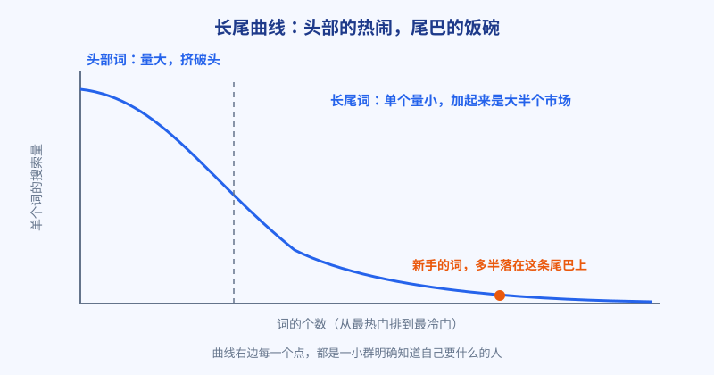

# 第 5 章 长尾词：搜索量小为什么反而赚钱

## 白话讲解

先说一个反直觉的现象：很多闷声赚钱的小站，流量不是来自一两个大词，而是来自几百个没什么人注意的小词，每个词每天只来三五个人，加起来却是一支队伍。这不是什么新发现，开网店的人早就懂这个道理：一家店的营业额，大半靠一堆不起眼的小商品撑起来，爆款负责吸引眼球，小商品负责养家糊口。搜索流量是同一本账。

这些小词有个统一的名字：长尾词。把一个品类里所有词按搜索量从高到低排队，画出来是一条曲线，如图 1 所示。左边陡峭的高点是少数头部词，搜索量惊人；右边拖着一条长长的尾巴，是成千上万个搜索量不大的词。单个看，尾巴上的每个词都不起眼；加起来，它们的总搜索量占了整个品类的大半。

为什么尾巴上的词反而适合新手？三个原因。

**第一，竞争小。** 大词是所有人的靶子，巨头、老站、广告主全挤在那儿。长尾词太碎，大玩家看不上，专门做的人又少，你认认真真做一个页面，就有机会排到前面去。

**第二，意图清楚。** 词越长，搜的人想要什么就越明确。搜「图片压缩」的人可能只是随便看看；搜「把 png 压缩到 200kb 以下」的人，手里就有一张图等着处理，需求、场景、规格全写在词里了。你把页面照着这个需求做，他来了就用，用了就可能付费或者收藏。这种流量，质量比大词高出一截。

**第三，转化率高，这是长尾的账本核心。** 如图 2 所示，评估一个词不能只看搜索量，要看「搜索量 × 排得上的概率 × 转化率」这笔连乘账。头部词搜索量大，可你的排名概率低、转化率也低，连乘下来常常约等于零；长尾词单项都不出众，但三项都不差，乘出来反而是实数。

长尾词长什么样？规律是「核心词 + 限定条件」。限定条件无非几类：加格式（转成某种格式）、加场景（给某个平台用、给某种文件用）、加规格（到某个大小、某种尺寸）、加动作（免费、在线、不用下载）、加对象（某种设备、某种系统上怎么处理）。把核心词和这几类限定条件排列组合，一个品类轻松长出几百个长尾词。注意，排列组合只是帮你列出候选，哪些值得做，还要回到第 4 章的漏斗里过一遍 Trends 和搜索验证，不是凑数。

### 长尾词具体从哪儿找

第一个来源是搜索框的下拉联想。你打出核心词先别回车，下面弹出来的一串，全是真实用户高频搜过的说法，抄下来就是候选。第二个来源是结果页底部的相关搜索，一层点一层，能顺着用户的思路走很远。第三个来源是问答社区和论坛：用户提问时用的都是大白话原话，「怎么把照片弄小一点传上去」这种句子，稍微整理就是一个长尾词，而且意图写在脸上。第四个来源是同行的页面标题和帮助文档，他们已经被市场教育过一轮，标题里藏着他们验证过的词。第五个来源是你自己的站：站内搜索框里用户输入过什么、评论区和留言里用户怎么描述他的问题，全是带着真实场景的词，别人抄不走。这五个来源轮着用，长尾词表永远有新货。

还要纠正一个常见误会：长尾词不是「把词写长」就行。词再长，没人这么搜，就是零。判断标准只有一个：真实搜索里有没有人这样搜、这样搜的人想要什么。工具的联想词、结果页的相关搜索、同行的页面标题，都是真实搜索留下的痕迹，顺着痕迹找，比自己编词组靠谱得多。

### 长尾也有它的脾气

先说量级预期。单个长尾词一天来三五个人是常态，有的词一周才来一个人。做之前先把预期放平：你做的不是一个词，是一批词的组合，评判标准是这批词加起来的总量和总转化，而不是盯着某一个词的曲线患得患失。

再说维护成本。词越细，页面越多，页面一多，维护就是真问题：功能改了，几十个页面要不要跟着改；某个说法过时了，页面还挂在那里误导人。解法是把长尾页面做成模板化的结构，变的只是标题和参数，主体共用一套，这样几百个页面也能管得过来，这正是第 15 章程序化 SEO 要解决的问题。

最后说边界。长尾不是把一句话拆成十个近义页面，那叫重复，不叫长尾。每个长尾页面必须答的是一个独立的问题：规格不同、场景不同、对象不同，答案就得真的不同。判断标准很简单：如果两个页面换个标题就能互换内容，它们就应该是一个页面。

最后一个心态问题。做长尾，回报是攒出来的：一个词一天三五个人，三十个词就是一百多人，坚持半年，词表滚到几百个，流量自然成规模。它不性感，不会一夜爆红，但它是新手在巨头林立的品类里，少数能靠勤奋和耐心换到的位置。

还有一个组织方式上的提醒：长尾词要成串地做，不要东一个西一个。同一个核心词下面的一串长尾，页面之间能互相推荐、互相链接，用户进来解决一个问题，顺手看到下一个问题的入口，停留和转化都会变好；对搜索引擎来说，一组互相咬合的页面，也比一堆孤岛更像「这个站是专门做这件事的」。具体怎么编排，后面的内容章节会细讲，这里先记住：挖长尾时按串挖，做页面时按串做。

### 长尾和大词，不是对立面

讲长尾讲了这么多，别误会成大词不用做了。正确的关系是分工：大词页面是门面，负责让搜索引擎和用户认定你这个站是做这件事的，顺带攒整个站的权重；长尾页面是里子，负责把一单单真实的需求接进来。门面太弱，里子再多也显得像杂货摊；只有门面没有里子，站看着挺体面，就是不来钱。比例随阶段变：新站八成力气放长尾，两成放门面，因为你还打不进去；等站有权重了，慢慢把比例倒过来，去争那些以前只能看的大词。很多老站最后的收入主力，恰恰是当年被它看不上的大词，只是那时候它已经有资格了。顺序对了，大词和长尾就是接力关系，不是你死我活。

## 阿哲的站

阿哲的第一批 4 个词里，只有一个是品类里的大词，其余三个都是长尾。

他的判断很实在：大词的页面他做，但不指望短期有排名，就当给站攒资历；真正押注的是带规格限定的词，比如把图片压到指定大小以下这类。他在同行的页面和论坛提问里发现，这类问法出现频率很高，搜的人往往手里正卡着一个明确的提交要求：某个系统只收 200KB 以下的图，传不上去，人就卡在那儿。

页面上线后的数据验证了他的判断：长尾词的页面平均停留时间和工具实际使用率，明显高于大词页面。这个比例他是拿后台数据对出来的，不是感觉：同样一百个访客，大词页面最后按下处理按钮的不到两成；长尾词来的人，七成以上会真的传一张图上去处理。他的站第一个月总共只有几百次访问，但已经出现了第一笔付费：一个用户为了批量处理，直接买了最便宜的付费档。

他还挖到另一类当时没太当回事、后来被证明很值钱的词：带具体场景的问法。用户不是搜某个功能，而是搜他正卡着的那件具体事，比如某个投稿系统的图片要求、某种证件照片的规格。这类词搜索量更小，有的词一个月只有几十次，但来的人目的极其明确，处理完还常常顺手收藏站点，因为他知道过段时间还要再来一次。阿哲把这类词单独标成一组，页面上直接把对应场景的要求写在标题下面，用户一落地就知道来对地方了。

两种长尾放在一起，他第一个季度的流量结构很清楚：大词页面负责让搜索引擎认识这个站，规格词和场景词负责真正带来使用和付费。他说这像开小店：招牌挂在大街上，但赚钱靠的是熟客一单一单的回头。

阿哲的体会是：别嫌弃每天只来几个人的词。对小站来说，三个「来了就用」的人，顶得上一百个「路过看看」的人。

他还把补长尾变成了一个每周的例行动作：每周花半小时，把这一周用户在站内搜索框里输过、但站里还没有对应页面的说法记下来，再去搜索框的下拉联想里转一圈，一次补五到十个候选进词表，过一遍验证漏斗，活下来的排进下周的页面计划。这个动作小到几乎没有存在感，但半年下来，他的长尾词库就是这么滚到几百个的。他说长尾这件事，拼的不是哪一次挖得多，是谁的例行动作坚持得久。很多同行不是不懂长尾，是补了两周就停了，词库停在几十个的量级上，自然攒不出规模。

## 翻车现场

有人做旅游攻略站，选词专挑搜索量大的：城市名加大词，篇篇都是几千字的「全攻略」。写了四十多篇，三个月，自然流量每天个位数。他当时还挺委屈：文章是认真写的，图是自己拍的，凭什么不给流量。他去问了一位做过同品类的前辈，对方只回了一句：你先去看看排在你前面的都是谁。他认真看完前十名，沉默了。问题出在哪？这些词的前十名是携程级的大站和经营多年的老牌攻略站，他的文章哪怕写得不差，也只能排在几十名开外，等于没写。

后来他换了打法，把词拆细：具体到某个小众景点怎么去、某个博物馆周几闭馆、某条线路带老人合不合适。这类词单篇流量不大，但写一篇进一篇前十，半年攒了一百多篇，流量稳稳过万，广告收入也跟着起来了。

他换打法时还补做了一件事：把已经写好的四十多篇大词文章逐篇过了一遍，能拆的全拆成小词页面，一篇全攻略拆成七八个具体问题的页面，旧文章留作目录页往下分发。存量没有浪费，等于白捡了一批页面。半年后这个站的流量结构里，头部词只占两成，剩下八成全是当年看不上的小词攒出来的。他在复盘里写：不是小词突然变值钱了，是我终于排得进去了。

翻车点总结：搜索量是给有实力的人看的指标。排不进前十，再大的搜索量也和你无关。新手的正确顺序是先用长尾词站稳，再慢慢向头部靠。先活下来，再谈做大。

## 要点回顾

- 长尾词单个量小，总量占品类大半，是小站的主战场。
- 词的价值是连乘账：搜索量 × 排名概率 × 转化率，缺一项都是零。
- 词越长，意图越清楚，来的人越接近掏钱那一刻。
- 长尾词的来源是核心词加限定条件，但必须用真实搜索痕迹验证。
- 长尾打法靠攒：几百个小词攒出的流量，比赌一个大词稳得多。
- 长尾词库靠例行动作滚大：每周从联想、留言和站内搜索里补几个候选，半年就是几百个。

## Kata

1. 拿你的品类核心词，按「格式、场景、规格、动作、对象」五类限定条件，各列出 5 个长尾候选，并注明你是在哪里看到有人这样问的。
2. 挑两个词算连乘账：一个头部词、一个长尾词，分别估搜索量、你排进前十的概率、转化率，乘出来比大小。
3. 去搜一个你品类的长尾词，看前五名的页面：它们的标题是怎么写的？如果让你做，你能比它们多答清哪一个问题？
