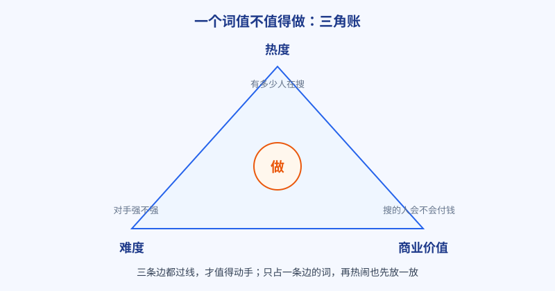
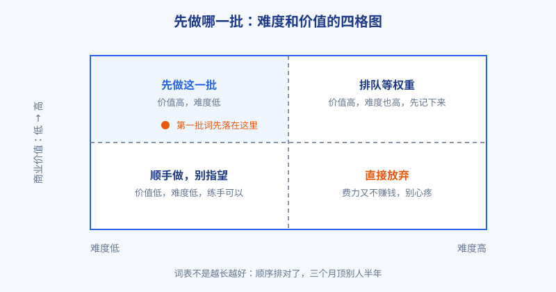

# 第 6 章 一个词值不值得做：热度、难度、商业价值的三角账

## 白话讲解

词表滚到几十上百个之后，新问题来了：先做哪个，后做哪个，哪个干脆扔掉？凭感觉排，今天看这个顺眼，明天看那个着急，三个月后发现做的全是难啃又不赚钱的词。这一章给你一把尺子：每个词都从三条边量一遍，如图 1 所示。

**第一条边，热度：到底有多少人在搜。** 看两个数。一是搜索量，工具会给估算值，别当真理，当量级看：每月几十次、几百次、几万次，是三个完全不同的物种。还有个土办法校准量级：看结果页的广告主数量和相关搜索的丰富程度，搜的人多的词，这两样都不会太寒酸。二是趋势，这个词是在涨、在跌，还是趴着不动。同样月搜 500 次，一个在稳步上涨，一个是三年前火过、现在一路阴跌，价值天差地别。热度这条边的过线标准很朴素：有人搜，且没有正在死去。

**第二条边，难度：你要打败的人是谁。** 难度不是工具给的那个分数说了算，要自己动手看。把词搜一遍，逐个打量前十名：是巨头和老站，还是论坛帖子和随手做的页面？对方的页面是专门为这个词做的，还是顺带提了一句？再看看你自己的家底：站是新的还是老的，有没有外链，内容能不能写得比前十名更对题。难度说到底是相对的：同一个词，对老站是送分题，对新站就是送命题。所以难度永远要结合「现在的我」来评，三个月后你的站长起来了，今天的高难度词可能就降级了，词表要定期重排。

还有一个影响难度的变量常被忽略：对手会犯错。老页面会过时，会改版改丢内容，原本排前面的站可能因为一次改版，把承接某个词的页面合并掉或者弄丢了。这种空位每年都会出现几次，你的词表重排时如果正好撞上，等于捡漏。所以「等权重」那一格不是垃圾桶，是观察哨，过段时间就要去瞄一眼。

**第三条边，商业价值：搜的人会不会付钱。** 这是最常被忽略、也最要命的一条。判断方法有三招。第一招，看词本身带不带交易气息：带「购买、价格、哪个好、免费和付费的区别」这类说法的词，搜的人离钱包更近。第二招，看结果页有没有广告：广告主不是傻子，他们肯为点击付费，说明这个词能带来订单。第三招，也是最准的一招：问自己，这个人搜到答案之后，下一步会做什么？如果答案是「看完就走」，价值就低；如果答案是「马上要用一个工具、买一样东西、订一项服务」，而你正好卖这个，价值就高。

三条边凑齐，还要落成可执行的排序。土办法是给每个词打分，满分各 10 分，热度看量级和趋势，难度反着打（越容易分越高），价值看离交易的距离，三项相加排队。但打分只是辅助，别迷信小数点，真正决定顺序的是图 2 这张四格图：横轴难度，纵轴价值。

高价值、低难度，先做，这是新手的起家粮；高价值、高难度，记在清单上，等站有权重了再回来打；低价值、低难度，顺手可以做，别投入太多；低价值、高难度，直接划掉，划的时候别心疼。这个顺序还有一层意思：先做的词赢了，能给后面的词带内链、带权重，词和词之间是互相抬轿子的。

### 拿三个词走一遍，你就懂了

假设手上有三个词。词甲是品类大词：热度拉满，搜索量全表第一；难度也拉满，前十名全是巨头和老站；商业价值高，搜的人确实在买东西。三角一看，两条边极好，一条边极差，结论是记下来等权重，现在动手等于送人头。

词乙是带规格限定的长尾词：热度中等，一个月几千次搜索；难度低，前十名里最好的页面也只是功能堆砌，没讲清规格怎么选；商业价值不低，搜的人卡在提交门槛上，事情办完顺手付费的意愿强。三条边都在及格线以上，还有一条突出，结论是先做。

词丙是看热闹的词：热度不低，难度也不高，但搜的人是来找图的、找乐子的，看完就走，和你要卖的东西隔着十万八千里。商业价值这一条边直接不及格，结论是划掉，哪怕它排全表热度第三。

三个词走完你会发现，三角账的精髓在那条短边：决定一个词命运的，往往不是它最强的边，而是它最弱的边。三条边都过线的词排前面；任何一条边塌掉的词，都要先问一句，塌的那条边我补得上吗？补不上，就放下。

### 打分时最容易犯的三个错

第一个错是唯工具分是从。工具给的难度分是按全网平均算的，不认识你的站，也不认识你这个人，只能当参考，不能当判决。第二个错是三条边平均用力。词和词之间真正拉开差距的常常是商业价值，可很多人打分时给热度打得最认真，因为它最容易量化。容易量的，不等于最重要的。第三个错是打完分就锁死。市场每个月都在动，对手每个月都在变，一张半年前的打分表，参考价值还不如你今天花十分钟重搜一遍前十名。打分是习惯，不是一次性的仪式。记住一句话：工具分是别人的尺子，前十名是你自己的眼睛，排期是你自己的腿，三样齐了，三角账才算真正走完。

最后提醒一句：三角账算的是「现在做哪个词」，不是「这个词永远好不好」。词会变，你的站也会变。把打分表留着，每隔一两个月重打一遍，你会发现排序自己就动起来了，这说明你在进步。

还要补一句关于顺序的经验：新手的第一批词，宁可挑价值中等、难度很低的，也不要挑价值很高、难度中等的。前者让你两三个月内尝到正反馈，把心气养住；后者拖你半年没结果，多数人不是输在能力上，是输在等不到反馈就放弃了。选词先保命，再图发展，这句话全书会反复出现。

### 分打完了，把它变成排期

打分表最大的敌人是打完就存进文件夹吃灰。正确的用法是当场变成排期：排在前四名的词，逐个写清要做成什么页面、大概哪一周上线；「等权重」那一格留一个复查日期，到日子就去重新搜一遍前十名。排期不用细，细到周就够了，它的作用是让你每天打开电脑就知道今天该推进哪个词，而不是对着一长串名单发呆。还有一个小技巧：排期时把同一串的词排在一起做，页面结构和内容素材能复用，速度能快一截。做到第三个月你再回头看，会发现自己真正在执行的从来不是「做一百个词」，而是「这一周做这四个」。远大的词表，靠的全是这种小步子。排期还有一个附带好处：它会逼你承认一周就只有这么多时间，很多排不进日程的词，看着看着，自己就学会放手了。

## 阿哲的站

阿哲把通过验证的 11 个词拉了一张表，逐个打分。打分之前他先给自己定了一条规矩：每个词的难度分，必须搜完前十名才能打，不许看着工具给的分数抄。光是这一条，就花了他整整两个晚上。

结果有点出乎意料。他原本最想做的一个词，热度全表最高，难度也全表最高：前十名里躺着两个巨头和三个经营五年以上的老站，商业价值倒是高，可综合排序只能挂在「等权重」那一格。真正排到第一位的，是一个带规格限定的长尾词：热度中等，难度低，前十名里最好的页面也只是把功能堆在一起，没讲清规格怎么选；商业价值却不低，因为搜这个词的人多半卡在某个提交门槛上，处理完图片，顺手付费解锁批量功能的意愿很强。

他照着排序做下去，先做的四个词里有三个在两个月内进了前十。回头再看那张表，他说最大的收获不是排序本身，而是被迫把每个词都搜一遍前十名：很多词看数据觉得行，亲眼看到对手就知道不行了。打分表逼着他把功课做完，这才是它的真正用途。

这张表他后来一直用，每月重排一次。第二个月就出了一件事：有个原本躺在「等权重」格里的词，前排的一个老站改版，把承接这个词的页面合并掉了，空出一个位置，他的页面顺势补了上去，成了他当时流量最大的一个词。他说这件事教会他，打分表不是算命，是雷达：分数告诉你往哪儿看，机会出现时你才接得住。

他还给每个做下去的词定了一条及格线：三个月内进前二十名，算判断及格；进了前十，是超额完成；三个月还在一百名开外，就要回表上复查，当初是哪条边看走眼了。半年复盘下来，他做过的词里大约一半及格，三成超额完成，剩下的两成里，多数错在难度这一条边：低估了某个闷声经营多年的老站。他把这个教训写在表头：老站不可貌相，看着不起眼的页面，背后可能有五年攒下的外链。打分表就这么越用越准，因为每一次看走眼，都被记下来喂回了下一次判断。

## 翻车现场

有个做家居内容的站长，选词只看一条边：搜索量。他的方法简单粗暴，工具按搜索量从高到低导，他从上往下写。他执行力是真的强，更新勤快，排版认真，在同行里算勤奋的，可惜勤奋用在了不对的方向上。一年写了两百多篇，流量确实有一些，但接广告一算账，傻眼了：来的全是搜「装修效果图」「客厅配色」这类看热闹的人，看完就走，不咨询、不下单、不买任何东西。本地装修公司找上门谈合作，看了他的流量来源，直接说：你这流量对我没用。

他的词个个热度高，商业价值却接近于零，因为搜的人根本不在买东西的路上。后来他补了一批带明确需求的词：带城市名、带户型、带「多少钱」字样的长尾词，单篇流量只有原来的零头，咨询电话却响起来了。

他调整之后，总流量并没有暴涨，有一阵子还略降了，但咨询量和订单量翻了几倍。他后来逢人就讲：以前我数的是人头，现在我数的是钱包。词表里多一列商业价值，整个选词的口径就变了，写每一篇之前都会先问一句，搜这个词的人，最后会把钱花在哪儿。

翻车点总结：流量不等于钱。热度决定有多少人路过，商业价值决定有几个人进店。只看搜索量选词，等于只数人头不数钱包，做得越辛苦，离收入越远。

## 要点回顾

- 每个词量三条边：热度看量级和趋势，难度看前十名是谁，价值看离交易多远。
- 难度是相对的：结合自己站的现状评，词表要定期重排。
- 价值有个土办法验证：结果页有没有人投广告，搜的人下一步要干什么。
- 排序看四格图：先做高价值低难度，高价值高难度记下来等权重。
- 打分表的真正作用，是逼你把每个词的前十名亲眼看一遍。
- 分数要落成排期和复查日期：躺在表格里的分数，本身不产生任何流量。

## Kata

1. 给你词表里的 10 个词打分：热度、易做程度、商业价值各 1 到 10 分，相加排序，和你凭直觉排的顺序比一比，差在哪几个词上？
2. 挑排序第一的词，把它的前十名逐个记下来：域名大概多大年纪、页面是不是专门为这个词做的、你打算靠什么比它强？
3. 找一个你已经放弃的词复盘：当初它死在哪条边上？如果三个月后你的站权重涨了，它值得重新捡回来吗？
