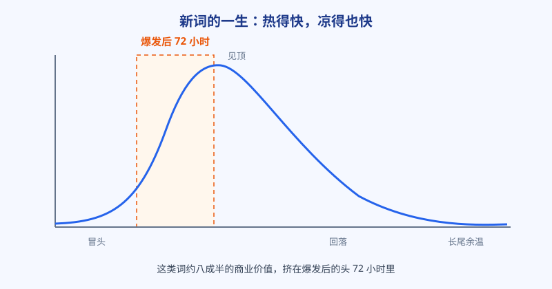
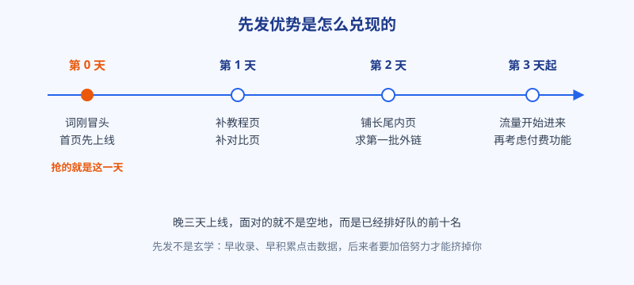

# 第 7 章 追新词：72 小时里藏着大半的钱

## 白话讲解

前几章讲的词，大多是「一直有人搜」的存量词，稳扎稳打。这一章讲另一类：突然冒出来、搜索量几天之内冲上天的新词。

新词从哪来？来源无非四类。一是新产品、新功能发布，某个大厂上线了新东西，用户立刻去搜它叫什么、怎么用。二是新梗、新玩法在社交平台爆火，看过视频的人转头就去搜同款做法。三是热点事件，新闻、赛事、名人动态都会带出一批短命的搜索词。四是政策、考试、季节节点带来的周期性新面孔。共同点是：需求是真实的，但所有人都是同一天知道的，包括你的对手。最后这一句是关键：新词面前没有信息差，只有反应差。你知道的时候，全世界都知道了，剩下的就看谁先把页面摆出去。

这类词的脾气，和存量词完全相反。看图 1：它的热度曲线是一根尖刺，几天之内冲到顶，然后快速回落，最后留一条低低的尾巴。按做这类词的人总结的经验口径，约八成半的商业价值挤在爆发后的头 72 小时里。道理不难懂：头三天，搜的人最多，而认真的页面最少，供需缺口最大；等大部队反应过来把页面铺齐，热度已经过去大半，你再进场，只能分到尾巴上那点余温。

所以追新词拼的不是文笔，是速度和判断。先说判断：不是所有新词都值得追。先问三个问题。第一，这个词的热闹底下，有没有一个能做成页面或工具的真实需求？纯看热闹的词，追到了也变不成你的资产。第二，它的生命周期是哪一种：是几天就散的一日行情，还是一个新品类、新玩法的起点，后者会沉淀成存量词，值得认真做。第三，你动手的速度赶不赶得上？要开发两周的功能，等你上线，黄花菜都凉了；能当天上线的简单页面，才配谈追新词。

三个问题里，第二个最难，也最值钱。分辨一日行情和品类起点有个土办法：看这个词背后有没有一个可持续的东西在支撑。新功能有产品在迭代，新玩法有平台在推，新品类有厂商在持续投入，这些都算有根；只有一条新闻、一个八卦在撑的，多半是浮萍。有根的词，哪怕你慢了一步，也值得认真做，因为它的尾巴会很长；没根的词，抢到第一名也只风光三天。

再说速度。追新词的正确姿势是把动作拆小，如图 2 所示：第 0 天，先把最核心的页面顶上去，哪怕粗糙，先占住位置，让搜索引擎收录你；第 1 到 2 天，补教程页、对比页和长尾内页，把这个词的周边需求一并接住，再去求第一批外链；第 3 天之后看数据，有流量进来，再决定要不要上登录、付费这些重功能。这个顺序不能反：先有页面占位，后有精雕细琢。等页面做到完美再上线，等于把窗口亲手关上。

占位版的标准也要说清：不是随便糊一个空页面。最低配置是四样：标题把词说准，正文把这件事是什么讲清，一段能真正用的功能或者一份真实有用的信息，再加一个干净利落、搜索引擎能顺利抓取的地址。糊弄用户的空页面，就算抢到位置，也会很快被点击数据打回原形，反而浪费了先发。

先发优势为什么这么值钱？因为搜索引擎的排名有一部分是「先来后到」的惯性：先被收录的页面先积累点击和停留数据，后进场的页面要拿出明显更好的东西，才能把先行者挤下去。你早三天上线，等于让所有对手多交三天的过路费。反过来也成立：你晚三天，就要替前面所有人交这笔过路费，而且常常要拿出双倍的内容和外链才补得回来。

### 新词从哪儿第一时间冒出来

追新词先要解决情报问题，盯四个地方。第一，社交平台的热榜和话题页，新梗、新玩法大多先在这里热起来，看到某个说法被反复模仿，就去搜一下它有没有变成搜索词。第二，Trends 的相关查询上升榜，这是第 8 章要细讲的功能，新词常常先在这里露头。第三，同行和竞品的上新动态，对手半夜上了一个新页面，往往说明他也闻到了味道。第四，你自己的站内搜索和用户留言，用户在你的地盘上找而找不到的东西，就是离你最近的新需求。四条线不用全天候盯着，每天固定花二十分钟扫一遍，比全天刷手机有用得多。

### 出手之前，先定止损线

新词的成本看着低，一页一天，架不住次数多。出手前先给自己定三条线：一个词最多投入两天；先上一个页面试水，有点击再补第二页；一周后复盘，没起量的就停手，页面留着接长尾，不再追加投入。再把每次出手的结果记下来：追了什么词、第几天上线、最后来了多少流量。记上十次，你就有自己的胜率账了，知道哪类新词适合自己、哪类纯属陪跑。没有这本账的人，追新词追的是热闹；有这本账的人，追的是期望值。胜率账记久了，你还会发现自己的出手在慢慢变准，这就是经验的复利。

### 也要认清自己品类的脾气

最后还有一层适配问题：不是每个品类都盛产新词。工具、娱乐、消费电子这类品类，新功能新款式不断，一年能有十几次像样的窗口；传统行业、本地服务这类品类，一年可能一个像样的新词都没有。拿别人的热闹给自己定指标，是追新词的人最常见的内耗来源：看着隔壁品类的人又吃到一波，自己这边风平浪静，就开始怀疑是不是自己盯得不够紧。多半不是，是品类本身的节律不同。品类新词少的，把精力放回存量词和长尾，偶尔真来一个，因为平时没人抢，你的胜算反而更高。先认清自己这口锅里能出多少菜，再决定要不要天天守在灶台边上。

最后一句降温的话：追新词是机会主义打法，适合当副业线，不适合当全部身家。它的日常状态是「十次出手，七八次扑空，一两次吃饱」。正确的姿势是手里有稳定的存量词基本盘，新词来了就快速出手试试，中了是惊喜，不中也就亏一两天功夫。把全部精力押在追新词上，心态先会被那根尖刺曲线折腾垮。

## 阿哲的站

阿哲围观过一次完整的新词爆发。一个国外平台上线了新的图片玩法，短视频平台上同款内容一夜刷屏，第二天，相关的搜法就开始往上冲。他在社群里看到有人晒数据：某个当天上线的小站，第二天就来了几千访问。他承认自己当时是动了心的，手指都放在新建项目的按钮上了。

阿哲的第一反应是激动，第二反应是打开自己的词表和待办清单算账：这个玩法落到图片处理上，他要新开发一个功能，最快也要一周；而这个词的热度，按同类事件的经验，四五天就会落下去大半。他算完账，做了个让自己不太舒服的决定：不追，只围观。

接下来四天，他每天记一次这个词的曲线和前十名的变化，眼睁睁看着两个反应快的小站吃到了头一波流量，其中一家的页面第一天上线时简陋得只有一个上传框。第四天，热度回落到高点的两成左右，两个小站的页面留在了前排，开始慢慢接住那条长尾余温。他还注意到一个细节：两个小站里，活得久的是那个第二天就开始补页面的。只做了一个页面的那家，热度一过流量就贴地了；补了教程页和几个长尾页的那家，把一波热闹转成了一个小小的词群，三个月后还在稳定来量。阿哲把这一条记进自己的预案：抢到位置只是上半场，把词做成串，才是下半场。

阿哲说这次围观比自己上手还值：他亲眼确认了窗口期是真的，也确认了自己的短板是上线速度。为了下次能当天出手，他做了两件具体的准备。一是页面模板：标题的写法、功能区的排布、说明文字的段落结构、常见问题的位置，全都定好版式，新词来了只需要换词和换参数，不用从空白页开始。二是发布清单：上线前要检查的十几项，从页面能不能打开，到提交收录的入口在哪，列成一张表贴在屏幕上。他说这两样东西平时看着像洁癖，窗口期里就是命：别人还在商量页面长什么样的时候，你的页面已经被收录了。机会主义的前提，是你平时把枪擦好了。

## 翻车现场

有个团队追一个爆火的新梗词，判断完全正确：词是真火，需求是真有。他们坏就坏在太认真：产品经理写了完整方案，设计出了精美稿，前后端排期一周，还想着顺便把付费一起上。第七天，功能终于上线，页面漂亮得不像话。

可那个词的搜索量，已经跌回高点的零头。更扎心的是，前排站着三个第一天就上线的糙页面，其中一个连移动端适配都没做好。搜索引擎把位置给了先到的人，用户的搜索习惯也已经在前三天被喂熟了。他们的精美页面排在第二页，一天来不了几个人，两周后团队把这个功能下线复盘。

这个团队后来把教训写进了流程：再遇到新词，先出占位版，两小时内上线，设计和精修全部排到占位版之后。下一个新词来的时候，他们是品类里第三家上线的，吃到了整段窗口里最肥的一部分。负责人在复盘会上说，以前我们总觉得慢工出细活，在新词这件事上，细活的前提是先活着排上队。

那套精美页面最后也没有全浪费：设计稿和文案被他们拆下来，用在了常驻品类的页面上，算是挽回一点损失。但负责人很清醒：能复用的是素材，复用不了的是那七天。再好的补救，也补不回窗口期里本该属于他们的位置。这件事之后，团队内部流传一句话：新词面前，先交卷，再润色。考试的比喻很贴切：交白卷的人写得再好也是零分，先把答案写上去的人，才有资格谈分数。

翻车点总结：新词的窗口里，完成度让位于时效性。先用最简陋但能用的页面占住位置，再慢慢打磨，这是顺序问题，不是态度问题。为了完美错过窗口，是追新词最贵的一种输法。

## 要点回顾

- 新词来自新品、新梗、热点和节点，特征是需求真实、所有人同时起跑。
- 这类词约八成半的价值在爆发后 72 小时内，拼的是判断和速度。
- 追之前先问三句：需求能不能落成页面、生命周期多长、我的速度赶不赶得上。
- 动作顺序不能反：第 0 天先上线占位，再补内容、外链和付费功能。
- 追新词是副业线：用存量词做基本盘，新词出手快、止损也快。
- 情报线、页面模板、发布清单都要平时备好，窗口来了才来得及；每次出手都记一笔胜率账，下一次判断就多一分底气。

## Kata

1. 复盘最近一个月你所在品类的一个新词：它哪天冒头、哪天见顶、现在还剩多少热度？当时前十名里，最早的页面是哪天上线的？
2. 给自己做一份「新词应急预案」：如果今晚一个新词落到你的品类里，你明天之内能拿出的最简页面长什么样？缺哪几个环节？
3. 找一条正在冒头的新词曲线，写下你的判断：追还是不追，理由对应本章的三个问题各一句。一周后回来对答案。
