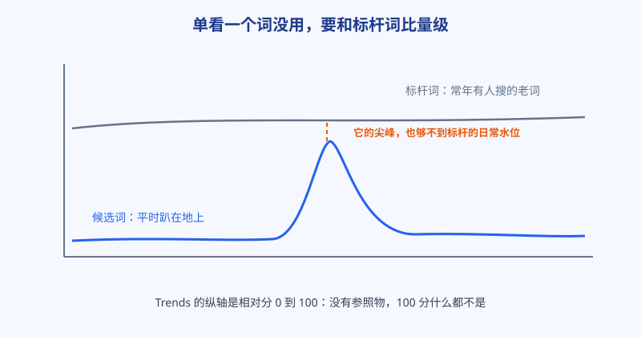
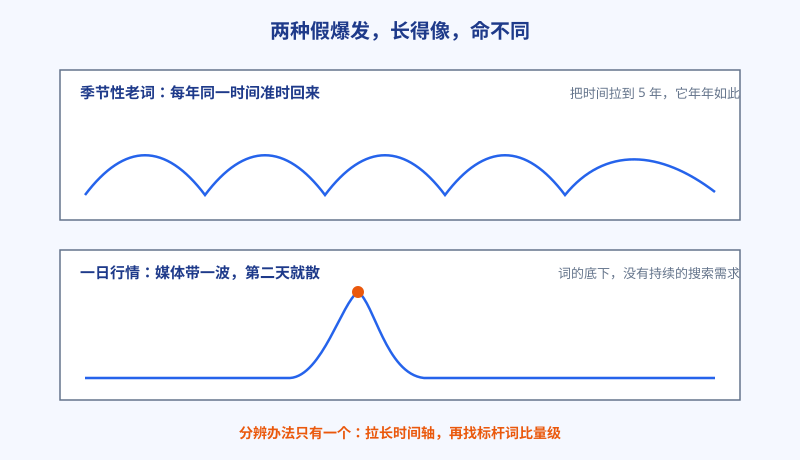

# 第 8 章 Trends 不说谎：会看曲线，才不会追错词

## 白话讲解

前面几章反复提到一个动作：词进词表之前，先去 Google Trends 看一眼。这一章把这个动作讲透。Trends 是个好东西，但它有个脾气：它从不直接告诉你「有多少人搜」，它只给相对分数。不会看的人，会被一根冲上天的曲线骗得热血沸腾；会看的人，能从同一根曲线里读出它值不值钱。

先说相对分数是什么意思。Trends 把你查询的这段时间里，搜索量的最高点记为 100，其余时间按比例折算。也就是说，曲线顶到 100，只代表「这是它自己的最高点」，不代表人多。换个比方：它像班级里的身高排名，只告诉你谁是班里最高的，不告诉你这个班是幼儿园还是篮球队。只看排名不看是什么班，就会闹出把小个子当巨人的笑话。一个每天只有几十人搜的小词，赶上新闻事件翻了十倍，曲线照样能冲到 100，看起来和国民级大词一样威风。所以第一条铁律：**单个词的曲线没有意义，必须拉一个标杆词进来同框对比。**

标杆词怎么选？选你品类里公认的、常年有人搜的老词，量级稳定、人尽皆知。选标杆还有个讲究：离候选词越近越好，最好是同一批用户在搜的词。拿一个国民级大词当标杆，什么候选词都显得渺小，判断会系统性偏保守；拿同品类的当家词当标杆，量级感才准。阿哲的做法是固定两个标杆，一个品类头词，一个和自己体量接近的对手词，验任何词都和这两个比，尺子就统一了。把候选词和标杆词放进同一张图，如图 1 所示，量级立刻现形：候选词的尖峰如果只够到标杆词日常水位的一小截，说明这波热闹的绝对量并不大，心里要有数；如果尖峰能冲到标杆词的几倍，那才是真有大事发生。

第二条铁律：**看曲线先拉时间轴。** 默认视图往往是最近 30 天或 12 个月，这对判断远远不够。把范围拉到 5 年，两种最常见的假爆发立刻现形，如图 2 所示。为什么默认视图害人？因为它只给你看最近这一小段，任何周期性波动到了上升段，都长得像爆发；任何事件尖刺在短窗口里，都显得气势汹汹。时间轴一拉长，背景露出来，形状自己会说话。

一种是季节性老词。它每年在固定时间准时冲高，比如和考试、节日、换季、赛事绑定的词。只看最近 90 天，你会以为它在「爆发」；拉到 5 年，你会发现它年年如此，而且高点一年比一年矮的也不少。季节性词不是不能做，它是存量词，要提前布局、在旺季前把页面准备好，而不是在尖峰当天才冲进去追。

另一种是一日行情。某个事件让词在几天内冲到顶，然后迅速归于平地，词的底下没有持续的搜索需求，只有媒体和社交平台带起来的一阵风。这种词的 5 年曲线是一片平原上孤零零的一根针，看见针，先冷静：它过去之后，这个词还会有人搜吗？多半不会。

第三条铁律：**没有实际曲线证据，「在涨」两个字就不算数。** 这是无数人栽过的跟头。常见的替代品有三种：一是有人写教程、发视频讲这个词，觉得「大家都在说，肯定在涨」；二是某个帖子火了，点赞转发很多；三是工具给的估算数字变大了。这三种都是间接信号。教程多，可能是因为这个词去年火过，大家补课；帖子火，量的是社交平台的人气，不是搜索框里的需求。判断一个词涨没涨，唯一算数的证据是曲线本身：最近一段时间的实际走势，加上和标杆词同框的量级。拿不到曲线，或者曲线对不上，就把这个词记为「待验证」，先放着，等证据齐了再说。宁可错过，不可追错，因为追错的成本是实打实的时间。

把这条纪律再往前推一步：连你自己的判断也要过这一关。盘感是个好东西，但盘感不能当证据。真到了要投入几天时间做一个词的时候，把曲线截图、标杆对比和你的结论一起存进词表，写清日期。过段时间回头看，你的判断对了几次、错在哪儿，一清二楚。做搜索的人最后拼的都是这套复盘能力，而不是某一次的灵光一闪。

### 看曲线之前，先把四个设置调对

Trends 打开就能用，但默认设置经常把人带偏，验词前先过一遍四个设置。第一是地区：你的用户在哪儿，就选哪儿。同一个词在不同国家是完全不同的曲线，拿全球数据判断一个只做美国市场的词，等于没看。第二是时间范围，上一节说了，先拉 5 年看底细，再缩回 90 天看近况，两个尺度都要看。第三是搜索类型：网页、图片、视频、新闻的曲线差别很大，你做的是工具站，就老老实实看网页搜索，别拿新闻热度给自己壮胆。第四是对比对象：一次放几个词同框，除了标杆词，还可以把同一需求的几种说法放在一起比，哪个说法在涨、哪个在退，一目了然。四个设置花一分钟调好，省下的是几天的冤枉路。

### 曲线的四种基本形状

看多了曲线，你会发现它们翻来覆去就四种长相。第一种是台阶：涨上去之后不下来，在高位稳住，说明底下有持续的新需求，这是最值得做的形状，等于需求换了一代。第二种是尖刺：第 7 章讲的新词曲线，冲得猛，落得也快，做它拼的是速度。第三种是波浪：规律起伏，多半是季节性或者周期性事件，做法是提前布局，等浪来。第四种是平地微升：没有爆发，但几年下来慢慢往上爬，常见于稳步普及中的品类词，适合当基本盘慢慢养。验词的时候先给曲线定形状，再谈做不做、用哪种打法，判断就稳得多。

最后说说相关查询这个宝藏功能。Trends 在每个词下面给出「相关查询」的上升榜，冒出来的往往是新说法、新问法，是第 4 章滚雪球的一手材料。养成习惯：每次验词，顺手把上升榜抄进词表，验证流程照旧走一遍。还有一个细节：相关查询分「热门」和「上升」两个榜。热门榜是存量，告诉你大家一直怎么搜；上升榜是增量，告诉你新的说法正在冒头。选词优先看上升榜找机会，写页面标题和正文时参考热门榜的说法，那是用户最熟悉的表达。

### 工具数字和曲线打架时，信谁

实际干活时你常会遇到一幕：工具说这个词月搜索量有好几万，曲线却趴在地上；或者工具显示没什么量，曲线却在稳步抬头。先说清两者的底细：工具的搜索量是拿多方数据建模估出来的整数，看着精确，其实误差不小；Trends 是抽样后的相对分，没有绝对数，但形状和走势是真实搜索的投影。两者打架时，先信曲线的形状和标杆对比，再拿工具数字当个参考。等你的页面上线、开始有展示数据之后，最终的账本是你自己后台的真实数据：哪个词真的带来了展示和点击，它说了算。工具和曲线都是参谋，参谋意见不一致时，听那个离真实战场更近的。

## 阿哲的站

阿哲差点追错一个词。

那个词和某种当季饮品的图片玩法有关，短视频平台上很热，他关注的两个同行都在群里说这个词在涨，晒出的截图也确实有一根漂亮的上冲曲线。他已经把页面结构都想好了，准备周末动手。群里已经有人晒出连夜赶出来的页面，他看着更着急，差点就把周末的其他安排全推掉。这种氛围是最容易让人跳过验证的：大家都在跑，你停下来查数据，像是在浪费时间。动手前，他按规矩把词放进 Trends，先拉了 5 年，又拉了品类的标杆词同框。

两眼看完，他就把周末的计划取消了。5 年曲线显示，这个词每年在同一个月份都会准时冲高，今年的高点甚至比去年还矮一截；同框对比更直接：它的尖峰只有标杆词日常水位的零头。这不是新爆发的词，这是一个被短视频重新翻红的季节性老词，今年的这波，还是它五年里最弱的一波。

他没有完全放掉这个词，而是把它改记成存量词处理：提前一个月把页面备好，等明年旺季之前上线，慢慢接它每年准时回来的那波量。他顺手把同品类的另外两个季节性词也查了一遍，把三条曲线的旺季月份标进日历，定了规矩：每年旺季前四十天开始准备页面，旺季里只做维护和复盘，不临时抱佛脚。后来他在复盘里写了一句：差一点，我就把「每年都来」当成了「正在爆发」，还要在最热的那天冲进去和全网抢座位。他说，Trends 最大的用处不是帮他抓机会，是帮他把「等」也变成一种有计划的动作：知道浪什么时候来，就不用天天在沙滩上站着。

第二年旺季，这个提前备好的页面如期接住了那一波量：整个旺季的访问量，比他站平时的月份高出一大截，其中大半来自这几个季节性词。虽然绝对数字和大站没法比，但对他来说意义完全不同：这是他第一次提前半年就知道流量会从哪儿来、什么时候来。从那以后，他的词表里多了一列「月份」，季节性词全部按日历排班，再没有在尖峰当天手忙脚乱过。

## 翻车现场

有个做节日用品的卖家，在某个节日前一个月，看到一个相关词的曲线陡峭上冲，又听同行说这个词今年特别火，立刻备货、做页面、投广告，全套动作压上去。他的执行不可谓不快，货备得足，页面做得也用心，输就输在最开始看图的那三十秒。结果旺季一过他才发现，这个词的「上冲」年年如此，是节日本身的节律；而且他进场时曲线已经到了高点，后半程全是下坡。他备的货，有一半砸在了手里。

另一个更典型的翻车是追错一日行情：某个词因为一条新闻冲上热搜榜，几个人连夜做了专题页，第二天新闻热度散了，曲线贴地，专题页再没打开过。他们的错误都不是不努力，而是把「曲线的形状」看错了：一个把周期当成趋势，一个把事件当成需求。事后复盘会上，卖家说了一句挺扎心的话：曲线就摆在那儿，年年如此，是我自己不愿意多拉那一下时间轴。很多假爆发骗的不是眼睛，是耐心：多点两下、多比一个词就能躲过去的坑，偏偏栽在「来不及了先做了再说」的着急上。

翻车点总结：Trends 不会说谎，说谎的是看图的人。只看默认时间窗、只看单个词、不拉标杆，三个错误犯任何一个，都能把假爆发看成真机会。

## 要点回顾

- Trends 给的是相对分，单个词冲到 100 分不代表人多。
- 验词必拉标杆词同框：尖峰够不够得着标杆的日常水位，决定它的量级。
- 先拉 5 年时间轴：季节性老词会现形，一日行情会现形。
- 教程、帖子、估算数字都是间接信号，没有实际曲线证据，涨势不算数，先记待验证。
- 相关查询的上升榜是滚雪球的一手材料，验词时顺手抄走。

## Kata

1. 拿你词表里最看好的一个词，和品类标杆词同框对比：写下它的尖峰是标杆日常水位的几分之几，你之前的判断要不要改？
2. 找一个每年固定时间冲高的季节性词，拉出 5 年曲线：它的旺季在几月？如果你要做它，页面最晚应该几月上线？
3. 回忆一次你差点追错的词（或者现在去翻一个正在被热议的词）：它的曲线证据齐吗？缺哪一样？按本章的纪律，它现在应该记为「待验证」还是「可动手」？
