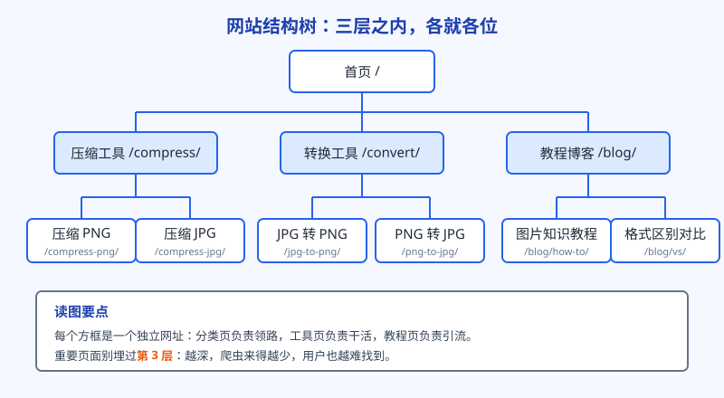
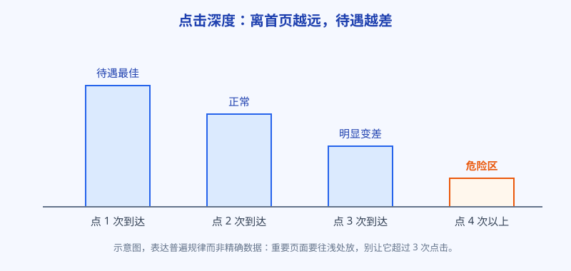

# 第 9 章 网站结构：让搜索引擎一眼看懂你卖什么

选词的活干完了，手里有词，心里有底，接下来是把站搭起来。搭站的第一件事不是选模板，也不是想配色，而是定结构：你的站一共有哪些页面，这些页面怎么摆放，彼此怎么连。这一章就讲这一件事。结构定对了，后面每一章的功夫都能落在实处；结构定错了，内容写得再好，也像把好货堆进没有分区的仓库，顾客找不到，理货员也找不到。

## 白话讲解

先打个比方。网站结构，就是你这家店的分区图。

走进一家大超市，你不用问人就知道饮料在哪一排、冷冻食品在哪一区，因为超市按品类分了区，每一区挂了牌子，每件商品都摆在它该在的位置。搜索引擎的爬虫走进你的网站时，处境和顾客差不多：它顺着链接一页一页逛，边逛边在心里拼一张地图，猜你这家店到底卖什么、哪几样是主打。地图拼得清楚，它才好给你的页面归类、收录、排座次。地图拼不出来，它逛两圈就走了。

结构这件事，拆开看就三个零件：层级、网址、面包屑。再加上一个容易被忘的：页面之间的链接怎么连。

**第一，层级要浅。**

一个站的页面天然是棵树：首页是树根，分类页是树枝，具体页面是树叶。用户从首页出发，点几次能到达某个页面，这个次数叫点击深度。经验值是：重要页面离首页不要超过 3 次点击。原因不玄乎，爬虫的耐心是按链接分配的，离首页越远的页面，它来得越少，分到的注意力越低；用户也一样，藏得太深的页面，基本上等于没有。

所以分类不要贪多。工具站常见的毛病是一上来就分十几个大类，每个类下面两三个页面，树长得又宽又浅，看着热闹，其实每个分类页都撑不起内容。先分两三个扎实的大类，等页面多了再细拆，结构是可以长大的。

层级也不是越浅越好，浅过头是另一个极端。有的站把两百个页面全部直挂在首页下面，树根上挂满树叶，看着每页都只有 1 次点击，实际上分类消失了，页面之间没了亲疏关系，爬虫面对一堵链接墙，照样理不清谁重要。合理的形状是中间状态：有分类，但分类不多；有层级，但层级不深。主导航的位置就那么几个，只放最重要的分类入口，剩下的体面，留给分类页内部去安排。

**第二，网址要说人话。**

网址是页面的门牌号，也是爬虫对这个页面的第一句自我介绍。`/compress-png/` 一看就懂：这页是压缩 PNG 的。`/page?id=832&type=2` 就什么都没说，还带着一串参数，爬虫只能点进去慢慢猜。给网址定三条规矩就够了：用真实的词不用编号，词与词之间用连字符隔开，全小写。英文站就用英文词，用户在搜索结果里看到网址也能对上号，心里更敢点。

还有一条：网址定了就尽量别改。改网址等于搬家，搬家要办手续（做跳转，下一章还会提到），办漏了，老地址积累的口碑就作废了。

**第三，面包屑要齐全。**

面包屑就是页面顶部那行小字：首页 > 压缩工具 > 压缩 PNG。它来自童话里撒面包屑认路的典故，作用也确实是认路。对用户，它告诉你现在站在店里的哪个区，想回上一层点一下就行。对爬虫，它是一份现成的上下级名单，顺着它就能把你的分类关系理清楚。写得规范的面包屑，还可能被谷歌放进搜索结果里显示，等于免费多了一行说明。

**最后，链接要把页面连起来。**

目录只是骨架，链接才是路。一个页面在目录里位置再对，如果全站没有任何链接指向它，爬虫发现不了，用户也走不到，这种页面叫孤儿页。反过来，分类页要老老实实链向它下面的每一个工具页，工具页之间要互相推荐：压缩完 PNG 的用户，可能顺手想转成 JPG，这一步的链接既方便用户，也是在告诉爬虫这几页是一家人。首页的位置最金贵，留给你最想推的分类和页面，不要拿去堆友情链接。

还要知道，链接和链接的价值不一样。搜索引擎会顺着链接传递一部分信任，离源头越近的链接分量越足。首页是全站被外部引用最多的页面，从它身上直接发出的链接最值钱；深埋在某个角落页里的链接，分量就薄得多。这就是为什么前面说总入口页要从首页直达，也为什么内链调整是个细活：你把首页的链接位给谁，等于在给全站的页面排座次。反过来，被很多站内页面共同指向的页面，会被爬虫理解为站内的重要角色，教程文章里链向工具页，起的就是这个作用。

最后补一个容易混淆的点：站点地图（sitemap.xml）不是结构本身。它是一份你交给爬虫的页面清单，能帮它更快发现新页面，但代替不了内链。清单上有、路上没有的页面，爬虫来过一次就不会再当回事；反过来，内链织得密的站，哪怕地图提交晚了，页面也照样能被逛到。顺序别弄反：先把路修好，再交清单。阿哲在这一点上没有省事：新页面发布当天就同步更新站点地图，这是他上线检查单里的固定一项；但他心里清楚，地图只是打个招呼，页面能不能被留下，还是看路修得怎么样。

最后说一句关于未来的：结构要给长大留口子。今天你只有压缩和转换两个分类，明天可能加编辑、加生成。定结构时把命名规则留出扩展性：分类前缀别写死，网址别带年份，这样新业务进来是添一根枝，而不是再栽一棵树。阿哲的站后面加教程、加西语版（第 13 章），用的都是在同一棵树上长新枝的办法。反过来，最忌讳的是按上线时间组织结构，比如按年份分目录，那是在拿你的内部编年史给用户和爬虫添堵，他们不关心你的历史，只关心东西在哪。

如图 9-1 所示，一个工具站的典型结构就长这样：首页往下分出压缩、转换两个大分类和一个教程博客，每个分类页再往下挂具体的工具页。注意教程博客也在树上，它不是外人，后面讲内容时你会看到，教程页是给工具页引流和做内链的重要通道。

图 9-2 是点击深度的示意。不是精确数据，画的是普遍规律：点 1 次能到的页面待遇最好，越往深越冷清，点 4 次以上才到的页面，很容易变成没人收、没人看的孤儿页。你站上但凡觉得重要的页面，都要想办法往浅处放。

## 阿哲的站

阿哲搭站之前，先在纸上把结构画了一遍，才开始写代码。

他的工具站主营图片处理，第一版结构定得很克制。树根是首页，放品牌、一句说清用途的话，和两个大分类的入口。第一个分类是压缩，网址前缀 `/compress/`，下面挂压缩 PNG、压缩 JPG、压缩 WebP 三个工具页，外加一个吃大词的总入口页，页面就叫图片压缩，专门对准那个搜索量最大的词（第 5 章讲过，大词留给分类总入口）。第二个分类是转换，前缀 `/convert/`，下面是 JPG 转 PNG、PNG 转 JPG、WebP 转 PNG、HEIC 转 JPG，都是他在选词阶段验证过、有人搜的组合，没有验证过的组合先不做，宁可页面少而精。第三个枝是博客，前缀 `/blog/`，放教程文章。

网址规矩他一次定死：全小写，连字符，不带日期，不带参数，以后只许加新页，不许改老网址。每个工具页，他都检查了一遍到达路径：首页点分类，分类页点工具，2 次点击到位。面包屑全站用同一套组件生成，样式和写法不许每个页面自己发挥。

还有一个小动作值得学：分类页他没有只放一排链接了事，而是每个分类页都写了几段说明，这个分类解决什么问题、下面每个工具分别适合什么场景。分类页本身也是要参与排名的页面，不能当成纯粹的过道。

还有两个细节能看出他是算过账的。一是那个吃大词的总入口页，他没有让它老老实实待在分类下面，而是从首页直接给了一条链接，点击深度压到 1 次，全站最重要的页面就该有这个待遇。二是博客的位置，他纠结过一小会儿：教程文章单看和工具不像一家，但教程的读者正是工具的用户，文章里天然能链回工具页，他最后还是把博客挂进了主树，而不是另开一个子域名自立门户。结构上的每一次分家，都要想清楚分出去的页面还回不回得来。

上线两周后，他在 Search Console 里看收录情况：提交的页面陆续被收录，没有出现一大片已抓取未收录。先别急着归功于结构，早期样本小，但至少说明爬虫进来逛得顺，这就是结构定对了的第一个信号。他还顺手把站点地图提交了，并且养成一个习惯：每次加新页面，先问自己它挂在哪根枝上、从首页点几次能到、分类页的链接加了没有，三个问题答完才发布。结构这东西，与其说是设计出来的，不如说是靠这种每次都不偷懒守出来的。

## 翻车现场

有个做在线文档处理工具的同行，站搭得比阿哲早，工具数量还是阿哲的两倍，但流量一直起不来，后来复盘，问题就出在结构上。

他的第一版是赶工赶出来的：所有工具页都塞在 `/tools/` 下面，还按上线年份分了层，进到某个工具要点五六次。再加上网址用的是参数形式，一长串编号和符号，用户不敢点，爬虫也只是浅浅爬一层。他站内还有不少页面，是从某个活动页临时链过去的，活动结束页面撤了链接，那些工具页就成了孤儿页，他自己都忘了它们的存在。

结果是：站点提交上去大半年，收录率不到三成，大部分页面谷歌根本没来过。后来他下决心重做结构，画了新树，网址全部换成语义化的短网址。但最疼的一刀在后面：老网址他没有逐个做跳转，直接全废了。老页面里有几个是排在第二页、眼看要起来的，就这么清零重来，等于把攒了半年的家底一把推倒。再后来他第三次微调结构时学乖了，先把新旧网址拉成一张对照表，逐条设置跳转，收录一个月上下就基本回位。同一个站，同一类改动，办手续和不办手续，差出整整一个季度。

这个翻车的教训有两层。第一层，结构要在动工之前画好，它是地基，地基返工的代价最大。第二层，万一真要动结构，老网址必须一个一个跳转到对应的新网址，这是搬家的正规手续，手续办全了，口碑才能跟着搬过去。

## 要点回顾

- 结构就是分区图：让爬虫和用户不用动脑，就知道每页在哪、卖什么。
- 重要页面离首页不超过 3 次点击，深埋的页面约等于不存在。
- 网址用真实的词、连字符、小写，定了就别改，改版必须逐个做跳转。
- 面包屑全站统一，既帮用户认路，也帮爬虫理清上下级。
- 没有内链指向的页面是孤儿页，分类页要链全，工具页之间要互相推荐。

## Kata

1. 给自己的站画一张结构树（纸上或文档里都行），给每个页面标上从首页出发的点击次数，找出超过 3 次的页面，想想怎么往浅处挪。
2. 把你站上最重要的 5 个页面网址抄下来，逐个自问：只看网址，能不能猜出这页是干什么的？猜不出的，记进待改清单。
3. 列一份全站页面清单，逐个确认它至少有一个站内链接入口。查出来没有入口的，就是你的孤儿页，这周内给它们接上路。
