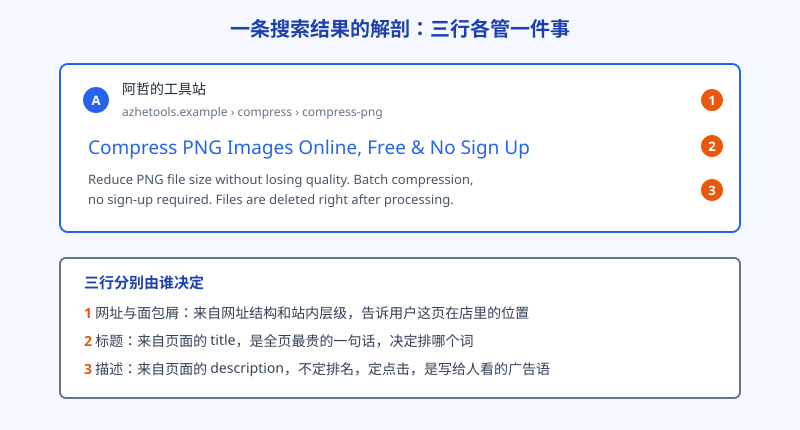
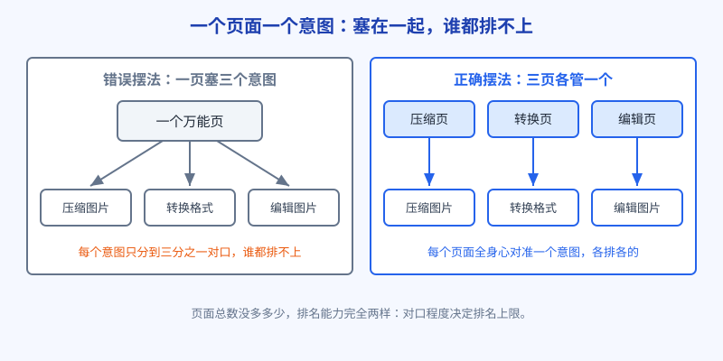

# 第 10 章 页面基本功：标题、描述、H 标签里的小心机

上一章把站的骨架搭好了，这一章蹲下来看单个页面。如果说结构决定爬虫愿不愿意进来逛，页面基本功决定的就是：逛到这一页时，它能不能一眼看懂这页在讲什么、该把这页排到哪个词下面。基本功没有花活，全是细节，但恰恰是这些细节，拉开了同类页面之间的差距。

## 白话讲解

一个页面递给谷歌的简历，主要有五项：标题、描述、H 标签、正文开头、图片说明。逐项说。

**标题（title）：全页最贵的一句话。**

标题就是显示在搜索结果里的那行大字，也是浏览器标签页上的名字。它在全页所有文字里权重数一数二，谷歌判断这页主打哪个词，先看它。写标题有四条经验：

- 核心词放前面。用户搜的那个词，尽量出现在标题前半段，人扫一眼就能对上号，爬虫也一样。
- 说人话，别堆词。标题是写给人看的句子，不是关键词清单。把同义词连着塞三四遍，既难看，还可能被判定为堆砌。
- 带一个真实的差异点。免费、在线、不用注册、支持批量，这些词能提高点击意愿，前提是你的页面真能做到，做不到别写，点进来发现上当，用户秒退，这个账谷歌记着。
- 长度收着点。标题太长，在搜索结果里会被截断成省略号，关键信息藏起来就白写了。

补两个标题的实务问题。一是品牌名放哪：首页标题品牌名在前，天经地义；内页则把核心词放前面，品牌名退到最后做个落款，因为搜具体词的人先要确认这页对不对口，品牌慢慢再认。二是谷歌会改写标题：如果你写的标题和页面内容对不上，或者太像广告词，它会自己从正文里挑一句话替换上去显示。被改写不等于出事，但十有八九说明你写的标题没说到点子上，值得回头自查，而不是去和它较劲。

**描述（description）：不决定排名，决定点击。**

描述是搜索结果里标题下面的那两行小字。先说清一个常见误解：描述写得好不好，不直接影响排名。但它影响另一件同样重要的事：同样排在第三位，别人的描述写得像广告，你的描述是系统随手截的一段正文，点击率能差出一截。点击率高的结果，谷歌会更愿意往前放，这笔账最后还是算到排名上。

写描述就当写一句广告语：这页能帮你解决什么问题、适合谁、和别家比有什么不同，三件事说清一两件就够。每个页面单独写，不要全站共用一句。

**H 标签：页面的目录，不是字号按钮。**

H1、H2、H3 是标题层级，相当于一本书的章名和节名。规矩很简单：H1 全页只有一个，就是这页的大标题，和搜索结果里那行标题呼应即可，不用一字不差地重复，那样反而浪费了两个位置。H2 是正文的分段小标题，把一页内容切成几块，每块讲一件事。爬虫读 H 序列，就能快速理出这页的提纲；读者也是，先扫小标题，再决定细看哪段。

最常见的误用是拿 H 标签调字号：觉得哪个词重要就套个 H2，全页套出十几个。层级一旦被当成装饰，提纲就乱了，等于没写。

拿工具页举个具体的排法。一个压缩 PNG 的页面，H1 是页面名，往下的 H2 可以这样切：怎么用这个工具、压缩前后效果对比、常见问题。每一块 H2 下面配一小段实在内容。用户扫一遍小标题就知道这页能干什么，爬虫读到的也是一份清爽的提纲。反过来，如果 H2 写的是震撼发布、行业领先这种口号，提纲就等于白写，口号救不了排名。

**一个页面只伺候一个意图。**

这是本章最要紧的一条。回顾第 2 章：每次搜索背后是一种意图。页面和意图要一一对应：想压缩图片的人，落地页就该直接给他压缩工具；想转格式的人同理。一个页面同时想接住压缩、转换、编辑三个意图，看起来谁都伺候了，结果是哪个意图都不够对口，三个词都排不上去。判断方法很土但有效：写下这个页面要接的那句搜索词，贴在屏幕边上，写正文时每一段都对照一下，跑题的段落挪走。

**图片说明（alt）：给看不见图的人写的字幕。**

页面上的图，爬虫看不见画面，只能读你配的文字说明，这就是 alt 文本的用途。工具站尤其躲不开：压缩前后的对比图、操作步骤的截图，都要配一句实在的说明，写清图里是什么、说明什么问题。不要借机在 alt 里堆关键词，那和标题堆砌是一个毛病。

顺带辟一个老谣：网页头部那个 keywords 元标签，谷歌早在很多年前就公开说过不用于排名了，现在往里塞词纯属白费功夫，删了也不心疼。真正还值得你花时间的，就是本章这五项。

再说正文里词的摆法。新手最容易纠结一个假问题：目标词要出现多少次？没有这种规定数字。搜索引擎早就过了数关键词次数的阶段，它看的是这页有没有把这个话题说全、说透。实用的做法是反过来想：用户搜这个词的时候，嘴里和心里还会冒出哪些说法？同义的、具体的、带场景的，把这些说法自然写进正文和小标题，页面覆盖的问法就宽了。这比把一个词重复二十遍有用得多，也安全得多。

**正文第一屏：先给东西，再讲道理。**

用户点进来，前三秒决定去留。工具类页面尤其如此：把工具本体放在第一屏，用户不用滚动就能上手操作。先写一千字介绍再露出工具的页面，跳出率高得吓人。介绍当然要写，那是给爬虫和爱看说明的人准备的，放在工具下面就好。

还有个尺寸问题只在手机上暴露：搜索结果在手机上是竖排卡片，标题能显示的长度比电脑上短，描述也只露出两行上下。写标题时先按更短的标准收着，把最关键的词和卖点放在前半句，前半句活下来了，后半句就算被截断也不心疼。写完拿手机搜一下自己的词，看看实际显示成什么样，比对着字符数猜要靠谱得多。

如图 10-1 所示，一条搜索结果就三行：网址行告诉用户这页在站内的位置，标题决定排哪个词、吸不吸引人，描述决定点不点进来。你在页面里写的 title、面包屑和 description，分别就是喂给这三行的。

图 10-2 对比了两种摆法。左边把三个意图塞进一个页面，每个意图都只分到三分之一的对口程度；右边拆成三个页面，每个页面全身心对准一个意图。页面数没变多多少，排名能力完全是两回事。

## 阿哲的站

结构定完之后，阿哲拿着一张自制清单，把主站的每个页面逐个过了一遍，清单就五项：标题唯一吗，描述单独写了吗，H1 只有一个吗，这页对准的那句搜索词是什么，第一屏能直接上手吗。

以压缩 PNG 这个页面为例。标题他写的是核心词在前、带真实卖点：Compress PNG Images Online, Free & No Sign Up。描述单独写了一句广告语：把 PNG 体积压小但不糊，支持批量，不用注册，压完即删。大标题 H1 他没有照抄标题，而是换了个说法，写成 Compress PNG Images，留着标题的位置去承接更多信息。正文里两张示例图，一张原图一张压缩后，alt 分别写明这是压缩前 8.2MB 的截图原图、这是压缩后 1.1MB 的效果图。

首页他也顺手改了。原先首页标题只写了品牌名，等于把全站最贵的位置空着。他改成品牌名加核心业务的写法，让首页去接那个最大的词，分类总入口页则去接稍微具体一点的词，父子页面各有分工，不打架。

转换页那边他多做了一步：把每个页面的 H2 按用户最常问的问题来排。JPG 转 PNG 的页面，小标题依次是转换步骤、转完画质会不会变、文件存在哪里、手机能不能用。这些问题是他从同类页面的评论区和搜索联想里抄回来的真实问法。好处是双份的：用户的问题在页内有了落点，页面顺带把这个意图周边的说法都覆盖到了，比生硬地重复目标词自然得多。

还有一个发现是他过清单时才注意到的：有三个转换页共用了一份描述，是他复制页面模板时漏改的。谷歌把这三页的部分内容判成雷同，其中一页的收录状态一直不稳定。逐页改开之后，这个问题再没出现。

过清单时他还处理了一组潜在的自相残杀：总入口页和压缩 PNG 页，标题里都带着 compress png 的说法，等于自家两个页面抢同一个词。他把分工重新划开：总入口页的标题改去对准更宽泛的图片压缩，具体的 PNG 词只留给 PNG 页，两页的 H1 和正文也随之错开。自己人和自己人抢词，是大站常见病（第 15 章会细讲内耗），他的站还小，先把规矩立在前面：一个词只许有一个页面当主攻，其他页面只能助攻。

清单过了两周，他在 Search Console 里对比点击率：改过的页面里，排位没大动的几个，点击率从百分之一出头涨到了百分之二上下。样本还小，他在笔记里只写了一句：标题和描述的账，先记着，继续看。他还养成一个对账习惯：每次动标题和描述，都在表格里记下改动日期和改了什么，两周后只和这个页面自己的改动前对比，不拿别的页面混着谈。这个习惯没什么技术含量，却能拦住大多数自我感动式的优化。

## 翻车现场

有一家做简历模板的站，页面数量不少，内容也不差，但收录一直卡在六成上下，站长想不通，找人一查，问题出在最不起眼的地方：全站七十多个页面的标题，一模一样。

他用的建站模板有个默认标题，写的是站名加一句口号。他上每个新页面时只顾着填正文，标题全用了默认的。谷歌看到这个站时的感受是：七十多页，递上来的简历抬头全是同一句，它只好自己动手，从每页正文里截一句话当标题显示，截得还经常不像样。更要命的是，标题雷同会被当作页面雷同的一个信号，一批页面被归进重复内容里，只收录一小部分，其余的晾着。

站长花了两个晚上逐页重写标题，第二周收录就开始往上走。但这事的代价不在那两个晚上，而在前面小半年的时间：页面一直都在，就是没递对简历，谷歌没法给它们排座次，流量自然无从谈起。

他后来的做法值得抄：新页面上线前，先过一遍标题唯一性，全站导出标题列成表，一眼就能看出有没有雷同。基本功翻车大多不惊险，就是这种一声不吭地漏分，漏上几个月才发现。

## 要点回顾

- 标题是全页最贵的一句话：核心词在前、说人话、带一个真实的差异点、长度收着点。
- 描述不直接定排名，但定点击，每个页面单独写一句广告语，别全站共用。
- H 标签是页面提纲：H1 只有一个，H2 用来分段，绝不当字号按钮使。
- 一个页面只伺候一个搜索意图，对口程度决定排名上限。
- 工具本体放第一屏，介绍往后放；图片都要有实在的 alt 说明。

## Kata

1. 把全站所有页面的标题导出成一张表，查三件事：有没有重复，核心词在不在前面，有没有哪页的标题和内容对不上。
2. 挑一个排在第二页的页面，给它写三个版本的标题和描述，对照本章的条目自评，选出最好的一版换上，两周后看点击率变化。
3. 对自己的一个页面做提纲检查：只看 H1 和 H2 列表，能不能复述出这页讲了什么？复述不出来的，说明提纲乱了，重排一遍。
