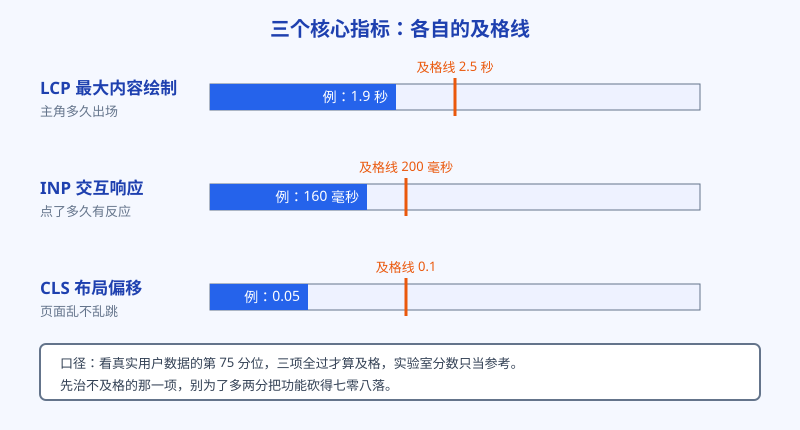
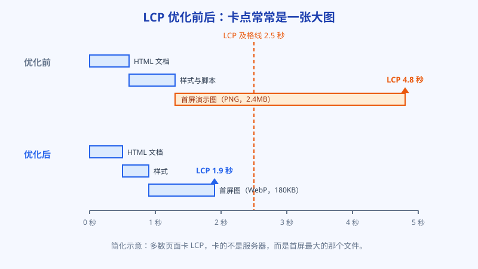

# 第 11 章 速度与手机：Core Web Vitals 说人话

页面基本功过完，轮到体检。速度是用户体验里最没法糊弄的一项：慢就是慢，三秒打不开，人就走了。谷歌也把速度写进了排名的考量里，还专门定了一套指标。这套指标名字听着唬人，拆开全是人话。这一章把三个核心指标讲清，再说一个更要紧的前提：谷歌现在主要拿手机版的页面给你打分。

## 白话讲解

**先说前提：移动优先索引。**

谷歌早就改了规矩：给一个网站收录和排名时，主要看的是它的手机版页面。为什么？因为今天大部分搜索发生在手机上，谷歌干脆拿手机上的样子当正本，电脑版只当参考。落到实处就是：你的站手机版缺内容、少功能、打开慢，电脑版做得再精致也救不回来。以后每次检查网站，先掏出手机，或者用手机尺寸的模拟视图。

**三个指标，逐个翻译成人话。**

谷歌的速度指标叫 Core Web Vitals，核心就三个，业内通行口径如下（数据来源：Google web.dev 官方文档）：

- **LCP（最大内容绘制），及格线 2.5 秒。** 翻译：页面上最大、最显眼的那块内容，多久能画出来。它通常是首屏的大图或者大标题。用户盯着屏幕等的主角就是它，主角 2.5 秒内出场，算快；拖到 4 秒开外，用户基本等跑了。
- **INP（交互到下一帧绘制），及格线 200 毫秒。** 翻译：你点了按钮、输了字，页面多久给你反应。这个指标 2024 年起正式取代了老指标 FID。卡顿最容易出在主线程被大块脚本占着：手点下去了，浏览器正忙着跑别的代码，没空理你。
- **CLS（累积布局偏移），及格线 0.1。** 翻译：页面上的东西乱不乱跳。正在读的文章被晚加载的广告顶下去，正要点的按钮被一张刚加载出的图片挤走，都算偏移。这个数越接近 0 越好，超过 0.1 就算不及格。

**口径要认清：看真实用户，看第 75 分位。**

跑分类工具（比如 PageSpeed Insights）给出的分有两种：实验室数据是工具当场模拟测的，只能当参考；真正算数的是真实用户数据，也就是过去一段时间里真实访客的体验汇总。及格的算法是看第 75 分位：把访客按体验从好到差排队，排在四分之三位置的那个人的数值过了线，才算你这个页面过线。意思很直白：不许拿少数人的飞快，掩盖多数人的卡顿；要让四分之三的访客都快，才算快。听着苛刻，其实公平：它逼你优化的是大多数人的日常体验，而不是演示给人看的那一次。三个指标必须都过，瘸一条腿也算不及格。数据去哪看：PageSpeed Insights 的报告上半部分是实验室数据，下半部分（有足够流量时才显示）是真实用户数据；Search Console 里另有一份核心网页指标报告，按页面组给你列出哪些不及格。日常盯后者，改版时用前者当场验证，分工要分清。

这也解释了一个常见困惑：为什么实验室测出来是绿的，真实用户数据却飘红？实验室用的是旗舰手机和办公室的快网，真实世界里有三年前的中低端安卓机、有地铁里的弱网、有开着一堆应用烫手的手机。谷歌按真实世界算账，是因为它把用户送到你这儿的时候，要保证大多数人落地不摔跤。你自测时把工具的模拟档位调到中端机型加慢速网络，看到的才更接近真相。

也把速度和排名的关系说透，免得两个极端：一端是觉得速度没用，慢就慢了；另一端是把测速分数当命根子，为了多两分把功能砍得七零八落。真实情况在中间：速度更像一道门槛，不及格会实打实地拖后腿，过了线之后，再快零点几秒换不来名次的跃升。先把不及格治成及格，再谈别的。

**三个指标，各自的常见元凶。**

LCP 慢，通常是主角本身个头太大，或者出场顺序被排到了后面：轮播图里排第二张的大图、等字体加载完才肯显示的大标题，都是经典卡点。INP 差，元凶多半是长任务：一段脚本一口气跑几百毫秒，期间用户的点击和输入全在排队；表单每输一个字就全量校验一遍，也是一个小号版本。CLS 高，不用猜，先查这三样：图片和视频没写尺寸、广告位晚加载、自定义字体切换时字形宽窄不一样。挨个对照，基本能把病灶圈出来。

**慢，通常慢在这几处。**

首屏大图没压缩，一张图几兆；第三方脚本堆太多，统计、客服、广告、分享按钮各来一份；图片和广告位不预留尺寸，加载完把版面撑得乱跳；脚本体积肥，用户还没见到工具，先下载几兆代码。工具站最常见的组合是第一种加第四种：素材重，代码也重。

再补一层常被漏掉的：服务器的第一声回应。页面还没开始画，浏览器先要拿到文档本身，这段时间叫首字节时间。你的用户如果主要在海外，而服务器和静态资源都放在离他们很远的地方，光是路上往返就能吃掉近一秒，后面的优化全是在追这一秒的债。出海站的常规解法是把静态资源放到内容分发网络上，让用户就近取，这笔钱在速度账里通常花得最值。

测速的纪律也说一句：先测出基线再动手，一次只改一类问题，改完立刻复测。不然五处一起改，分数涨了也不知道是哪处的功劳，分数跌了更不知道该回滚哪一步。速度优化是个实验活，不是许愿活。

再进阶一点，可以给自己的站定一份性能预算，写在纸上：首屏资源总量不超过多少，第三方脚本不超过几个，单张图片上限多大。新功能上线先过预算这一关，超了，就要拿别的功能来换。没有预算的站，速度只会随着功能越加越慢，这件事不以人的意志为转移。

如图 11-1 所示，三个指标各管一段体验：LCP 管主角出场快不快，INP 管操作跟手不跟手，CLS 管版面稳不稳。记住三条橙色的及格线就行，其余交给工具去量。

图 11-2 是阿哲站的加载过程简化示意。上半是优化前：文档和样式很快就到，首屏那张演示大图慢慢传了三秒多，LCP 被它拖到 4.8 秒。下半是优化后：图换了格式又压了体积，1.9 秒收工。速度这事，多数时候卡的不是某一项高科技，而是某个没人管的大文件。

## 阿哲的站

阿哲的图片工具站，在速度上先天吃亏：卖的是图片处理，页面里全是图；处理又放在浏览器端做，编解码的脚本库体积以兆计。他第一次拿手机测速，结果挺难看：LCP 4 秒开外，INP 勉强及格，CLS 飘红。挨个查下来，病灶有四个。

一是首屏的演示图。那是一张压缩前后的对比图，原图是随手截的 PNG，2.4MB，躺在页面最显眼的位置，LCP 等的就是它。二是脚本加载策略：图片处理库不管用户在哪个页面，一进站就全量下载，在首页看介绍的人，背上了几百 KB 用不上的代码，主线程一忙，INP 就难看。三是图片没写宽高，示例图加载出来之前高度是 0，加载完猛地把下面的文字顶下去，CLS 就这么来的。四是两个闲置脚本，一个早就不用了的统计，一个试装过一次的在线客服，舍不得删，一直跟着每个页面跑。

复查时他又逮到两个小病灶，都很典型。一个出在字体上：他给大标题用了一款自定义英文字体，字体文件没做预加载，标题先用系统字体闪一下再切换，既拖了 LCP，又带来一次布局跳动，后来只保留两个常用字重并提前加载，才算了结。另一个出在交互上：用户选中一张大图之后，页面要先把图解析完才给出反应，几百毫秒里按钮像死了，他把处理改成分片执行，选图后立刻先回一句正在处理，INP 这才回到线内。这类问题在实验室里不容易暴露，都是真实用户数据先飘红，才逼着人去查的。

他的处理顺序值得记：先治最痛的那一处，也就是首屏图。演示图改成 WebP 格式，体积压到 200KB 上下；非首屏的图一律懒加载，滚到附近才加载。其次拆脚本：处理库改成进了工具页才按需加载，首页只留轻量代码。再次是补尺寸：所有图片在代码里写死宽高比，位置先占住，图来晚了也不许挤别人。最后删闲置脚本，删的时候挨个确认确实没业务在用。

还有一笔是地理的账。他的用户主要在北美和欧洲，服务器起初随手选在了离自己近的机房，首字节时间在海外测有九百多毫秒。他把图片、脚本这些静态资源放到内容分发网络上之后，海外用户的首字节降到三百毫秒上下，LCP 顺带再快了一截。这一步和代码优化无关，纯粹是把东西摆到离用户近的地方，再次印证那句话：速度问题多半不是技术问题，是没人管的问题。

改完复测，实验室口径下手机 LCP 回到 2 秒以内，CLS 降到 0.05 上下。排名没有立竿见影地飞，但他注意到一个更实在的变化：从搜索点进来的人，在工具上真正完成一次压缩的比例涨了。速度的账，一半算在排名上，另一半算在留得住人上。从那以后他给自己立了个发布习惯：新工具页上线前先跑一遍测速存档，数字难看就不许上线，免得欠账攒成一堆，要还的时候都不知道从哪笔还起。

## 翻车现场

有个做旅游攻略的站长，内容做得扎实，外链也不差，就是移动端流量常年只有同行的零头。他自查过很多轮：标题改了，内链补了，内容也加厚了，始终没找到原因，因为他每次自查，用的都是公司那台高配电脑。

直到有一次他用自己手机打开自家网站找一篇攻略：首屏是一段自动播放的航拍视频背景，加载了五六秒才露出标题，期间页面白花花一片。他回去一测才发现，手机版的 LCP 在 6 秒上下，而他在电脑上看到的分数是 95 分，因为电脑版早就针对测速做过优化，视频只在手机版开启。

他的错，错在把测速当成了应付考试：只看实验室分数，只看电脑版分数，恰好把谷歌真正看的那一份（手机版、真实用户数据）漏在了外面。后来他把手机版的视频背景换成一张压过的静态图，又给几个主要模板做了减法，移动流量用了小半年才慢慢回到应有的位置。代价是半年，是因为纠错不难，难的是发现错在哪：你用什么设备看自己的站，决定了你能看见什么问题。从那以后他立了个笨规矩：每月用自己的手机，关掉无线网，用移动网络把主要页面走一遍，五分钟的事，比任何报表都更早暴露问题。这个笨办法，阿哲后来也抄了过去。

## 要点回顾

- 谷歌主要按手机版页面收录和排名，自查永远先看手机版。
- 三个指标说人话：LCP 看主角出场（2.5 秒），INP 看操作反应（200 毫秒），CLS 看版面乱跳（0.1）。
- 及格口径是真实用户数据的第 75 分位，三个指标要全过，实验室分数只当参考。
- 拖慢速度的常见元凶：没压缩的大图、全量加载的大脚本、不预留尺寸、闲置的第三方插件。
- 优化顺序：先治最痛的一处，通常是首屏最大的那个文件。

## Kata

1. 用 PageSpeed Insights 测自己站最重要的一个页面，把 LCP、INP、CLS 三个数和它们对应的卡点元素记下来，和及格线逐个对比。
2. 揪出你页面的 LCP 元素：它是谁，多大，能不能换格式、压体积或者推迟加载？动手处理一次，再测一遍。
3. 全站扫一遍图片：凡是没写宽高（或宽高比）的，补上；凡是躺在页面里没人用的第三方脚本，列个清单，逐个确认能不能删。
