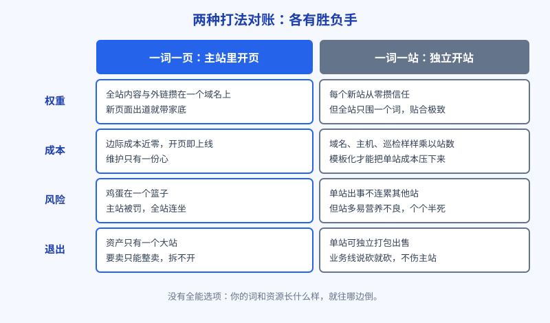
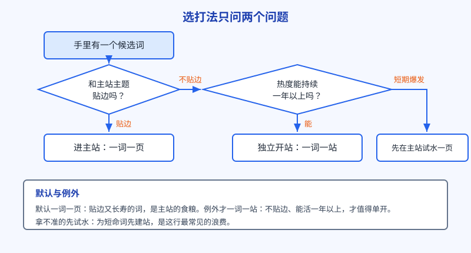

# 第 12 章 一词一页还是一词一站：两种打法的账

站搭起来了，阿哲手里还有第二篇攒下的一串词没消化完，这时候要做一个决定：新词来了，是在主站里开一个页面接住它，还是单独为它建一个站？这两种打法在圈内有个简称：一词一页和一词一站。选哪个，没有标准答案，只有账算得清不清。这一章把两本账摊开算给你看。

## 白话讲解

先把两种打法说清。

**一词一页**：主站是一个大篮子，每来一个对口的词，就在站内开一个页面去接。页面之间共享同一个域名的家底，新页面一出生就带着主站攒下的信任。

**一词一站**：每个词（通常是一个热点或一个细分需求）单独建一个站，独立域名，首页就是这个词的落地页。站和站之间互不相干，一个倒了不连累其他。

先把丑话说在前面：这两种打法争的不是对错，是你把有限的资源往哪儿押。独立开发者最缺的从来不是想法，是把一个站养到赚钱的那份持续投入。所以下面每一本账，最后都要落到你养得起几个站上。

账算四个维度。

**一是权重账。** 搜索引擎对站的信任是攒出来的，攒在哪？攒在域名上。一词一页的模式下，你写的每一篇内容、拿到的每一条外链，都在给同一个域名添砖加瓦，站越老越值钱，新页面跟着沾光，出道即有底子。一词一站反过来，每个新站都从零开始攒信任，头几个月基本是裸奔；换来的好处是专注：整个站从域名到标题到首页，全围绕一个词，贴合度做到极致，这是大站里的一个内页比不了的。

裸奔是什么滋味，经历过的人都懂：新域名上线头几周，收录慢，搜品牌名都排得费劲，发出去的页面像石沉大海。这不是你的错，是新站必经的被观察期，搜索引擎对没历史的域名天然多留个心眼。预算时间的时候要把这一段算进去：一词一站的启动成本里，藏着两三个月只投入没产出的日子，现金流紧的人容易就死在这一段。

**二是成本账。** 一词一页的边际成本约等于零：开一页就是写个页面的事。一词一站的成本是明码标价的：域名一年几十到上百元，主机、证书、维护另算，钱倒在其次，真正贵的是注意力，每多一个站，就多一份要巡检、要更新、要续费的心。只有一个例外能把这本账算平：模板化。当你把建站做成流水线，同一套程序换个词、换套文案就能上线一个站，单站成本被摊到极低，一词一站才从冲动变成打法。第二篇讲的新词爆发，配套的正是这种打法：词的热点窗口就那么几天，靠手工慢慢建站，黄花菜都凉了。

给个具体的数感受一下成本账：一个独立站，域名和主机摊下来一年一两百元，看着不多；但每月两小时的巡检、更新、回邮件，按自己的时薪折算，一年就是几千元的隐形账。站越多，这份年费和工时乘得越大。算成本时只算看得见的钱、不算自己的时间，是独立开发者最常犯的会计错误。

**三是风险账。** 一词一页是鸡蛋放一个篮子：主站一旦被算法误伤或者自己作死被罚，全军覆没。一词一站是分散存放：某个站出问题，其他站不受影响。但别急着羡慕分散，营养不良是这种模式的常见死法：站太多，每个都喂不饱，个个半死不活，加起来还不如一个壮实的主站。分散的是风险，稀释的也是资源。

**四是退出账。** 这一条容易漏算：一词一站建出来的站，是可以整体打包卖掉的资产，域名、流量、收入都独立，买家接手就能跑；一词一页模式下，你的资产只有一个大站，要卖只能整卖，灵活性差得多。反过来说也成立：想砍业务线的时候，单站说关就关，不伤筋动骨；而主站里的页面牵一发动全身，删页都要小心。当然，这是把站做成才有资格烦恼的事，现阶段知道有这本账就行。

**五是匹配账。** 有些词和你的主站八竿子打不着，硬塞进主站，不光这页难排，还会稀释主站的主题，让搜索引擎对"你到底是干什么的"产生疑惑。这种词要么不做，要做就单开一站，别往主站里混。反过来，和主线严丝合缝的词，放进主站就是给主站添内容，单开一站反而浪费了攒权重的机会。

如图 12-1 所示，两种打法没有谁碾压谁：一词一页赢在权重集中和省钱，一词一站赢在贴合度和风险分散。你的词是什么样、你的资源有多少，决定了该往哪边倒。

图 12-2 是阿哲给自己定的决策顺序，一共就两个问题：这个词和主站贴边吗？贴边，进主站开一页，没得商量。不贴边，再问第二个：这个词的热度能活过一年吗？能，才有资格考虑单开一站；活不过的短期热点，要么不做，要做就先在主站试水一页，绝不为一个短命词先把站建起来。

第二个问题最难答，补一套判断词寿命的土办法。看需求的来源：这个词是因为某个事件、某部剧、某个版本更新火起来的，还是来自年年都有的日常需求？事件型的词，事件一过就凉，曲线是尖峰；日常型的词，曲线是平的或者缓涨。再看搜索的人想干什么：追热点的人用完即走，日常需求的人会复访、会付费。最后看有没有大玩家在进场：巨头亲自下场做同类工具的地方，留给小站的窗口通常也就几个月。三个问题答完，这个词大概能活多久，心里就有数了。第 8 章讲的看曲线方法，在这里要再用一遍，两章是连着的。

还要提一句混合打法，免得把两种模式想成单选题。常见搭配是：主站走一词一页当基本盘，个别量大又独立的词，用子域名或者独立站单独打；或者反过来，有一个跑通了的新词站，后来长出了家族词，慢慢长成它自己的小主站。模式是长出来的，不是第一天选死的。你现阶段要定的，只是默认往哪边倒。

## 阿哲的站

阿哲的决定下得很快：主站一律一词一页。

理由三条。第一，他的词全是贴边的：压缩的各种长尾、转换的两两组合，都长在同一棵树上，进主站就是给主站添枝加叶。第二，这些词的寿命长：只要还有人传图片，压缩和转换的需求就在，值得把权重慢慢攒厚。第三，他只有一个人的时间，先把一个站养壮实，比同时喂三个瘦站划算。

第二篇抓到的那些新词呢？按决策顺序走，多数是短期热点，又和图片处理不贴边，两个问题都过不了，他一个都没急着开站，而是建了个观察名单：词、发现日期、当时的热度证据、判断的寿命，先记下来，每月回头看一眼，还活着的、而且势头不减的，才进入候选。名单里后来真有一个词活满了半年还在涨，他这才开始认真考虑：等主站流量稳定了，用一套模板给它单开一站。那是后话，本书后面讲新词打法时还会回到这件事。

那个活满半年的词，他复查时做的事也值得记下来：调出半年的曲线和最初的标杆词对比，确认不是季节性的回光返照；翻搜索结果前两页，看有没有大厂的产品下场占位；再查这个词下面有没有长出新的长尾词，一个词开始生词，往往说明需求在扎根。三条都过关，他才把这个词从观察名单挪进候选，并且排在本季度主站工作之后：先有余粮，才配开新灶。

观察名单他还定了淘汰规则，免得名单越攒越长变成心理安慰：连续两个月热度掉一半以上的，直接划掉；有大厂带着同类产品进场占住前排的，降级为只看不动；只有势头稳住、长尾词还在往外冒的，才留在名单上。名单是用来筛的，不是用来收藏的，这条他写在名单文件的第一行。

这套流程还真拦下过他一次冲动。某段时间有个游戏联名相关的图片词突然爆了，搜索量翻了几十倍，和图片沾边，他的手很痒。按流程问自己：贴边吗？搜的人要的是游戏素材，不是处理工具，不贴边。能活多久？联名活动就两周，活不长。两个问题问完，他把这个词记进名单就放下了。两周之后，这个词的热度果然跌回原样，他在笔记里给那个词标了一句：差点为它建了个站。框架的价值往往不在帮你抓住机会，而在帮你躲开这种看着像机会的坑。

他还给自己立了两条规矩，写在笔记第一页：同时在养的站不超过两个；任何新站动工之前，先算一遍年成本，域名、主机之外，把自己的维护时间也折成钱算进去。算完还觉得值，再动手。

## 翻车现场

有个同行是新词打法的狂热信徒，手又快，一年时间陆续开了二十多个站。他的逻辑听起来没问题：每个站只打一个词，域名里就带着词，上线就往各个平台丢链接。头两个月确实有起色，其中一个站还冲到了日入几十美元，他逢人就讲一词一站是版本答案。

第二年续费季，账算不过来了。二十多个域名和主机一年的费用先摆在那；更要命的是维护：程序要更新，内容要续，偶尔还要处理投诉和侵权信，他一个人根本巡不过来，只能挑流量好的几个管，其余的自生自灭。而自生自灭的站有个规律：内容停在建站那一天，谷歌对长期不更新的薄站会慢慢收紧待遇，有几个站还因为页面太空、只剩模板骨架，被归进了低质页面，排名一夜回到解放前。最后他砍到只剩三个站，算总账，那一年还不如把精力全押在一个站上的人赚得多。

复盘他的问题，不在一词一站本身，在于他把开站的成本算漏了一半：建站有模板，成本确实低；养站没有模板，每个站都是一份长期工。他犯的第二个错更隐蔽：一批站里有的页面只有换了词的同一套话，内容空心，这类规模化生产的薄页面，谷歌近年的质量判定正盯着这一类（第 17 章会细讲），运气不好的时候，是会连人带站一起算账的。

他砍站那天发过一条动态，话挺实在：开站的时候以为自己在做资产，砍的时候才明白，没人维护的站是负债。阿哲把这句话抄进了自己的笔记，还添了一行小字：资产和负债的区别，就是有没有人在管。

## 要点回顾

- 一词一页攒权重于一域，边际成本近零，适合贴边、长寿的词。
- 一词一站贴合度和分散性占优，但每个站都要从零攒信任、全周期养着。
- 一词一站成立的前提是模板化，把单站的建站成本压到足够低。
- 决策顺序：先看贴不贴边，贴边进主站；再看能活多久，短命的词不配单独建站。
- 开站的成本一半在养，不算时间成本的账都是假账。

## Kata

1. 把你手头待做的 10 个词拿出来，按贴不贴边、能活多久两个问题逐个过一遍，分成三堆：进主站、候选单开、放弃。
2. 给一个你动过心想单开的站算全年账：域名、主机、证书，加上每月维护时间折成的钱，和你预估它一年的收入摆在一起，还值不值得开？
3. 给主站列一份未来 10 个一词一页的清单，按搜索量和与现有页面的距离排好顺序，这就是接下来一个季度的施工图。
