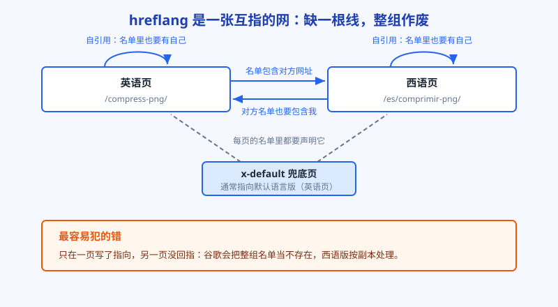
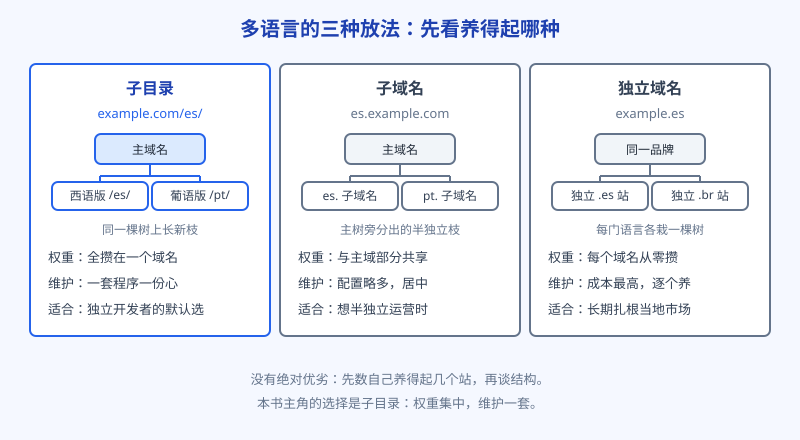

# 第 13 章 多语言站：hreflang 和翻译的坑

主站跑顺了，下一个念头通常是向外扩：同一套工具，换一门语言，是不是就能多吃一个市场？还真能，而且逻辑有点诱人：英文市场卷成红海的词，换到西班牙语、葡萄牙语市场，对手可能少一截，用户的需求却一点不少。但多语言站也是全书第一个真正容易把人绕晕的课题，坑大多不在翻译，在一套叫 hreflang 的声明上。这一章先把坑说清，免得你和阿哲一样，在同一个地方摔一跤。

## 白话讲解

**先分清语言和地区。**

语言是说什么话，地区是人在哪。hreflang 的标注用的就是语言加地区的组合：`es` 是西班牙语（不分地区），`es-ES` 是西班牙的西班牙语，`es-MX` 是墨西哥的西班牙语。同是西语，西班牙人说 ordenador，墨西哥人说 computadora，词汇和用法都有差别。多数工具类、内容类站点，按语言做一版就够了；只有价格、配送、法规这些和土地强绑定的业务，才需要细到地区。上来就按国家拆十几个版本，是给自己挖运维的坑。

**hreflang 到底是什么。**

它不是翻译工具，也不是排名开关。把一个页面想成一家连锁店的分店，hreflang 就是总店贴在每间分店门口的总名单：本店是西语店，这套班子在别的城市还有英语店、葡语店，地址都在这儿。谷歌的爬虫每到一个版本，就靠这份名单确认：哦，这几页是同一个页面的不同语言版本，用户搜的是哪种语言，就把哪家分店推给他。

它解决的问题只有一个：别推错版本。美国用户搜到西语页、西班牙用户点开英语页，都是推错。推错的代价是用户秒退、谷歌困惑。至于每个版本自己能不能排上，还是看它自己的内容和权重，名单写得再工整，也不会给排位加分。

**三条铁规，犯一条整组作废。**

- **双向互指。** 英语页在名单里写了西语页，西语页的名单里必须写回英语页。单向的声明，谷歌不认，整组忽略。道理像介绍信：只有一方承认的关系，等于没关系。
- **自引用。** 每一页的名单里，必须包含它自己。很多人以为名单是列出其他版本的地方，把自己漏了，名单同样不成立。
- **每页同名单。** 同一组页面，每一页贴出的名单应该一字不差地相同：英语页、西语页，将来再加葡语页，三页贴同一份名单，各自的网址都在里面。另加一条兜底：名单里放一个 `x-default`，指向默认版本，给语言对不上号的用户和爬虫一个去处。

名单写在哪里，也有三种选择：写在每个页面的 HTML 头部里，最直观，页面少时用它；通过 HTTP 响应头发送，适合没法改页面的情况；写进站点地图文件，一组页面的对应关系在地图里集中声明，页面多、版本多时最好维护。选哪种都行，关键是别三种混着写还互相矛盾，谷歌只会更糊涂。新手用页面头部，老老实实一页一页贴，先把对错弄明白，再考虑搬家到地图里。

**还有一个常打架的邻居：canonical。**

canonical 是页面自己声明的正本网址。多语言最常见的乌龙是：西语页的 canonical 指回了英语页。这话翻译过来就是：别收我，我是英语页的副本。这和你要推西语版的意图正好相反，西语页会被干脆合并进英语页，永远出不了头。每个语言版本的 canonical，只许指向它自己。

还要泼一盆冷水：hreflang 救不了内容不对等的版本。如果你的西语页只是英语页的标题翻了一下、正文空空如也，名单写得再规范，谷歌也不会愿意把这么个空壳推给西语用户。每个语言版本都要是能独立站住的页面：内容对等、功能对等、内链对等。多语言的成本大头在这里，不在那几行声明上。预算不够时，宁可少开一门语言，也不要开一门只有空壳的语言。

生效之后怎么验证？土办法最可靠：把浏览器语言切成目标语言，或者用目标语言的说法去搜你的核心词，看谷歌推给你的到底是哪个版本。Search Console 里也可以按国家拆分数据，西语市场开始有展示和点击，说明版本推对了、人也找对了。验证这一步别省，名单写错的人，多半是写完从来没验过。

**结构选哪种。**

同一门语言的内容放哪儿，有三种摆法：子目录（主域名后面接 `/es/`）、子域名（`es.` 开头的独立子域）、独立域名（单独注册当地域名）。图 13-2 做了对比。给独立开发者的默认答案是子目录：权重全攒在一个域名上，维护也只要一套，缺点是和主域共命运。独立域名在当地用户眼里信任感最强，但每个域名都要从零养，账在第 12 章算过。子域名居中，两边都不极端，麻烦也居中。

再加一条内链纪律：语言版本之间，各自内部也要成网。西语的工具页要链向西语的教程和西语的兄弟工具页，而不是图省事链回英语版。链错语言，用户点过去一脸茫然，谷歌也会怀疑你这西语版是不是个空壳。一组语言版本，就是几张平行的小网，结构互相镜像，平时各过各的日子，只靠 hreflang 名单互相认亲。

**翻译质量：机翻打底可以，直发不行。**

界面上的按钮、标题、工具说明，是用户对你的第一印象，术语翻错的杀伤力比语法瑕疵大得多：把压缩翻成压迫，再流利的句子也救不回来。稳妥的做法是机器翻译出稿，母语者只校对关键页面：首页、工具页、付费页。长尾的教程文章可以排队等，但门面要先过人眼。

如图 13-1 所示，一组双语页面的关系是张小网：箭头要成对出现，每页脚下还有一根指向自己的线，最下面是 x-default 兜底。检查你自己的站时，就按这张图数箭头：缺哪根，补哪根。

图 13-2 对比了三种放法的账：子目录省事且权重集中，子域名半独立，独立域名最像本地生意，但成本和养护都翻倍。没有最好的，只有你养得起的。

## 阿哲的站

阿哲选的第一门外语是西班牙语。选它的理由是查过数据的：图片压缩这类词的西语搜索量不小，comprimir imágenes 一类词的竞争又明显弱于英文；他的工具本身没有地区属性，语言对了就能用。

结构上他没犹豫，子目录，`/es/` 前缀，和主站共用一套程序和模板，只换文案。范围上他做了取舍：第一批只翻十二个页面，首页、两个分类页和搜索量最高的几个工具页，教程文章一律排队。道理很简单：先让谷歌把西语版的门认下来，看看有没有点击进来，再决定要不要把剩下的页面补齐。全站一起翻，万一方向错了，返工也是全站级的。动手前他把第 9 章的规矩搬了过来：西语版的页面和英语版一一对应，英语有什么页，西语就有什么页，网址里的词也翻成西语，不留半截英文。

坑就出在模板上。他给英语页加上了指向西语页的 hreflang，验收时看着没问题就上线了。西语页的模板是他复制英语页改的，复制时把 hreflang 那一段输出逻辑漏掉了：西语页压根没有名单。另外，西语页的 canonical 沿用了模板默认值，指向英语页。两个错叠在一起，等于西语版从没向谷歌报过到。

结果毫无悬念：三周过去，西语页一个都没收录，Search Console 里它们以副本身份躺在英语页名下。他排查的顺序值得学：先怀疑名单，拿两个页面的源代码对照着数箭头，发现互指断了；再顺手查 canonical，发现指错了人。两个问题一起改：全站每一页都由同一段代码生成完整名单，自引用、互指、x-default 齐全；canonical 改成各指自己。

改完之后他学乖了，上线新语言之前，先在本地数一遍箭头再发布。西语页在改对之后的两周上下开始陆续收录，先从竞争小的长尾词来了每天几十次点击。数不大，但对一个刚出海的语言版本来说，这是从 0 到 1 的信号，比数字本身重要。第二批扩页时他学聪明了，不再按自己的喜好挑，而是看英语版哪些页面已经有稳定点击，就先做哪些页面的西语版：需求被验证过的页面，换个语言大概率还有需求。这叫让数据排队，不让热情排队。

翻译上他没省门面钱：首页和几个核心工具页，请了一位西语母语的兼职按小时校对，教程文章先用机翻稿垫着，打上排队标记，等核心页稳了再逐篇过人眼。校对还真挑出个笑话：某个转换页的西语标题里，convertir 被他拼错了一个字母，自己盯着看了十遍愣是没看出来。这类错对排名影响有限，对信任影响却很大，用户会想，连招牌都写错的站，文件交到它手里放心吗。

主站还没站稳之前，他也不建议任何人急着开多语言：没有稳定流量、没有管翻译的人、没有每月回头检查的工夫，多语言只会多出一份要操的心。阿哲动手的前提，是主站已经有稳定点击、西语版有人校对、自己也立了每月验一次推流版本的规矩。三个条件缺一个，他都会把这件事往后推。

## 翻车现场

这一跤摔在语言跳转上，主角是一个做菜谱的站，内容是真好，多语言版本也做了五种，偏偏流量只来自英语市场，其他语言跟没做一样。

它犯的错在今天看来很典型：为了让用户体验显得智能，它上了按 IP 和浏览器语言自动跳转的逻辑。用户从哪来，就给看哪种语言，点错了都不给你自己切的机会。听起来贴心，坏就坏在谷歌的爬虫也吃这一套：爬虫主要从美国的机房出发、带着英文环境来访，于是每次都被稳稳地跳回英语版，另外四种语言的页面，它连门都没进过。站长在后台看着五种语言的页面都在，以为万事大吉，其实在谷歌的索引里，这个站只有英语版存在。

更冤的是真实用户：西班牙用户从搜索结果点进西语菜谱的链接，因为用的网络出口在别国，被跳转到英语首页，莫名其妙，关掉走人。跳出率的数据在那摆着，站长还一直以为是翻译质量的问题，白请人重译了一遍。

救法是拆掉智能：关掉强制跳转，每个语言版本有自己稳定的网址，谁来都不跳；顶部最多挂一条小提示，说有你母语的版本，你愿意就点过去。爬虫能直达每个版本，用户也不再被绑架。两个月后，其他语言的收录和流量才陆续对上它内容应得的份。这件事还有一半教训：凡是按访客特征区别对待的自动化，上线前先把爬虫代入一遍想一遍，它享受的往往是最差的那一档待遇。

## 要点回顾

- 先分语言再谈地区：多数站按语言做一版就够，细到国家是运维负担。
- hreflang 是分店名单不是排名开关：作用只有一个，把对的版本推给对的人。
- 三条铁规：双向互指、每页自引用、全组同一份名单，外加 x-default 兜底。
- 每个语言版本的 canonical 只许指向自己，指回主语言等于自愿当副本。
- 默认选子目录：权重集中、维护一套；千万别用强制跳转招待爬虫和用户。
- 每个语言版本各自成网，内链别跨语言乱指，版本之间只靠 hreflang 名单认亲。

## Kata

1. 拿自己站上一组双语（或准备做的双语）页面，手写一份完整的 hreflang 名单，逐条核对：互指成对吗、自引用在吗、x-default 有吗？
2. 检查多语言页面的 canonical：随便抽三个语言版本，看它们是不是各指自己；凡是指回主语言的，记进修复清单。
3. 选题练习：拿你主打的词，去查它的西班牙语和葡萄牙语说法，再看这两个语种的搜索结果前十名质量如何，评估哪门语言值得你先开。
