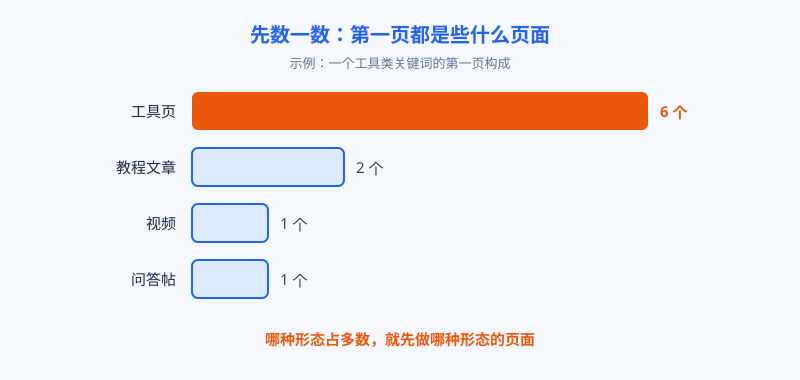
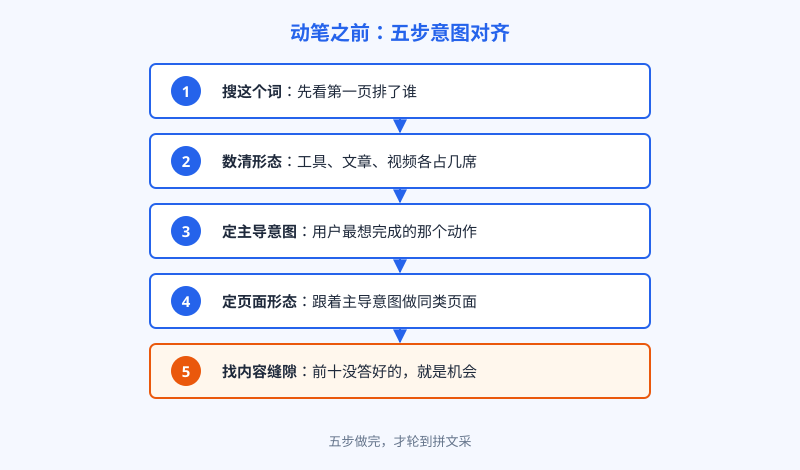

# 第 14 章 先对意图，再谈文采

## 白话讲解

前两篇我们把词选好了，站也搭起来了。接下来是最容易让人自我感动的一步：写内容。很多人的做法是这样的：选一个词，打开文档，凭自己对这个词的理解闷头写三千字，写完觉得文采飞扬，一发布，三个月过去，排名还在五十名开外。问题通常不在文采，在意图。

意图这个词，第 2 章讲过四分类：找网站、找答案、做比较、要下单。这一章把它落到操作上。所谓对意图，说白了就是一句话：用户搜这个词的时候，心里想完成的那个动作是什么，你的页面能不能让他当场完成。想用工具的人，你给他工具；想查步骤的人，你给他步骤；想比参数的人，你给他对比表。给错了东西，写得再漂亮也是答非所问。

怎么知道用户到底想要什么？不用猜，搜索引擎已经替你做过海量民意调查了，结果就摆在搜索结果第一页。动笔之前，先把这个词搜一遍，数一数第一页都是什么页面。如图 14-1 所示，如果前十名里六个是工具页，两个是教程，一个是视频，一个是问答帖，结论就很清楚：搜这个词的人，大多数是来找工具直接上手的。这个构成，就是搜索引擎用点击数据投出来的票。

*图 14-1：第一页的形态构成，是搜索引擎用点击数据投出来的票*

数完形态，还要看第二层：这些排在前面的页面，具体在答什么。把前三名到前五名逐个点开，记下三件事。第一，它们共同回答了哪些问题，这是这个词的必答题，缺了就是内容不完整，连进场的资格都没有。第二，它们各自有什么不同：有人加了对比表，有人加了视频演示，有人加了在线计算的小工具，这是各自的加分项。第三，它们都没答好、或者干脆没人答的问题，那是留给你的缝隙。必答题决定你能不能进场，加分项和缝隙决定你能不能往前挤。

还有一层经常被忽略：内容的深度也是意图的一部分。前十名普遍是三百词的短页面，说明用户要的是快答案，你写三千词就是自找没趣；前十名普遍是长文加数据表，说明这个词的用户愿意细读，你写五百词就会被判定为太薄。深浅没有统一标准，标准就藏在前十名的平均水位里。你的目标不是写得最多，是比平均水位多答好那条缝隙。

除了页面本身，搜索结果页上还有几个免费信号值得看。如果某个词的结果页顶部挂着精选摘要，说明这个词有相当一部分人在找一个一句话能说清的答案，你的页面里就该有一段能被直接引用的定义。如果视频卡片排得很靠前，说明很多人更愿意看演示，纯文字页面就先天吃亏。如果"用户还问"的问题框里反复出现同一个问题，那这个问题就是必答题里的必答题，记得把它写进小标题里。这些信号不用任何工具，搜一下就全看见了。

举个例子，把这套看法完整走一遍。假设你要做一个词："照片变清晰"。先搜一遍，前十名里有六个是在线工具，三个是手机应用的下载页，一个是教程。结论一：主导意图是上手处理照片，页面主体必须是工具。结论二：应用下载页也能进前十，说明有一批人在找手机端的方案，你的工具页如果在手机上用着别扭，就先输了一截。再看必答题：前五名都有的，是上传照片、处理前后对比、下载结果，这三件缺一不可。再看缝隙：前十名大多只处理单张，可问答区里老有人问能不能批量处理，批量就是你可以打的那条缝隙。五分钟，一张意图卡片就填满了，这时候再谈怎么写，不会跑偏。

看完之后，动笔的顺序要反过来：先定页面形态，再列内容清单，最后才写句子。如图 14-2 所示，这五步做完，文采才有发挥的地方。顺序千万别颠倒。文采的作用，是在意图对齐的前提下让用户多停留一会儿、多信你一分；意图没对齐，文采越好，用户越快确认"这不是我要的"，然后关掉页面。

*图 14-2：五步意图对齐，文采排在最后一步之后*

还有一个细节：同一个词，意图可能是混合的。比如"图片压缩"，主导意图是找工具上手，但也混着一部分想了解原理的人。处理办法是主次分明：页面主体伺候主导意图，次要意图用一小节或者一个内链接住，不要五五开。五五开的页面两边都不讨好。这也是第 2 章那句"一个页面只伺候一个意图"的真正含义：不是只许有一个意图，是只许有一个主导意图。

再往细一层看：形态对了，顺序也可能错。工具页把三千字说明堆在上传框前面，用户划半天找不到入口，照样关掉；教程页把结论埋在最后一段，急着找答案的人也留不住。所以对意图还有一个下手处：页面内部也按用户需求的急迫程度排序。最想完成的动作放在最前面，解释和背景放在后面，第一屏先给答案，长尾巴留给愿意细看的人。这不只是体验层面的事：用户进来就走，还是停下来把事情办完，这些行为最后都会以某种方式回到排名里。标题同理，标题是你在结果页上和用户说的第一句话，要把主导意图直接写进去。找工具的人，看到标题里有"在线""免费用"才会点；找对比的人，看到"区别""哪个好"才会点。标题再有文采，和意图对不上，点击率先输一截，后面的内容写得再好，也没人能看见。

最后留一个自查动作：内容写完、发布之前，把你的页面和前三名摆在一起，问自己一句：如果我是用户，点开这十个结果，我的页面凭什么是值得多停留的那一个？答不上来，就说明必答题没答全，或者缝隙没打中，先别发，改完再说。

还有一件事要提醒：意图不是一成不变的。同一个词，三年前搜的人想看文章，三年后可能就想用工具，因为用户的习惯被新产品教育过了；一个新功能发布、一部热门剧播出，都能让一个词的意图构成在短时间内翻面。所以核心词的意图卡片不是填一次就完事的，隔几个月要重新数一遍前十。发现形态构成变了，就要考虑把页面跟着改。把意图当成需要定期复检的变量，而不是开工时的一次性判断，是这一章最后一个动作。

## 阿哲的站

阿哲在这件事上交过学费。他站点上线初期，主打词之一是"compress image"。他当时的想法是：这个词竞争激烈，自家工具在功能上不占优势，那就用内容取胜。他花了整整三天，写了一篇三千多词的英文长文，把有损压缩、无损压缩、采样原理讲得头头是道，自认为是全网讲得最清楚的一篇。结果两个月过去，这篇文章的排名一直在五六十名徘徊，每天带来的访问只有个位数。

复盘时他才第一次认真去数前十名：十个结果里九个是工具页，进门就是上传框，剩下一个是百科条目。他这篇讲原理的长文，形态上就进错了考场。搜这个词的人，手机里正躺着一张传不出去的图，他要的是立刻把图压小，不是来上课的。

他按图 14-2 的五步重做了这个页面：工具提到最上面，打开就能用；原理部分砍到三百来词，挪到工具下方，改成"想了解原理的往下看"；再补上前十名都没写清楚的一个问题：图压完了，为什么还是传不上某些平台，并附了一张常见平台的图片大小限制对照表。这张表，就是他数前十时发现的缝隙。改完大约六周，这个页面爬进前十，守在第八名上下，这个词带来的日访问从个位数涨到两百多。功能一点没变，变的只是页面回答问题的方式。

这套办法在他另一个页面上又验证了一次。有个对比类的词"png vs jpg"，搜的人是来做选择的：发社交平台用哪个，长期存照片用哪个。他先数前十：一半是对比文章，一半是问答，没有一个工具页。于是他老老实实写对比文：开头一张表，把体积、透明通道、画质三项列清楚；正文按场景逐个给结论；最后一句给一锤定音的建议。这篇文章没费多大劲，两个月就进了前五，成了站里最稳定的流量来源之一。同一个站，工具词用工具页打，对比词用对比文打。他后来的说法是：内容这件事，先有对词下药，才有写得好。

形成习惯之后，他给每个核心页面都建了一张小卡片：这个词的主导意图是什么，前十的形态构成是什么样，必答题清单有哪几条，我打的那条缝隙是什么。新页面动笔之前先填卡片，填不出来就不许写。这个笨办法后来成了他整个内容流程的地基，下一章的程序化页面，用的也是同一套判断。

## 翻车现场

有一类翻车，和阿哲这个是亲兄弟。有个做家居内容的站长，看中了一个小家电的选购词，搜索量不小。他判断这个词需要"深度内容"来打，于是请人写了一篇近万字的长文，从工作原理、发展历史一路写到选购参数，配图精美，前后花了小两千元。文章发出去之后，排名长期在三十名开外，流量寥寥无几。

他想不通，去问同行，才被点醒：这个词的前十名，清一色是电商导购页和榜单页，卡片式的产品对比、价格区间、适用人群一目了然，用户的动作是"挑一款下单"。他那篇万字长文，干的是百科的活，跑到了导购的考场里。参数讲得再全，用户也嫌慢，看两眼就退回去点导购页了。

后来他把这批内容重新摆了位置：文章主体改成导购形态，原来的参数积累重新组织成对比表和选购清单；原文里的深度部分拆成两篇科普文，从导购页用内链引过去。两个月后，导购页进了前五，两篇科普文也各自吃到了长尾词。钱没有白花，内容也没有白写，错的只是第一次把内容摆错了位置。

这类翻车有个共同点：复盘时大家总爱说"内容质量不够"。其实"质量"这两个字太笼统，容易把人带偏。更多时候内容本身并不差，差的是没有先去看看考场长什么样，就急着交卷了。

后来这个站长学乖了：每接一个新词，先花半小时把前十名拆开看一遍，再决定请人写什么。有意思的是，他的内容成本反而降了，因为返工少了。先看考场再答卷，慢的只是动笔前那半小时，省的是发布之后那三个月。

## 要点回顾

- 写内容之前先搜词数前十：页面形态的构成，就是用户意图的投票结果。
- 前十名共同回答的问题是必答题，没人答好的问题是你的缝隙，两样都要记下来。
- 结果页上的附加信号也别放过：精选摘要、视频卡片、"用户还问"，都在提示意图偏好。
- 动笔顺序是形态、清单、句子，文采排在最后；意图错了，文采帮不上忙。
- 意图可以混合，但主导意图只能有一个，次要意图用小节或内链接住。
- 发布前自问一句：十个结果里，用户凭什么在我的页面多停留？

## Kata

1. 挑你站点的一个核心词，把第一页十个结果逐个点开，按工具页、文章页、视频、问答、商品页分类计数，再判断这个词的主导意图是什么。
2. 找一篇你已经发布、但排名在二十名开外的页面，对照前三名列出它的必答题缺口：少答了哪几个问题，哪些问题答得比前三名浅？
3. 给你的下一个页面先填一张意图卡片：主导意图、前十形态构成、必答题清单、你准备打的那条缝隙，填完之后再动笔写正文。
