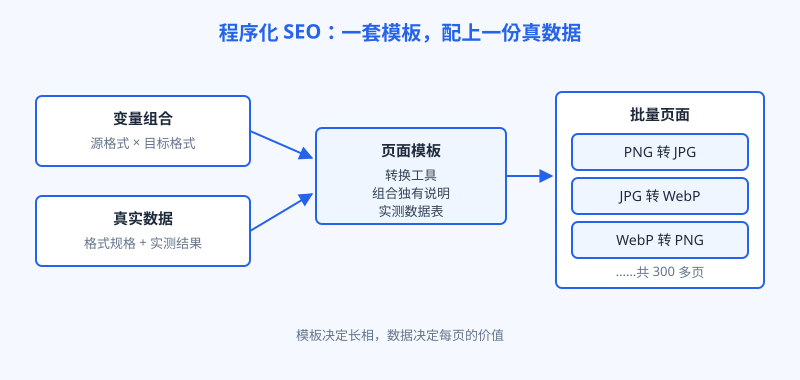
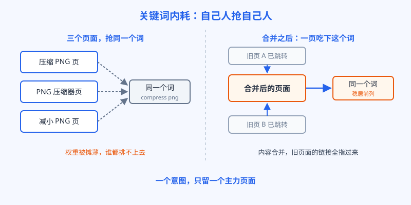

# 第 15 章 程序化 SEO

## 白话讲解

先说一个场景。阿哲的工具站要做一个"JPG 转 PNG"的页面：一个转换工具，加一段说明。做完之后他想，既然 JPG 转 PNG 能做，那 PNG 转 JPG、PNG 转 WebP、WebP 转 JPG 是不是都能做？常见图片格式两两组合，有几十种；再加上每种格式各自的压缩页，又是几十种。靠手写，一种组合写一页，要写到猴年马月。程序化 SEO 解决的就是这个问题：把页面拆成"模板"和"数据"两部分，模板写一次，数据灌进去，批量生成页面。

打个比方：模板是信封的版式，数据是收件人名单。版式设计一次，名单里有一千个人，就能打出一千封各不相同的信。放到网页上，如图 15-1 所示，一条程序化流水线有三个部件：可枚举的变量组合、一份真实数据、一个承载数据的模板。三样缺一样都不成立：没有变量组合，就没有批量；没有真实数据，页面就是换皮；没有模板，数据没地方待。

*图 15-1：程序化 SEO 的流水线，模板负责长相，数据负责价值*

三个部件里，最要紧、也最容易被偷工减料的是数据。每一页都必须有别页没有的真实信息，这页才有独立存在的资格。数据的来源通常有四类。第一类是公开的规格和标准，比如图片格式里 PNG 支持透明通道、WebP 支持动图，这些是写在规范里的事实。第二类是官方参数和文档。第三类是自己实测出来的数据，比如拿同一批样本图，实测每种转换之后体积变化多少。实测数据别人抄不走，是最硬的一类。第四类是真实的用户需求组合，也就是大家确实在搜的那些长尾搭配。前两类保证内容正确，后两类保证内容有别人没有的东西。

变量组合也不是排列得越多越好。每一个组合格子，先问一句：真的有人搜这个吗？没人搜的组合，生成出来就是一页零需求的孤页，白白占着抓取和维护的成本。阿哲的格式组合有几十种，他没有全做，只做了两类：一是工具日志和搜索数据里真实出现过的，二是在规格上有明确意义差异的。剩下那些理论上成立、实际上没人用的组合，他宁可空着。程序化的克制，一半体现在数据上，另一半就体现在这种取舍上。

模板这一环也有讲究。模板不只是排版，它决定了每一页的骨架：标题怎么写、网址怎么拼、页面从上到下有哪几块、块与块之间怎么互相链接。骨架定得好，三百页看起来整齐划一，用户在任何一页学会的用法，到另一页都通用。还有一件事要在模板里预先想好：这批页面彼此之间怎么链、新页面挂在哪个目录下、和已有的手工页面是什么关系。等生成完了再补内链，是个体力活，还容易漏。

网址和标题也要在模板阶段就定死规则。网址里带上变量组合本身，比如转换页的网址直接写成"源格式转目标格式"的样子，用户看一眼网址就知道这页是干什么的，搜索引擎也一样。标题同理：每页的标题必须因为变量不同而天然不同，而不是靠编号硬凑。反过来检验一下：如果把几百个标题遮住变量部分，看起来全是同一个句式在换词，那就说明这批页面的差异只剩下变量本身，数据那一环大概率是空的。

把丑话说在前面：程序化不等于采集，更不等于洗稿。区别就一条：你的每一页，是不是真的能独立解决一个具体问题。用户点进"JPG 转 WebP"页面，能当场完成转换，能查到这个组合独有的注意事项，比如转完之后透明通道会不会丢，这页就成立。如果页面之间只有标题和几个词不一样，内容全是同一段话换个说法，那不叫程序化，那叫复制。复制能复制多快，搜索引擎算账时就有多狠，第 17 章会专门讲这种下场。

程序化页面还有一个只有自家人才会犯的错：关键词内耗。变量组合切得太细，就会生出一堆意图几乎相同的页面。比如"压缩 PNG""PNG 压缩器""减小 PNG 体积"，用户搜的词写法不同，心里想的是同一件事。你却做了三个页面去接，搜索引擎要在三个亲兄弟里挑一个代表，挑来挑去挑花了眼，结果是三个都排不上去，权重被自己人摊薄了。如图 15-2 所示，内耗的解法不是把多余的页面删掉了事，而是分工：一个意图只留一个主力页面，内容合并过去，老页面用 301 跳转，把权重和已有的外链都指到主力页上。

*图 15-2：关键词内耗与合并解法，一个意图只留一个主力页面*

合并的时候还有两个动作别漏。一是站内所有指向老页面的内链，顺手改到主力页上，不要指望跳转替你传话，每多跳一层就多损耗一点。二是合并之后观察几周，主力页的名次常会先小幅波动、再往上走，别三天没见效就急着拆回去。

怎么发现内耗？有个土办法：在搜索引擎里用 site 语法搜你的域名加上目标词，看是不是冒出来好几个自家页面在抢。再进一步观察：如果同一个查询下面，几个自家页面轮流露脸、名次还都不高，就是典型的内耗信号。第 21 章讲 Search Console 时，会讲一种更准确的看法，先在这里埋个头。

再给薄页划一条下限。一页程序化页面，至少要有四样东西：一，用户要的那个功能或答案，进门就能用；二，这页独有的数据，哪怕只是一行实测结果；三，这页独有的一段说明，讲清这个组合和别的组合有什么不同；四，通向相关页面的内链，让用户能顺着往下走。四样里缺了独有数据和独有说明这两样，这页就是空壳，数量再多也只是给未来的自己攒风险。上线之后还要抽检：每周随手点开几页新生成的页面，像用户一样完整用一遍。模板驱动的站最怕的，是模板悄悄坏了一处，几百页一起带着同一个错误，还没人发现。

最后一个问题是节奏：批量不等于一次全放出去。稳妥的做法是分批，先上五十页，观察两周，看收录了多少、哪些页开始有展示，确认模板和数据都没毛病，再放下一批。一口气放五千页，等于把全站的命运押在一次没验证过的模板上。模板上有个小毛病，五千页一起陪葬，连排查都无从下手。

## 阿哲的站

阿哲的格式转换页就是这么建起来的。变量是两个：源格式和目标格式。六种常见格式两两组合，去掉自己转自己，得三十个转换页；再加上六种格式各自的压缩页，以及搜索量最大的几个组合的参数版本，最后铺到三百多页。

数据这一块他下了笨功夫。规格部分，他把六种格式的规范要点整理成一张表：压缩方式、透不透明、支不支持动图、尺寸上限。实测部分，他找了五十张有代表性的样本图：照片、截图、插画、带透明底的图标各挑一批，写了个脚本把所有转换组合批量跑完，记录每种组合的平均体积变化和画质损失。这样每个页面上都有一段别处没有的内容：一张这个组合的实测数据表，外加一句结论。比如"照片类的图，JPG 转 WebP 平均还能再小三成；带透明底的图转 JPG 会丢掉透明通道，别转"。工具是每页都有的共性，数据才是每页的个性。

上线节奏按前面说的分批来：先放六十页，两周后收录了五十多页，有十几页开始有展示，他才把剩下的两百多页分三批放完。三个月后回头看，这批程序化页面贡献了全站一半以上的搜索流量，其中表现最好的不是大词页，而是几个具体的长尾组合页，单个页面日访问也就几十到几百，胜在数量多、加起来可观。

他还给自己定了一条停损线：每一批新页面放出去两周后看收录率，低于一半就先停，不许放下一批，先回头查模板和数据哪里出了问题。第三批时真触发过一次：一批四十多个页面只收录了十几个，查下来是模板改版时把每页独有的那段说明弄丢了，页面之间相似度太高。补回去重新提交，两周后收录才回到正常水平。他说这条停损线救过他一次：要不是它拦着，他会带着这个毛病把剩下的页面全放出去。数据维护上他也排了日程：每季度重跑一遍实测脚本，把各页的数据表更新成最新结果，并注明实测时间。规格会变，工具会升级，数据表停在两年前的页面，会慢慢从资产变成负债。

内耗他也实打实地踩了。早期他给"compress png"这个意图做过三个页面：一个是最早的工具页，一个是后来程序化生成的近义页，还有一个是博客里写的教程页。三个页面在同一个词上轮流露脸，名次在三十到五十名之间晃，谁也上不去。他把教程页里有用的内容并进工具页，教程页用 301 跳到工具页，程序化的近义页直接下线并跳转。合并之后大约一个月，工具页稳稳进了前十五名。他从此立了条规矩：新生成一批页面之前，先把变量表和已有页面比对一遍，意图重合的，宁可少生成一个。

## 翻车现场

程序化做砸的，通常不是技术不行，而是数据那一环偷了懒。有一个做生活信息类的站，思路和阿哲类似：城市加服务的组合页，模板现成，城市名单现成，一口气生成了两万多页。上线第一个月看着还挺热闹，抓取量涨得很快。可是点开任何一页看，除了城市名和几个地名，内容几乎一模一样，当地的联系方式、价格、注意事项要么是空的，要么是从别处拼凑来的。

三个月后，这批页面的收录率掉到不足一成，Search Console 里堆满了"已抓取，尚未编入索引"。更糟的是，整站的抓取都被这批空页拖累，原本正常收录的栏目也开始掉页。搜索引擎每天来你站上的次数是有限的，两万多个空页排在前面，真内容就轮不上被看。

站长后来复盘，说了一句很实在的话：他当时觉得模板做得越像那么回事，搜索引擎越会买账。其实反了，搜索引擎最后只认一件事：这页上有没有别处没有的东西。补救时他做了减法，只保留有真实本地数据的三百多个城市页，其余全部下线，剩下的页面把数据一条条人工核对补齐。半年之后，站的收录才慢慢回到正常水平，流量只恢复到出事前的六成左右。两万多页的热闹，最后换来三百多页的踏实。

这个案例和阿哲的区别，不在规模，在每页的含金量。程序化放大的，是你手里已经有的东西：有真数据，放大的是价值；没有真数据，放大的是风险。

## 要点回顾

- 程序化 SEO 是模板加数据：变量组合决定数量，真实数据决定每页有没有资格存在。
- 数据来源按硬度排序：自己实测的最硬，其次是官方参数和公开规格，拼凑抄来的垫底。
- 每页要能独立解决一个具体问题；只有标题不同的页面不叫程序化，叫复制。
- 模板要预先想好网址、内链和目录归属，生成完再补这些，成本翻倍。
- 关键词内耗是自家页面抢同一个意图，解法是合并加 301，一个意图只留一个主力页。
- 上线要分批：先小批量验证收录和展示，再放量，别把全站押在一次模板上。

## Kata

1. 拿你站点的一组程序化页面随机抽十页，逐页回答：这页有什么信息是其他九页都没有的？答不出来的页，列出来准备合并或者补数据。
2. 用 site 语法搜你的域名加核心词，数一数同一个意图下有几个自家页面在抢，再画一张合并方案表：谁当主力，谁跳转过去。
3. 设计你自己的变量表：列出两个变量的所有组合，先圈出意图重合的组合，再决定最终生成多少页，并写出分批上线的节奏。
