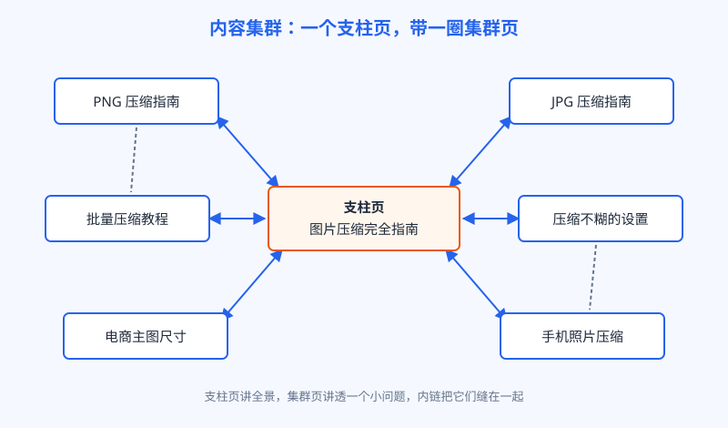

# 第 16 章 内容集群

## 白话讲解

先看一个常见场面：一个站写了三十篇教程，篇篇都是好内容，可就是不涨排名。单看每一篇都没毛病，问题出在篇与篇之间：它们彼此不认识。用户读完这篇，不知道还有下一篇；搜索引擎看完这篇，也判断不出这个站在这个领域到底有多深。三十个散兵游勇摆在那里，就是三十个孤页。这一章要解决的，就是把散页攒成集群。

这个问题说到底是权重分散。每个页面能分到的关注都是有限的，孤页只能靠自己，集群页背后有一整组页面互相引荐。同样是三十篇好内容，散着放和攒成组放，差距会越拉越大。差的不是内容，是组织。

内容集群的结构不复杂，如图 16-1 所示，就两种页面。一种叫支柱页：选一个大主题，写得宽而全，目标是接住这个主题最大的那个词，它像一本书的目录页加总论。一种叫集群页：每页只讲透主题下的一个小问题，接一个长尾词，窄而深。两种页面用内链缝起来：支柱页链向每个集群页，集群页链回支柱页，相近的集群页之间再按相关性互相链。

*图 16-1：内容集群的星形结构，支柱页与集群页双向链接*

为什么这么摆会有用？接着用图书管理员的比方：搜索引擎判断一个页面值不值得排前面，除了看这一页本身，还会看它背后站着谁。一个孤页，背后空无一人；一个集群页，背后站着一个支柱页和一圈兄弟页，等于整个专题在给它作证。反过来，一圈集群页都在往支柱页输送内链，支柱页在大词上的分量也跟着变重。这就是大家常说的主题权威。说白了就是：在一个小领域里成体系，搜索引擎更愿意信你。集群打法的全部秘密，就是用内链把这个体系显形出来。

支柱页怎么写，也有个常见误区：很多人把支柱页写成一篇更长的文章，恨不得把每个子问题都讲透。结果是支柱页和集群页内容重复，反而和自己的集群页抢词，又回到上一章说的内耗。支柱页正确的写法是目录式的：每个子问题讲清要点、给出结论，细节留给集群页，想深挖的读者点过去。支柱页的价值在全景和分发，不在深度。还有一个动作别忘：集群里新增了页面，要回头把支柱页对应的那一节补上链接和简介。支柱页是活页，不是一次写完就供起来的。

集群的扩张节奏也要克制：一口气规划五个集群，每个都只有三五页，等于把散页换了种摆法重新散一遍。正确的做法是先把一个集群做透：支柱页加十来篇集群页，内链缝好，看着这一组有起色了，再开第二个集群。搜索引擎对"成体系"的判断，需要的不是你宣称有多少个专题，而是至少有一个专题真的深。深度先于广度，这句话在集群这里，和在单篇文章里一样成立。

怎么判断一个集群算不算做成了？看三个信号。一是整组的展示量在涨，而不是只有某一篇在涨，说明搜索引擎开始把你当成这个主题上的一个整体。二是支柱页开始吃到越来越多相邻的词，覆盖面在变宽。三是新发的集群页，收录和起量的速度明显比以前的孤页快，说明组里的内链和信任在给新页铺路。三个信号里出现两个，这个集群就立住了，可以考虑开下一个。反过来，如果只有个别页面有量、整组纹丝不动，多半是地图画错了：那些子问题之间其实没有那么强的关联，是被你硬攒成了一个集群。

内链里有个细节值得单独说：锚文本，就是链接上显示的那几个字。锚文本是给搜索引擎看的路牌，告诉它下一个页面是讲什么的。两种常见的错误摆法：一种是全站的路牌都写"点击这里"，等于没写；另一种是反过来，每块路牌都写同一个目标关键词，一篇文章里同一个词加十次链接，读起来像广告，用户烦，搜索引擎也会觉得你在刻意操纵。如图 16-2 所示，正确的做法是让锚文本顺着句子自然出现，说法略有变化：这次写"把图片压小的方法"，下次写"PNG 压缩这一页"，指的可以是同一个页面，读起来都是人话。

*图 16-2：锚文本要自然多样，同一个目标页准备几种说法轮换*

内链的位置也有讲究。正文里的内链最值钱，因为它出现在语境里，读者顺着意思就点过去了；页脚和侧栏那种全站统一的推荐位，用户早就学会了自动忽略，它的作用更多是给搜索引擎看个结构。至于一篇文章放几条内链，没有官方标准，经验上以不打断阅读为准：一篇一千多字的文章，正文里链出两到四条到集群内的页面，读起来还算自然；超过这个数，先问自己是不是在凑数。判断方法很简单：把这条链接删掉，这句话还顺不顺，读者还需不需要它。需要，就留；不需要，就是凑数。

搭集群的顺序也有讲究，不要从写新文章开始，先画地图。把这个主题下用户会问的问题列成一张树状清单：大问题当支柱，子问题当集群页；已经有的页面先归位，缺的再补写。顺序反了，就会一边写一边发现结构对不上，返工的成本全在后面。还有一条纪律：新内容动笔之前先问一句，它归哪个集群？归不进去的，要么说明这篇内容偏离了你的主题，要么说明该开一个新集群了。两种情况，都值得停下来想三分钟。

问题清单从哪来？有三个现成的来源。一是第 14 章数前十时记下的"用户还问"，那些问题就是现成的集群页题目。二是你站点已有的搜索流量数据：哪些长尾词已经有了展示，却没有合适的页面承接，补页去接。三是用户真实问过你的问题：邮件、留言、同行群里的提问，都是没被满足的需求。三个来源凑一凑，一个集群二十多个坑位就列出来了，比拍脑袋想选题靠谱得多。

最后提醒一个边界：集群是组织法，不是许愿池。它能把已有的好内容互相抬轿子，但救不活本身就没答对意图的页面。意图对齐是第 14 章的事，批量生产是第 15 章的事，这一章只负责把它们摆成阵型。

## 阿哲的站

阿哲的图片压缩相关内容，原本是东一篇西一篇散着的：工具页在一个栏目，几篇教程在博客里，格式转换的程序化页面又在另一个目录，彼此之间基本没有内链。他按这一章的办法做了一次归拢。

先画地图。他把"图片压缩"这个主题下用户常问的问题列了出来：大的问题是压缩的原理和通用方法；小的问题按格式分，PNG 怎么压、JPG 怎么压；按场景分，电商主图、手机照片、网站配图各有什么讲究；按疑难分，压完还是太大怎么办、压完变糊怎么办。一共列出二十多个问题。然后定支柱：新写一篇"图片压缩完全指南"当支柱页，结构就是这张地图本身，每一节讲清一个问题的要点，再链到对应的集群页细读。

已有的十几篇教程逐篇归位：内容有重叠的两篇合并成一篇；一篇跑题太远的，降级为博客里的普通文章，不进集群。最后是缝内链：支柱页到集群页、集群页回支柱页，各走一遍；相近的集群页之间，按"读完这篇的人下一篇最想看什么"补横向链接。锚文本全部手写，一句一句顺着正文来，没有用任何自动工具。

动手改的其实只有内链和一篇新支柱页，集群页的正文基本没动。效果是两个月里慢慢显出来的：这一组页面的展示量一起往上走，先是长尾集群页，有四五篇从二三十名爬进了前十；支柱页慢一些，三个月后排到第二页靠前的位置。他自己的体会是，单个页面看不出变化，看整组页面的曲线才看得出区别。集群的价值，体现在"组"这个字上。

这件事还给了他一个意外的好处：内容规划变简单了。以后再想写图片压缩相关的新题目，先对着地图看坑位：哪个子问题还没有页，哪个页的数据该更新了，一目了然，不用再凭感觉选题。地图画一次，后面每次选题都省力。

尝到甜头之后，他用同样的办法收拾格式转换那一片：以"格式转换"为支柱，把第 15 章的程序化转换页按格式家族归成几组，组内互相加内链，再给支柱页补了一段"不知道选哪种格式时先看这里"的导览。程序化页面原本是平铺的一层，归拢之后变成有层次的一棵树。他自己的说法是：第 15 章解决的是页从哪来，这一章解决的是页和页之间是什么关系。两件事都做完，站点才开始像一个作品，而不是一堆页面的堆积。

## 翻车现场

集群的架子好搭，翻车往往翻在内链的执行上。有个站长听完内容集群的课，回去就给全站装了一个自动内链工具：设定好几个目标关键词，只要文章里出现这个词，就自动给它加上指向目标页的链接。一夜之间，全站多了几千条内链，支柱页的内链数看着非常壮观。

问题很快就来了。同一篇文章里，"图片处理"这个词出现了九次，就被加了九次链接，句子读起来疙疙瘩瘩；有些链接加在完全无关的句子上，比如一篇讲收费政策的文章，因为提到了"处理速度"，也被链到了压缩工具页。用户点过去发现文不对题，跳出率明显变高。两个多月后，目标页的排名不升反降，从第二页掉到了第四页。他把自动工具拆掉、内链恢复成人工挑选之后，又花了两个月才慢慢爬回来。

他后来总结得很到位：内链是编辑判断，是"我作为作者，真心建议你接着看这一页"，不是关键词替换。自动工具只认词，不认句子，更不认读者下一步的需求。集群里真正起作用的内链，每一条都应该是作者愿意当面说出口的推荐。数量从来不是重点：阿哲那一组页面，总共也就补了几十条内链，条条都是手挑的。

还有一类相似的翻车是只搭架子不做内容：支柱页写得花团锦簇，集群页却全是凑数的薄页。架子再漂亮，没有真内容撑着，集群就是个空心的。这种就不展开了，回到第 14 章和第 15 章的标准自查即可。

这两个翻车，一个错在把内链当成机械活，一个错在把架子当成内容。归到一句话：集群里没有一步是可以偷懒带过的，画地图、写锚文本、挑内链，全是编辑的判断活。

## 要点回顾

- 内容集群就两种页面：支柱页宽而全接大词，集群页窄而深接长尾。
- 支柱页要写成目录式：讲全景、给结论、做分发，深度留给集群页，避免和自家页面抢词。
- 内链是集群的缝合线：支柱与集群双向链，相近集群页按阅读路径横向链。
- 主题权威说白了就是成体系：一圈页面互相作证，比孤页更容易被信任。
- 锚文本顺着句子写、说法有变化；全写"点击这里"是浪费，全堆同一个词是操纵。
- 搭集群先画问题地图再动笔；新内容先问归哪个集群，归不进就停下来想想。

## Kata

1. 选你站点最重要的一个主题，画一张问题地图：一个支柱问题、至少八个子问题，并把已有的页面逐篇归位，标出缺页的位置。
2. 挑一个你准备重点推的页面，给它写五种自然的锚文本说法，要求每一种都能顺顺当当地嵌进一句话里，不显得生硬。
3. 打开你站内内链最多的一篇文章，逐条检查：每条内链的目标页，是不是读到这里的人真正想看的下一篇？把凑数的删掉，记下删了多少条。
