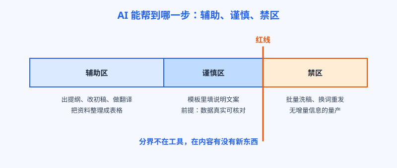
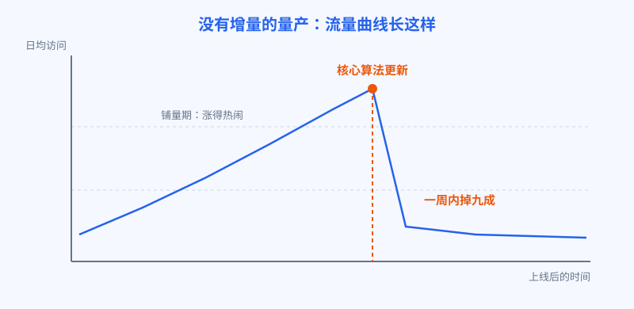

# 第 17 章 AI 写稿的边界

## 白话讲解

这一章聊一个躲不开的话题：用 AI 写内容。先说结论，免得你带着焦虑往下读：AI 写稿本身不是原罪，搜索引擎惩罚的也不是"AI 写的"这四个字。谷歌官方的口径一直很明确：它反对的是低质内容，不管是人写的还是 AI 写的；它看重的是对用户有没有帮助，也不管你用什么工具生产。所以真正的问题不是"能不能用 AI"，而是"用 AI 做什么"。

先看 AI 能帮的忙，这一串是安全的。出提纲：让它把一个题目拆成小节，你再增删调整。写框架：先把每节的骨架句列出来，你往里填事实和判断。改稿润色：把你写通顺的段落修得更顺。翻译：把中文稿译成英文稿，你再校对术语。整理资料：把你查到的规格、参数、数据归成表格。还有第 15 章说的程序化模板：在模板里填入基于真实数据的说明文字。这些活有个共同点：事实和判断来自你，AI 只负责加速表达。如图 17-1 所示，这条线的一边是辅助，一边是禁区，中间还有一段要小心对待的灰色地带。

*图 17-1：AI 辅助光谱，分界不在工具，在内容有没有增量*

禁区是什么？它有明确的名字：规模化内容滥用，英文叫 scaled content abuse。2024 年 3 月，谷歌把它正式写进了垃圾内容政策。认定标准说白了就一句：大量生成页面，主要目的不是帮用户，而是操纵排名，页面本身没有增量价值。换词不换意的同义改写，把别人的内容抓来让 AI 重写一遍再发，用一百个长尾词套同一个模板、生成一百篇除了词什么都一样的文章，都算。注意，这个认定不看生产工具，看的是"规模"加"无增量"这个组合：写一篇没营养的文章是质量问题，写一万篇就是滥用问题。

灰色地带为什么要小心？因为它离红线只有一步。比如程序化页面里的说明文案，让 AI 填，前提是数据真实、每页有别，这个在第 15 章里是成立的做法；可要是把"数据真实"这一条抽掉，模板还是那个模板，立刻就滑进禁区。再比如 AI 翻译整站内容：你自己的原创稿，译成多语言，是正常的本地化；把别人的站整站译过来发，就是另一回事了。判断的关键不在用了哪个环节，而在最后交到用户手里的东西，是不是你的、是不是真的。

为什么无增量的内容注定排不上去？其实不难理解。AI 写出来的东西，是全网已有信息的平均数。你让它写"如何压缩图片"，它给你的每句话都对，但也都是别人写过的。一个页面如果只包含平均数，它凭什么排在平均数前面？排在前面的页面，靠的都是平均数之外的东西：实测数据、亲身经验、独家工具、最新消息。AI 可以帮你把这些东西表达得更好，但变不出这些东西本身。这是整章最重要的一句话：AI 提的是表达的速度，提不了信息的增量。

平均数之外最值钱的，是经验。搜索引擎这些年反复强调一个判断维度：写字的人是不是真的做过这件事。用大白话说，就是你的文章里有没有现场感：参数是你亲手调出来的还是抄来的，结论后面有没有跟一句"我们测了二十组，有一组翻车了"，图片是你自己的截图还是图库里的摆拍。这些细节，用户一眼能分辨，算法也越来越能分辨。AI 生成的稿子最缺的正是这一层：它没去过现场，只能转述去过现场的人的话。所以正确的工作流不是让 AI 凭空写，而是你先把现场材料备齐：实测记录、截图、踩过的坑，再让 AI 帮你组织成文。材料是你的，文章才可能是你的。

也要理解，为什么那么多人明知道悬乎，还是忍不住要踩。算一笔账就明白了：人工写一篇认真的教程，查资料、做实测、大半天写作，成本摆在那里；用 AI 批量生成，一百篇的成本可能还不到一篇人工稿。短期看，量产的回报确实诱人，尤其是在算法还没更新的那几个月。但这笔账漏算了一项：域名信用。手工时期攒下的信任，是按年计算的；量产透支的，也是这个账户。把域名信用折进成本里，量产就不再便宜了，它更像是在借高利贷。用的人要么算不明白这笔账，要么赌自己能在算法收网之前下车。赌赢的个例永远有人晒，赌输的多数都沉默了，你听不见而已。

给你三把尺子，发布任何 AI 参与的内容之前量一量。第一，这页有没有只有我能给的信息：我的实测、我的数据、我的经验，至少占一样。第二，用户看完能不能少走一步弯路：是给了可直接执行的结论，还是正确的废话。第三，假设明天所有同行都用同一个 AI 写同一个题目，我的页面还剩下什么。三个问题都答不上来，这页就不该发，发了也是给未来的自己埋雷。

顺带把一个流行误解掰正：用 AI 参与写稿，不需要在页面上特意声明"本文由 AI 生成"才能排名，也没有任何政策说 AI 稿要被打折。搜索引擎认的是成品质量，不是生产过程的自首。反过来，声明了也没有护身符的作用：一篇无增量的文章，就算写明是 AI 写的，照样排不上去。把心思花在成品上，别花在这些表面功夫上。

如果你的站已经发出了一批无增量的 AI 稿，也不用恐慌，按三步处理。第一步是盘点：把这批页面按有没有真实流量、收没收录分开，真正被用户用上的先留着。第二步是改造：有救的页面补上你的实测和经验，让它重新过一遍三把尺子；没救的、连你自己都不会点开的，干脆下线，不要心疼沉没成本。第三步是止损：停掉新的量产，把更新节奏改回你能认真对待的速度。搜索引擎对肯清理的站向来留有余地，它防的是持续输出无增量的内容，不是一次走错路。怕就怕你一边清理，一边还在偷偷上新。

最后说说风险的形状。手工写的烂内容，死是一篇一篇死，规模化生产的烂内容，死是一批一批死。平时看着流量涨得热闹，其实是把全站的信用押在了一次算法更新上。这个账，阿哲算过一遍；翻车现场里，还有人替所有人交过学费。

## 阿哲的站

阿哲动过这个念头，而且不是想想而已。那段时间，他认识的一个同行用 AI 给一个教程站一天发五十篇文章，流量肉眼可见地往上涨，还在同行群里晒数据。阿哲看着自己的更新速度：一周两篇，每篇要查资料、做实测、再写大半天。要说不眼热，是假的。

他给自己留了个底线：先小批试，不动主力内容。他挑了二十个长尾问题，用 AI 生成教程文，自己通读一遍，把明显的错误改掉，就发出去了。两周之后看数据：二十篇里只有三篇被收录，有展示的几个词，排名都在三十名开外；点进来的用户，停留时间短得可怜。他把其中两篇和排在前面的页面逐段对比，结论让他有点泄气：内容挑不出错，但全是正确的废话，没有他的实测，没有他的参数表；同一件事，官方文档讲得比他全，老站讲得比他早。他的页面对用户来说，没有任何多点开一次的理由。

他把这批文章下线了，回到老办法，只是把 AI 挪到了它该待的位置：选题之后，让 AI 出提纲和竞品要点汇总；初稿自己写，实测部分更是必须亲手做；最后让 AI 帮他把英文稿润色一遍。一周还是两篇，但每篇都带他的样本数据和结论。两个月后，这批慢工里有三篇进了前十，其中一篇用的就是第 14 章的打法：意图对齐，外加一张别人没有的对照表。他后来的说法是：AI 是个很快的助理，但助理不能替你去现场。现场去过的人，写出来的东西才有别人没有的部分。

这件事之后，他把三把尺子做成了发布检查清单，钉在每篇稿子的模板开头：独家信息有哪一条，给用户的结论是哪一句，同行复现不了的是什么。填不满三行，稿子不许发。他说这不是为了防搜索引擎，是为了防自己：人忙起来、累起来的时候，最容易向"差不多得了"投降。清单不会累，它每次都会把你拦下来问一遍。

## 翻车现场

把规模开大，下场就是这一节的样子。有个做生活窍门类的内容站，巅峰时期手里有两万多篇文章，其中绝大部分是半年内用 AI 批量生成的：一个问题模板，套上几千个生活场景，"XX 弄脏了怎么办""XX 发霉了怎么办"，每篇五六百字，句式整齐，信息量约等于把常识复述一遍。上线初期确实吃到了甜头，日均访问一度冲到几万，广告收入看着像模像样，团队还扩了人，专门负责想新的问题模板。

学费是在一次核心算法更新里交的。一周之内，整站流量掉到原来的一成不到，两万多篇文章里的大部分被移出索引；剩下还排着的，多是早期人工写的老文章。更麻烦的是域名本身被拖下了水：之后人工写的新内容，收录和排名都明显比同类新站慢，等于这个域名在搜索引擎那里记了账。团队试过删文、改文、申诉，折腾大半年没有起色，最后整个站推倒，换域名重新开始，两年的积累清零。

*图 17-2：没有增量的量产，流量来得快，去得更快*

复盘这个案例，不必笑话当事人。他的每一步单看都"有效"：模板是对的，量也确实换来过流量。错在地基：两万多篇文章的增量信息加起来，约等于零。当一种打法的全部优势只是"快和多"，它其实是在向算法借钱，算法哪天不借了，连本带利一起收。图 17-2 里这条曲线，量产型站点迟早要面对，区别只是来得早还是晚。

还有个细节值得知道：规模化内容滥用属于垃圾政策条目，处理通常是算法自动完成的，没有人工处罚通知，也就没有申诉入口。站长能做的，只有把无增量的页面清理干净，然后等，用月甚至年为单位等。这也是为什么前面反复说，量产的风险不是"被抓到罚款"，而是"连解释的机会都没有，资产直接归零"。动手之前先想清楚：这批页面如果明天全没了，我的站还剩下什么？剩得下，再做；剩不下，就是把命押上了。

也不要把这个案例读成"AI 不能用"。同一次更新里活得好好的站，有的是用 AI 用得很深的：区别在于人家用 AI 处理的是自己实测的数据、自己的用户案例，规模放大的是真东西。工具从来不是分界线，内容有没有增量才是。

## 要点回顾

- 搜索引擎不罚"AI 写的"，罚的是低质和无增量，官方口径一直如此。
- AI 适合做辅助：提纲、框架、改稿、翻译、整理资料、模板填充，前提是事实和判断来自人。
- 红线是规模化内容滥用：量大、无增量、目的是操纵排名，三条占全就危险。
- AI 写的是全网信息的平均数，排前面的页面靠的都是平均数之外的东西。
- 灰色地带离红线只有一步，判断只看成品：是不是你的，内容是不是真的。
- 发布前用三把尺子量：有没有独家信息，能不能帮用户少走弯路，同行都用 AI 时你还剩什么。

数据来源：Google Search Central 垃圾内容政策（2024 年 3 月更新，含规模化内容滥用条目）。

## Kata

1. 找一篇你用 AI 参与写过的文章，用本章的三把尺子逐条打分，把答不上来的部分补上你的实测或经验，再对比修改前后的差异。
2. 给自己写一张 AI 使用红线清单，分三栏：放心用、先想想、绝不做，贴在你的写作流程旁边，写每一篇之前先看一眼。
3. 选一个你排名靠后的词，把 AI 直接生成的稿子和排名第一的页面并排读，列一张表：对方有、而 AI 稿没有的增量信息，一共有几项？
