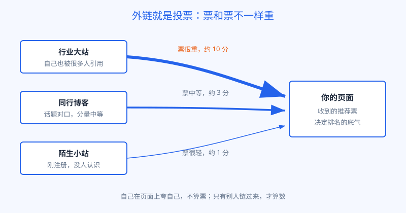
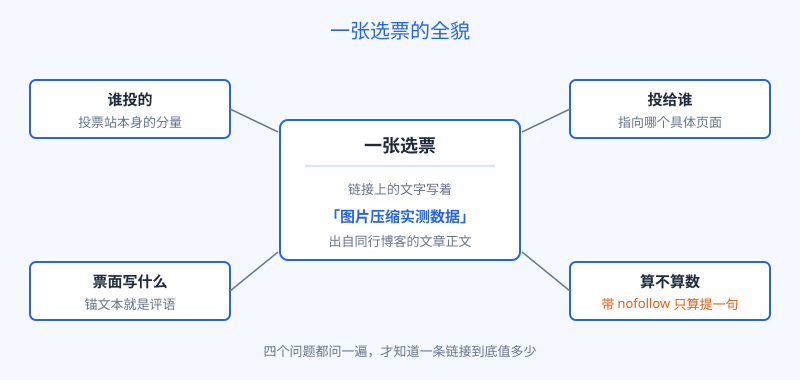

# 第 18 章 外链就是投票

## 白话讲解

先想一个生活里的场景。

一条街上新开了两家餐馆，你都没吃过，想挑一家。同事告诉你：左边那家我去了三次，排队都要等位。右边那家的老板站在门口，逢人就说自家是全城第一。你会进哪家？

不用多想，你多半会跟着同事的推荐走。道理很朴素：别人的一句推荐，比当事人的十句自夸更可信。

搜索引擎面对的是同一个难题。全世界有几十亿个网页，它不可能派人一个个去试。内容写得再漂亮，也可能只是自卖自夸；页面上写着"我是这个领域最专业的"，谁都可以这么写。于是它需要一种来自站外的证据，来判断一个页面到底值不值得排在前面。

这个证据，就是外链。

外链的全称是外部链接：别的网站在自己的页面上，放了一个能点到你页面的链接。搜索引擎看待外链的方式，可以用两个字概括：投票。

一个页面被别的站链接一次，就相当于那个站为它投了一票。投票者的意思是：我看过这个页面，我觉得它值得推荐，所以我愿意把我的读者往这里领。票数多的页面，搜索引擎会认为它更受欢迎、更有分量，排名时就更占优势。这套逻辑从搜索引擎诞生初期一直用到今天，中间细节改了无数轮，大方向没有变过：链接就是互联网上的推荐票。

图 18-1：同样是链接，分量并不一样。谁投的票，决定了这一票有多重。

但投票这件事，有五个细节必须弄明白。弄不明白，后面两章的打法就全是空中楼阁。

**第一，谁投的票，分量不一样。**

选票不是一人一票平均算的。一个在行业里做了十年、自己就被无数人引用的大站投给你一票，和一个昨天刚注册、没人认识的小站投给你一票，在搜索引擎眼里完全不是一回事。投票者本身越有分量，它的票就越重。这也解释了为什么站长们都盯着大站的链接：大家争的不是数量，是分量。一条来自行业头部站的链接，常常顶得上几百条无名小站的链接。

**第二，一张票可以被稀释。**

一个页面对外链出的链接，就是它投出的票。它只链向你一个页面，这一票就整整给了你；它同时链向五十个页面，这一票就被拆成了五十分之一。所以那些满页都是链接的名单页、批发页，上面的票几乎不值钱。判断一条链接的价值时，先数一数同一个页面上一共躺着多少条外链，这个习惯能帮你省掉很多自欺欺人的功夫。

**第三，票面上写着字，这字叫锚文本。**

锚文本就是链接上那串可以点击的文字。别人写"这里有一份图片压缩的实测数据"，把其中的几个字做成指向你页面的链接，搜索引擎就会把这几个字理解成投票者对你的描述：大家用这几个字称呼这个页面，那这个页面多半就和这个话题相关。所以锚文本不只是把人引过来，它还在替搜索引擎给你的页面贴标签。它直接影响搜索引擎对你的页面主题的判断，这也是为什么自然的锚文本总是五花八门，而人为操纵的锚文本往往整齐得可疑。

**第四，票和话题对不对口，也影响分量。**

同行投给你的一票，和一个八竿子打不着的行业投给你的一票，分量也不一样。一个做图片教程的站链向你的图片工具，上下文严丝合缝，这一票既是推荐，又是对你主题的一次确认；一个卖渔具的站突然链向你，搜索引擎反而要多想一想：这票是从哪儿来的？所以站长们挑链接时，除了看对方站大不大，还要看对不对口。话题越贴近，这票投得越自然，搜索引擎也越愿意照单全收。那些满世界乱撒的链接之所以成色差，一半就差在这个对不上。

**第五，有的票只算提一句，不算正式推荐。**

链接可以带一个叫 nofollow 的标记。带上它，等于投票者声明：我只是顺嘴提一下这个页面，不为它背书。搜索引擎看到这种标记，通常就不把这张票计入排名投票。社交平台、评论区、论坛帖子里的链接，大多属于这一类。它们能带来真实的访客，这很有价值，但对排名的作用有限。后来又多了两个亲戚标记：sponsored 表示这是付费合作的链接，ugc 表示这是用户自己发布的内容里带的链接。性质类似，都是在提醒搜索引擎：这张票，你掂量着算。

把这五点拼起来，一张选票的全貌就清楚了，如图 18-2 所示。

图 18-2：拿到任何一条链接，先问五件事：谁投的、投给谁、票面写什么、话题对不对口、算不算数。

顺便回答一个很多人会问的问题：既然链接是票，搜索引擎为什么不干脆只数个数？因为它试过，吃过大亏。搜索引擎的早期版本确实更看重数量，结果立刻催生出一门生意：批量制造页面、互相链接，专门给客户刷票数。票数通货膨胀之后，搜索结果前面排满了会刷票的站，真正好用的站反而沉了下去。从那以后，算法一代代进化，学会了看质量、看来源、看话题、看增长曲线，数量慢慢退到了次要位置。这段历史对今天的你只有一个提醒：任何只拼数量的打法，都是在和二十年前的老算法较劲，注定过时。

除了选票本身，还有两个延伸的道理，顺手一起记住。

**一是链接所在的位置，也影响票的成色。**同样出自一个页面，出现在正文里、被作者郑重推荐的链接，和塞在页脚角落里的链接，分量完全不同。道理和现实一样：一个人在台上正儿八经介绍你，和把你的名字印在他名片背面，效果能一样吗？正文里的、上下文对得上的链接，才是投票者真心的一票。

**二是票投进来之后，还会在你的站内流动。**大站链到你的某一篇文章，这篇文章就攒下了一份分量；这篇文章再通过站内链接指向你的工具页、产品页，等于把一部分分量分了过去。这就是第 16 章讲内链时埋下的伏笔：内链的活儿，一半是给读者指路，一半就是在站内分配这些来之不易的票面分量。外链负责把水引进来，内链负责把水送到该去的田里。

还有一个容易被忽略的事实：票是会过期的。对方改版、删页、关站，都会让链接悄悄消失；对方的站自己掉了分量，你收到的那一票也跟着缩水。业内把这叫链接流失，速度因行业而异，但方向只有一个：你的外链库存，每天都在自然减少。这意味着外链不是攒够一次就一劳永逸的事，而是一条要持续进水的管子：进水停了，存量就会慢慢见底。这也是为什么成熟的站从不停止做值得被引用的东西，人家不是贪心，是在对冲流失。

最后记住一点：**正常的投票，是慢慢攒出来的。**

一个页面上线后，被同行陆续发现、引用，链接一条一条多起来，这是自然的样子。反过来，上线第二周突然多出几百条链接，就像一个新餐馆开业三天，全城冒出一千条整齐划一的好评。搜索引擎见得多了，对这种不自然的增长天然警惕。这一条先记住，第 20 章我们会看到，它翻起车来是什么样子。

## 阿哲的站

阿哲的站走到这一章，站内的活儿已经做得差不多了：结构顺了，内容也按第 14 到 17 章的打法铺了起来，程序化页面加教程文章，收录一切正常。他满怀期待地等流量，结果数据很冷静：每天只有几十个访客，几个精挑细选的长尾词排在第二页、第三页，就是挤不进首页。

他把排在前面的同行站拉出来逐个对比，发现一个扎心的事实：论内容，他不比人家差，有两篇教程他自认写得还要细。差的是外链。他用工具查了一圈：指向自己站的外部链接，一只手数得过来，其中还有两条是他自己在别处随手留的；而排在前三的同行站，外链多的有上百条，来自几十个不同的网站，有教程站，有资源汇总页，还有几个行业里叫得出名字的博客。

阿哲这才反应过来：搜索引擎不是不认可他的内容，是还不认识他。一个没有人投票的新面孔，内容再好，也只能先在候补席上坐着。排名的前几页，坐着的都是已经在这个圈子里被反复推荐过的人。

他一度很焦虑，半夜还给同行发消息打听，有没有什么快点的办法。同行回了他一句：快办法有，就看你敢不敢。这个回答让他更睡不着了。第 19 章讲他最后选了哪条路，第 20 章讲那条快路通向哪里。

## 翻车现场

先看一个把票投废了的例子。

有位做小工具的站长，思路和阿哲正好相反：他觉得既然链接是投票，那就先把数量堆上去。他花了大概一个月的时间，在各大论坛、博客评论区、问答社区到处留言，话术都差不多：先夸对方一句，再贴上自己工具的链接。一个月下来，他数了数，链接多了八百多条，心里很满意，觉得这一票仓算是囤满了。

结果是：排名纹丝不动。

原因现在回头看一点都不难。评论区和论坛里的链接，绝大多数带着 nofollow，本来就不计入投票；少数能计入的，出处页面的分量也低得可以忽略，同一页上躺着几百个外链，票被稀释得所剩无几。更麻烦的是，这种到处贴链接的行为模式太像垃圾信息了，他有两个主力页面还短暂掉过一截排名，后来花了比留言多几倍的时间去清理痕迹。

他最大的误会，是把链接的数量当成了选票的数量，却忘了选票要先算数，其次才数张数。八百张废票，不如一张正经票。这一课，也是本篇接下来两章的总纲：先求票算数，再求票多。

顺带说一句他的后来：他把评论区留言的事停了，转头认真做了一个小工具，第二年再看外链列表，虽然总数只有几十条，但其中十几条来自叫得出名字的站，排名反而一点一点上去了。数量的故事和质量的故事，结局从来不一样。

## 要点回顾

- 外链是别的站在它的页面上给你留的入口，搜索引擎把它理解成一次投票：一次来自第三方的推荐。
- 投票者越有分量，票越重；一个页面链出的链接越多，每张票被稀释得越厉害。
- 锚文本是票面上的评语，搜索引擎靠它理解你的页面在讲什么；话题对口的票更值钱，正文里郑重推荐的链接比页脚角落里的链接成色好。
- 带 nofollow、sponsored、ugc 标记的链接只算提一句，通常不计入排名投票，但仍能带来真实访客。
- 正常的链接随时间慢慢攒出来，短期暴增在搜索引擎眼里是不自然的信号。

## Kata

1. 随便找一个你行业里的页面，数一数它正文里一共对外链出了几个链接，再想一想：如果它是投票者，它的每一票被稀释成了多少？
2. 用任意一款外链查询工具（多数有免费额度），对比两个站：一个你常去的成熟站，一个刚上线的新站。比较三项：外链总数、来源网站数、其中你叫得出名字的网站有几个。写下你对"票的分量"的理解。
3. 回想你最近一次点开别人推荐的链接：对方当时是用什么锚文本描述它的？如果让你给自己的站写一句最想被别人引用的描述，你会写哪几个字？为什么？
