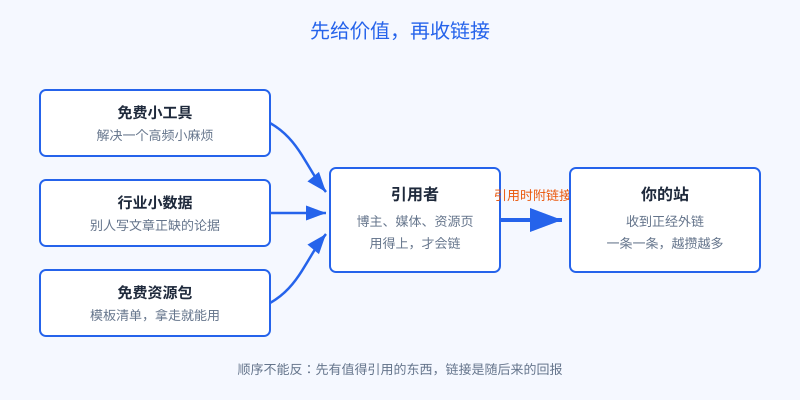
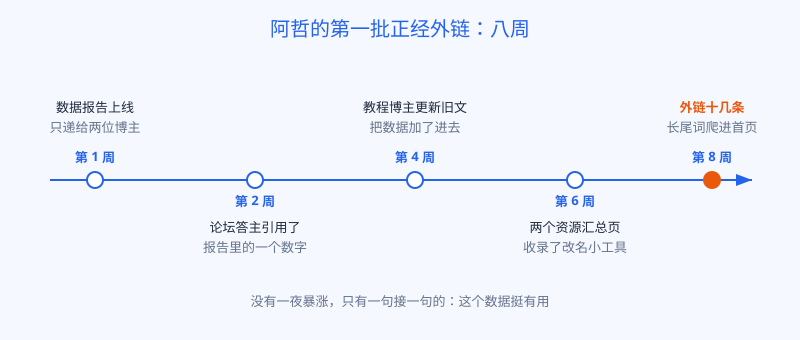

# 第 19 章 正经拿外链

## 白话讲解

第 18 章我们把道理说明白了：外链是投票。但知道了这个，多数人的第一反应还是同一句：那我上哪儿要票去？

先把心态摆正：**正经外链不是要来的，是挣来的。**

站到投票者那一头想一想。别人在自己的文章里放一个链接，等于把读者往外送，还要为这次推荐的质量担责，他凭什么送？掰开算，无非三个理由：这个东西对我的读者有用；这个数据能替我说的话作证；这个资源能显得我分享得内行。反过来说，你想拿到链接，得先做出值得被引用的东西。这类东西有个统称，叫可链接资产。名字听起来玄，说白了就是别人写文章、做页面时用得上的干货。

常见的可链接资产有三类。

**第一类，免费小工具。**

一个真正能解决小问题的小工具，是天然的链接磁铁。教程作者写教程时需要拿工具举例，会链它；资源汇总页收录同类工具时，会链它；用户在论坛里帮人解决问题时，也会顺手贴它。工具不用大，关键是恰好卡住一个高频出现的小麻烦。这类资产的特点是链接来得慢但稳：只要工具还活着、还好用，新链接的机会就一直存在，它是一份会自己下蛋的资产。

**第二类，行业小数据。**

原创数据是引用率最高的资产之一。原因很朴素：写文章的人需要数据来支撑观点，但自己做调研太贵、太慢。谁手里有一份现成的、口径写得清清楚楚的数据，谁就会被反复引用，而引用的标准动作就是附上链接注明出处。数据不需要多宏大，你自己业务里沉淀的数字就行：用户是怎么用的、大家偏好什么、某个价格或尺寸怎么变。把它们整理成一页带图表的报告，就是一份全网独一份的资产。记住，重点是原创和口径清楚：网上抄来的汇总数据人人都有，没有引用价值；只有你能给出的一手数字，才值得别人专门为你留一个链接。

**第三类，免费资源包。**

模板、清单、速查表、素材包、在线计算器，都属于这一类。它们被资源页和教程收录的门槛最低，因为收录者要的就是给读者备一份现成的好东西。做资源包有两条经验：一是真免费、拿走就能用，中间不要设一堆注册墙，分享的人嫌麻烦，就不会分享；二是留好署名和出处说明，让引用你的人省事，他省事，才更愿意引。

动手做资产之前，先用引用者的视角问自己三个问题，能帮你省下大量白做的功夫。第一，写文章的人会缺它吗？教程作者最缺的是能直接引用的例子和数字，资源页编辑最缺的是能放心推荐的现成工具，你的东西正好补上谁的缺口，心里要有数。第二，引用它方便吗？有没有一个稳定的页面地址，数据能不能一眼看懂、随手摘走，还要不要再加工半天？越省事，被引用的概率越高。第三，它和引用者的话题对得上吗？一份再漂亮的数据，递给话题不相干的人，也换不来链接。三问都过关，再投入时间去做，这份资产才算立得住。

图 19-1：三类可链接资产殊途同归：先让别人用得上，链接随后自己来。

三类资产有一个共同点：**先给价值，再收链接。**顺序反过来，就是第 18 章翻车现场里那种到处贴链接的样子。

有了资产，还差最后一步：让该知道的人知道。这一步叫外联，说白了就是有分寸地打个招呼：

- 找到正在写相关话题的人，把你的资产当作补充材料递过去，一句话说清它能帮他的读者解决什么问题，多一句都不说；
- 盯住资源汇总页和同类工具的收录页，按人家写明的格式提交，收不收是人家的自由；
- 在社区里先帮忙、后露脸：先回答问题、先贡献经验，资产的链接只在真正对题的时候出现。

外联的底线是：对方没有回复，或者明确拒绝，就到此为止，绝不追问第二遍。这条底线为什么重要，本章的翻车现场会给出答案。

再补一个进阶玩法：数字公关。意思是把你的数据或工具，包装成一个现成的故事角度，递给媒体编辑和行业通讯的作者。他们每天都在找选题和素材，你递过去的如果正好是一个能直接写成稿子的点：一个反常识的数字、一个新趋势的苗头，再附上图表和原始页面，编辑采用的概率比普通投稿高得多。采用之后，稿子里的出处链接就是分量最重的那一类票。数字公关和群发外联的区别只在一件事：你递的是对方正缺的素材，而不是你正缺的链接。

还有一件事顺手就能做：盯住那些提到你、却没给链接的人。你的工具名、报告名被人写进了文章，但对方忘了附链接，这种情况叫未链接提及。这时候写一封短邮件过去，先道谢，再客气地问能不能补上出处链接，成功率出奇地高，因为对方本来就认可你，缺的只是一个提醒。这也是外联里性价比最高的一个动作：不用做新资产，只是把已经挣到的推荐补全成一张正式的票。

最后提醒一句：资产是要养护的。数据报告里的数字会过期，去年写的报告，今年还挂着旧数字，被人引用一次发现对不上，伤的是你的可信度，而可信度正是人家愿意链你的全部理由。工具要保证还能打开、还能好用；资源包里的内容要跟着版本更新。阿哲的做法是给报告页标上更新日期，每季度把数字刷新一遍，旧报告不下线，原地更新，这样已经链过来的链接不用改地址，还能继续生效。养资产的成本比做资产低得多，但省掉这一步，资产就会从下蛋变成占地方。

最后讲一个心态问题：正经外链的回报，是按月算的。一份数据报告，第一个月可能只换来两条链接，但它会在接下来的一年里被人陆续翻出来引用。链接的复利就藏在这个陆续里。这也是正经链接和买来的链接最根本的区别：买来的链接从付款那天起就开始贬值，自己挣来的链接从发布那天起才开始增值。第 20 章我们会把这笔账算到底。

## 阿哲的站

阿哲没有去走那条快路。他回头盘了盘自己手里有什么，发现还真有两样东西。

第一样，是攒下的数据。他的工具站跑了几个月，用户上传的图片早就按规则删掉了，但匿名的统计留了下来：大家平均上传多大的图、最常见的尺寸是哪几个、压缩之后平均能省下多少体积。这些数字躺在他眼里是后台日志，放到写教程的人眼里，就是现成的论据。

他花了两个晚上，把这些数字整理成一页报告：《2026 年用户图片使用习惯小报告》。四个核心数字，四张图，统计口径写得清清楚楚，页面末尾还特意留了一行字：引用数据请注明出处并附上链接。页面上线之后，他只做了两个动作：把链接发给两位之前请教过问题的教程博主，说自己做了一份小数据，也许对他们的读者有用；又在两个行业论坛讨论图片体积的话题里，各贴了一次。

第二样，是一个顺手做的小工具。他在主工具旁边加了一个免费的批量图片改名小页面，功能小到只有一屏，但教程作者演示批量处理图片时，正好用得上。

结果来得不快，但很扎实，如图 19-2 所示。第一条正经外链来自论坛里的一位答主，他在回答里引用了报告中的一个数字。第二周，一位教程博主更新旧文章时把数据加了进去，顺手给了链接。接下来一个月，两个资源汇总页收录了那个改名小工具，报告页又被三篇文章引用。两个月下来，他的站多了十几条来自不同网站的链接，全是他叫得出名字、点得进去看的正经页面。

中间还有个小插曲。第三周时，阿哲发现一份行业通讯引用了他的数字，写得挺认真，却忘了附链接。他照着本章的方法写了封邮件：先谢对方引用，再说读者如果想看完整口径，可以从这个页面查到，顺手把链接附上。第二天，对方就把链接补上了。阿哲说，那一封邮件只写了三句话，换回来的票却比他之前到处留言一个月还要实在。

流量的变化是慢慢显形的：先是几个长尾词从第二页爬到首页末尾，又过了一个月，月访问量从几百涨到了几千。阿哲后来在笔记里写了一句：原来链接不是买回来的，是一次次"这个数据挺有用"攒回来的。

图 19-2：阿哲的第一批外链来得很慢，但每一条都点得进去、叫得出名字。

## 翻车现场

和阿哲形成鲜明对比的，是另一位站长的邮件海战术。

这位站长也懂外链是投票，于是他把外链当成了一道采购题：收集了三百多个博客的联系邮箱，用同一封模板邮件群发，中心思想是"我的文章很好，希望你能链接一下"，附件里甚至附上了现成的锚文本建议，服务不可谓不周到。

三百封邮件的战果是：回复的不到十封，其中一半是礼貌拒绝，两封是明码标价谈收费。还有一封最扎心：一位博主把邮件截图发到了社交平台，配文吐槽，又来一个连我名字都写错了的。他的域名跟着截图一起出了名，只不过是坏名声。后来他再正经写邮件联系任何人，对方都要先愣一下：是不是那个群发的？信任一旦这样透支，补起来比从零开始还要难。

他错在哪里？错在顺序彻底反了。阿哲是先做出值得引用的东西，再轻轻提醒一句；他是东西还没有影，先把人情消耗光了。外联的本质是信息的撮合：你手里正好有对方需要的东西。没有这个前提，发一封是打扰，发三百封，就是一场事故。

还有一个细节值得留意：他的邮件里连对方的名字都写错了，说明那封信根本不是写给收件人的，是写给一个邮箱列表的。收件人分辨模板和真信，只需要一眼。外联的每一封信都应当是单独写的，提到对方最近的一篇文章、一个具体的问题，让对方知道你真的看过他的东西。慢，但这才是外联该有的样子。

## 要点回顾

- 正经外链是挣来的：先有值得被引用的东西，链接是别人用过之后给的回报。
- 三类可链接资产：免费小工具、行业小数据、免费资源包，共同点是先给价值。
- 原创数据引用率最高：口径写清、图表齐全、出处说明留好，被引用的概率会高很多。
- 外联只做一件事：把资产递到正好需要它的人面前，单独写、写得短，对方不理，就到此为止。
- 正经链接按月产生复利，买来的链接从付款那天开始贬值，这笔账第 20 章算完。

## Kata

1. 盘一盘你手里的业务数据：有哪些数字，是同行写文章时正缺的？挑一份出来列一个报告提纲，要求只有一个标题、三个数字、一张图。
2. 找一个和你业务相关的资源汇总页，认真看它收录的标准和提交格式，然后对照检查：你的站现在够不够格提交？具体差在哪一条上？
3. 给一位你真心读过的博主写一封外联邮件草稿，不超过五句话，前提是只能推荐你已经做好的一个资产。写完之后，把所有夸自己站的话删掉，只留对方读者能得到的好处，再读一遍。
