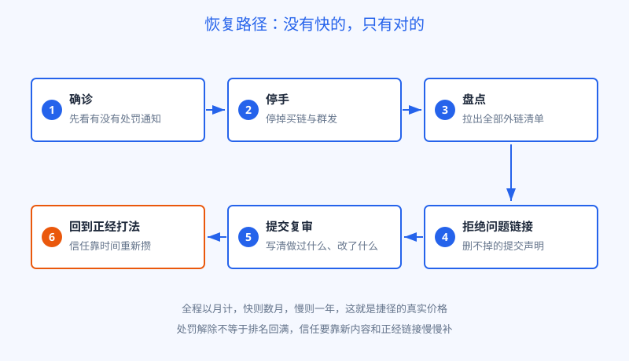
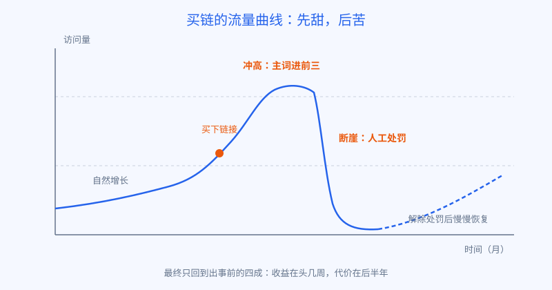

# 第 20 章 捷径的代价

## 白话讲解

先说句公道话：想走捷径，不丢人。

正经挣链接有多慢，第 19 章已经看到了：做报告、做工具、等引用，回报按月起步。这时候要是有人告诉你，一周就能多一百条高权重链接，价格还不贵，换谁都会心跳一下。

但买链这门生意，有一个绕不开的问题：**它卖的恰好是搜索引擎明文禁止的东西。**

回忆一下第 18 章的投票模型。链接之所以能当选票，是因为它代表第三方自愿的推荐。买卖链接，等于花钱买选票。任何一场选举里，买票都是要出局的重罪，原因也简单：买票一旦泛滥，选举结果就不再代表民意，而是代表谁的钱包厚。搜索引擎的公开规则写得很明白：以操纵排名为目的的链接买卖、大规模交换、批量制造，都属于违规的链接作弊。判断方法也不复杂：把钱这个因素抽掉，这条链接还会存在吗？不会，那就是买的。

这里要先分清一条界线，免得矫枉过正：花钱买曝光本身没有问题，问题出在伪装。正常的广告合作、付费推广，只要给链接老老实实带上 sponsored 或 nofollow 标记，明示这是花钱买的位置，搜索引擎是认可这种做法的，它本来就是互联网正常的商业形态。作弊指的是另一回事：钱花了，却要求对方装作是自愿推荐，把广告票混进选票里，指望它按正经推荐计分。界线就一条：这条链接的存在，读者和搜索引擎是否都被告知了它是买的。告知了，是广告；瞒着，是买票。

你可能还听过另一种说法：某某买了链，排得好好的，也没见出事，所以这条路能走。这话要打一个大问号。你能听到的现身说法，天然只来自还没出事的那批人，专业上这叫幸存者偏差：出事的站要么关了，要么忙着申诉清理，没人会出来写经验帖。再加上处罚有滞后性，今天没出事，只说明算法还没轮到这批链接，不说明这批票永远算数。拿别人的还没出事，来赌自己的不会出事，这个赌局的赔率从来不在你这边。

被查出来之后会发生什么？惩罚分两种，轻重差得很远。

**第一种是算法自动处理，可以理解为票作废。**

搜索引擎的算法每天都在识别不自然的链接。识别出来之后，最常见的处理不是通知你，而是直接让这批链接不计票，顺带下调整站的信任评分。你看到的现象是：排名一点点往下掉，流量长期阴跌，站长工具里没有任何警告。很多站长到最后都不知道发生了什么，只觉得最近运气不好。钱花了，票没算数，等于白买，这是最常见的结局。

**第二种是人工处罚，可以理解为取消资格。**

情节明显的，搜索引擎的人工审核团队会直接出手：轻则把出问题的一批页面降权，重则把整个站从搜索结果里移除，站长工具里会躺上一封人工处罚通知。这时候就不是阴跌了，是断崖：流量几天之内掉到接近于零，而且只要处罚不解除，之后写再多新内容也回不来。

群发垃圾链接、站群、PBN 这类玩法，走的也是同一套逻辑，只是规模越大，倒得越整齐。站群和 PBN 说白了，是自己给自己投票的工业化版本：一批站互相链接，假装有很多互不相干的第三方在推荐。搜索引擎识别这类网络，靠的是它们批量留下的共同痕迹。平时这些痕迹不起眼，一旦被串起来认定，不是一张票作废的问题，而是整张网一起沉没，网里的每一个站都白养。平时看着有几十上百个站的家底，清零只需要一夜。

再把账算完整。买链的真实成本，从来不只是那一笔交易款：

- **时间账**：被罚之后，清理、申诉、等待、重建，以月为单位起步，拖上一年也不稀奇。而这段时间里，老老实实做链接的同行没有停下过。
- **机会账**：处罚是有案底的。解除之后，信任要从头攒，爬回原来的位置，往往比第一次爬上去还要难。
- **连带账**：如果你还经营着别的站、别的业务，不同项目之间共用的东西会互相传染风险。现实里因为副业小站作弊、拖累主业站的例子，并不少见。

万一已经买了，或者接手了一个有历史问题的站，恢复的路是存在的，只是没有快的，如图 20-2 所示：

图 20-2：恢复没有捷径，六步走完，快则数月，慢则一年。

1. **先确诊。**看站长工具里有没有人工处罚通知；没有通知但流量断崖的，把下跌的时间点和算法更新、自己近期的动作对一对，先分清是票作废、人工处罚，还是别的问题。第 22 章有一张完整的排查顺序表，可以对照着走。
2. **先停手。**停掉一切买链和群发，还在续费的先断掉，防止一边清理一边新增问题链接。
3. **盘点外链。**把指向你的链接拉出一份完整清单，标出明显是买来的、垃圾的、批量制造的那些。
4. **拒绝问题链接。**能联系删除的先删；删不掉的，用搜索引擎提供的拒绝链接工具提交清单，声明这些链接与你无关。这个工具是自救用的，不是日常武器，名单务必慎重，误伤正经链接得不偿失。
5. **提交复审。**有人工处罚的，在清理完成之后提交复审请求，老老实实写清三件事：做过什么、改了什么、以后怎么做。复审是人工看的，态度和证据链比文采重要。一次不过，就补一轮清理再提交，交上三四次才通过的并不罕见。
6. **回到正经打法。**恢复期里，把精力放回第 19 章那条路：内容，加上正经外链。处罚解除不等于排名自动回满，信任只能靠时间重新攒。

等待期里最难熬的，是不知道还要等多久。这里给两个经验：一是复审的回复周期通常以周计，提交之后不要天天改、天天重交，频繁变动只会让审核的人无从判断；二是处罚解除之后，先观察四到八周再下结论，排名的回升本来就是台阶式的，一格一格往上挪，指望它弹回原位，只会把自己熬出焦虑来。这段时间真正该做的，是把内容短板补上、把正经外链的节奏恢复起来，等信任重新攒够，位置是跟着回来的。反过来，如果半年过去毫无动静，多半是清理还没做到位，或者站本身除了链接问题之外还有内容上的硬伤，那就回到确诊那一步，重新查起。

走完这一整套要多久？常见的情况是几个月起步。记住这个数字，再回头看卖链广告里那句一周见效，你就明白：那一周的效，是拿后面几个月换的。

## 阿哲的站

阿哲动过买链的念头，还不止一次。

最动心的一次，是在数据报告刚有点起色的时候。链接在涨，但一周也就新增一两条，他急。一天晚上，他收到一封私信，对方自称做外链服务，开门见山地报价：一批所谓高权重站点的链接打包出售，还附了几个客户案例，说其中一个站三个月流量翻了五倍。

阿哲没有当场拒绝。他把案例里的站挨个查了一遍。前两个站确实排着一些词，看着像那么回事。轮到第三个，他多看了一眼流量曲线：那个站半年前有一波陡峭的冲高，随后在某个月整段塌了下去，到现在还趴在谷底，只剩冲高前的零头。卖家展示的，恰好是冲高那一段的截图，塌下去的部分只字不提。

他关掉私信，在自己的笔记里补了一行：卖链的人给你看的，永远是断崖之前的那一截。

后来阿哲把这件事复盘完，又想通了另一层：自己的站还小，就算真买来几十条链接把排名冲上去，那也是在沙地上盖楼。他的站扛不起一次断崖，几个月的时间成本，对独立开发者来说就是命。相比之下，报告页每周还在新增一两条引用，这条曲线慢，但它是往上长的，而且不会在某个清晨突然归零。从那天起，再有类似的私信，他看都不看，直接删掉。那封私信他倒是留了一张截图，后来写教程讲到外链这一段时，他把截图打码后当了反面素材，还真有读者留言说，自己收到过一模一样的话术。多留个心眼，有时候也能变成内容。

## 翻车现场

最后讲一个完整的断崖故事，就是阿哲复盘过的那位同行的经历，细节做了合并处理。

这位同行做的是一个下载类工具站，自然增长做了大半年，月访问量到了五万上下，势头不错。眼看一个旺季要来，他想在旺季之前冲一把，找了市面上的链接服务，一次性上了一大批所谓的高权重链接。头六周，效果立竿见影：几个主词冲进前三，流量涨了六成，他甚至在同行群里小小地得意了一把。

第七周开始，流量掉头向下。起初是阴跌，他以为只是正常波动；到第十周，主要页面成批从搜索结果里消失，整站流量掉到只剩一成。他这才想起来去翻站长工具：人工处罚通知，已经在里面躺了三周。

他的流量曲线，就是所有买链案例的标准形状，如图 20-1 所示。

图 20-1：买链的收益集中在头几周，代价摊在后面大半年。

接下来是一张漫长的时间表。第一个月，停掉服务、盘点链接，几百条买来的链接里，能联系上并删掉的不到三分之一，其余的只能走拒绝清单。第一次复审被打回，理由是清理不彻底；他又花了三周做第二轮清理，第二次复审才通过。从处罚生效到解除，前后四个月，旺季整个错过。解除之后又过了两个月，流量才慢慢回到出事前的四成左右。他自己的总结是：用四个月加一大笔清理成本，买了六周的虚假繁荣。

这件事最值得记住的，不是他被罚了，而是时间线的形状：买链的收益集中在最前面几周，代价却摊在后面大半年。几乎所有捷径的账本都是这个形状，先甜后苦，而且苦的那一段，比甜的那一段长得多。

他后来的选择也值得一提：恢复期里他没有再碰任何快办法，老老实实更新内容、做了一份行业数据页，一年之后流量回到了出事前的八成。他说那份数据页带来的链接，是他做站以来睡得最踏实的票。这句话，恰好和第 19 章阿哲的结论对上了。

## 要点回顾

- 买链是花钱买选票，与外链作为自愿推荐的根基直接冲突，是搜索引擎明文禁止的链接作弊。
- 惩罚有两种：算法处理让票作废，流量阴跌且没有通知；人工处罚可以整站移除，必须先解除处罚才谈得上恢复。
- 站群、PBN 是自己给自己投票的工业化版本，被识别靠的是批量留下的共同痕迹，一旦认定，整网一起沉。
- 恢复路径只有一条：确诊、停手、盘点、拒绝问题链接、提交复审、回到正经打法，整个周期以月计。
- 捷径的账本形状固定：收益在头几周，代价在后面大半年，先甜后苦。

## Kata

1. 假设你接手了一个站长工具里躺着人工处罚通知的站，按本章的恢复路径，列出你第一周要做的四件事，并逐件写明目的。
2. 找一个你知道的、曾经流量大幅下跌的站点，或者用公开的流量估算工具看任意一个大站的历史曲线，试着区分：它的下跌更像票作废式的长期阴跌，还是整站移除式的断崖？你的判断依据是什么？
3. 给未来的自己写一条规则：如果哪天你动了买链的念头，先强迫自己做完哪三件核查，才允许继续考虑？提示一下：把对方案例的完整流量曲线查到底，是其中一件。
