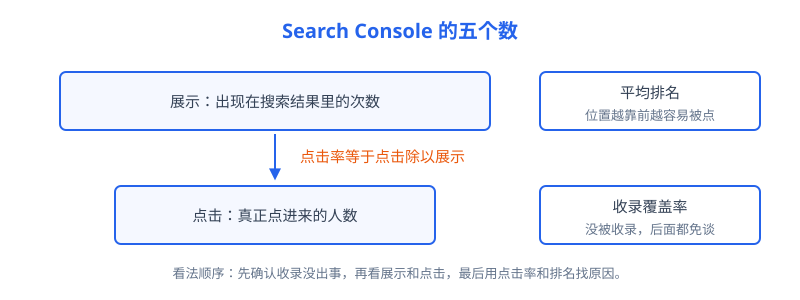
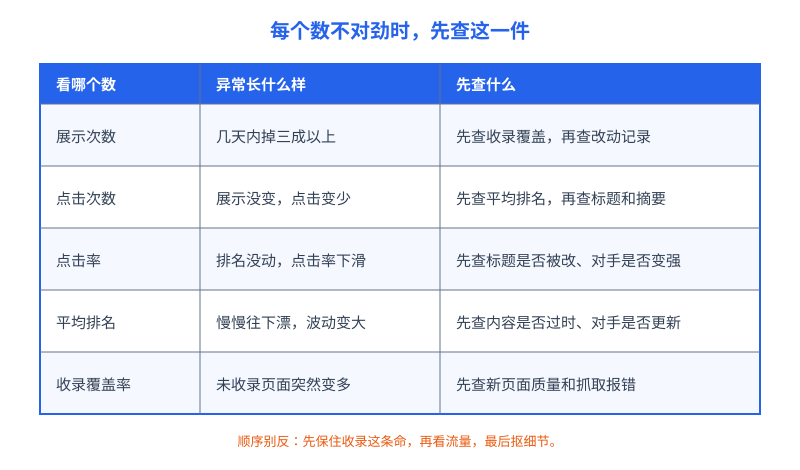

# 第 21 章 Search Console 只看五个数

## 白话讲解

站做起来之后，日子怎么过？答案是：看数据过日子。但数据工具最容易把人带偏，一打开满屏都是报表和曲线，看多了头晕，看少了心慌。这一章把话说死：日常你只盯五个数就够了。这五个数来自谷歌官方给站长的免费工具 Search Console（简称 GSC），它是搜索引擎亲口告诉你的数据，比任何第三方估算工具都靠谱。缺点只有一个：数据有两三天的延迟，所以它适合看趋势，不适合看直播。

先把 GSC 的边界交代清楚，免得用错地方。第一，它只管谷歌这一家，其他搜索引擎的流量、直接访问、社交平台推荐，都不在里面，你站的总流量要用统计工具看全貌。第二，数据只保留十六个月，想做年度对比，趁早把关键月份的数字导出存档。第三，按查询拆分时，有一部分查询因为量太小被隐藏了，所以各查询加起来会比总数少一截，这是隐私保护，不是数据丢了。三条边界记牢，后面很多疑惑会自动消失。

第一个数是**展示次数**。意思是：你的页面出现在搜索结果里，被用户看到的次数。注意，是出现在结果页里就算，不需要用户真的点进来。打个比方，你在夜市摆了个摊，展示就是有多少人从你摊前路过。

第二个数是**点击次数**。路过的人里，有多少真的停下来走进了你的店，这就是点击。展示和点击是一条链子的前后两环：没有展示，点击无从谈起；展示很多但点击很少，说明摊摆出来了，可没人愿意进。

第三个数是**点击率**，英文缩写 CTR，算法很简单：点击除以展示。它回答的问题是：在同等曝光条件下，你的页面吸引人点击的本事有多大。点击率有个脾气：它和排名位置强相关，排第一的页面点击率天然比排第八的高出一大截。所以点击率只能跟自己比，或者跟位置差不多的页面比，拿第一名和第十名的点击率硬比，没有任何意义。

还有一个细节：点击率是把所有词混在一起算的。搜你品牌名的用户本来就是冲你来的，点击率高得离谱；搜通用词的用户要在十个结果里挑，点击率低得多。两个数混在一起，平均出来的点击率既不代表品牌词，也不代表通用词。想看清真实水平，就在查询维度里把品牌词和非品牌词分开看，这是老站长常用的一个拆分动作，后面阿哲的站还会专门讲他在这上面吃的亏。

第四个数是**平均排名**。你的页面在某个词下面平均排第几位，GSC 给的是所有展示加权之后的平均数。这个数最容易误导人：它是平均数，新收录一批排在几十名的长尾页面，平均排名立刻被拉低，看上去像退步，其实是好事。所以平均排名要配合展示次数一起看，两个数一个涨一个跌，先别急着下结论。

第五个数是**收录覆盖率**，藏在 GSC 的"网页索引编制"报告里。它回答：你站里有多少页面真正进了谷歌的索引库，又有多少没进去。这一条是地基：页面没被收录，展示、点击、排名全都不存在。前四个数是楼面上的生意，这个数是地基有没有打好。

收录报告里有几个状态值得先认识，不然容易像后面翻车现场那位一样自己吓自己。“已发现但尚未编入索引”，意思是谷歌知道这个网址存在，还没来得及抓，多见于新站和页面太多的站，先放着观察。“已抓取但尚未编入索引”，是抓过了，但谷歌觉得暂时不值得收，内容太薄、和已有页面太像，都是常见原因。“备用网页”多半是带参数的重复页，谷歌从中选了一个正本收好，其余有意排除，属于正常去重，不用处理。分清这几类，你就知道哪些数字可以无视，哪些必须当回事。

如图 21-1 所示，这五个数不是并排的五个仪表，而是一条链子加一个地基：收录决定你有没有资格上场，展示和点击是生意本身，点击率和平均排名帮你找原因。

五个数连起来看，能读出大多数问题。比如展示涨了、点击没涨，先看平均排名是不是被新页面拉低了；展示没变、点击变少，多半是排名掉了或者标题出了问题；五个里四个都挺好，唯独收录覆盖在恶化，那是地基在漏水，要优先修。

实操层面还有两个习惯。第一，看 GSC 默认就用"过去 28 天对比上一个 28 天"，不要盯着单日数据大惊小怪，单日波动里噪音太多。第二，五个数的优先级有顺序：收录出事是急诊，其他四个是门诊。如图 21-2 所示，每个数不对劲时，第一步该查的东西其实很固定，照着查，能排除掉八成虚惊。

这张表的使用方法是：先对号入座找到出问题的数，只查它对应的第一件事，查完没问题再往下想。多数人栽跟头就栽在顺序反了：一看到点击掉，第一反应是改标题、改内容，改了一圈才发现，是收录先出了事，自己白忙活还添了乱。

再补一个新手常问的问题：为什么 GSC 里的点击数，和自己装的统计工具里的访问数对不上？因为两边数的不是一回事。GSC 数的是搜索结果页上发生的点击，统计工具数的是真正到达你的网站、并且成功加载了统计代码的会话。用户点了却中途关掉、浏览器拦截了脚本、页面打开太慢人走了，都会让两边对不上，差出一两成属于正常。两边对不上不是谁造假，是口径不同，别拿着这个去怀疑数据。

什么时候要从看数升级到排查？给你一条分界线：五个数里只有一个在两成以内波动，其余正常，多半是噪音，看一周再说；如果展示和点击同时掉三成以上，或者收录数在持续往下走，别等，直接翻到下一章的排查顺序表，一步一步来。还有一个免费帮手别忘了：GSC 在收录和抓取出现明显异常时，会给站长发邮件提醒，确认你的账号邮箱能收到，别让它躺在垃圾箱里。

最后把展示的口径再说细一点，免得日后对不上账。同一个页面，在同一个词的结果里出现一次，记一次展示；换一个词再出现，再记一次。所以展示次数永远多于真实的搜索人数，它数的是版面，不是人头。同理，页面排得太靠后、用户没有翻到那一页，通常是不计展示的。这也解释了为什么排名掉出前几页之后，展示会断崖式下跌：不是没人搜了，是你已经不在用户会看的那一页上了。

## 阿哲的站

阿哲的工具站做到第二年，月访问量涨到了 6 万次上下，来自搜索的点击每月两万多次。站上了量级之后，他给自己定了一条规矩：每周一早上花十分钟，只看这五个数，多一秒都不看。看的方式也固定：打开 GSC 的效果报告，选 28 天对 28 天对比，五个数字从上到下过一遍，再点开网页索引报告瞄一眼收录变化。十分钟看完，该干嘛干嘛，不因为某天曲线抖了一下就去改站。他的记录方式也简单：一张表格，每周一行，五列分别是五个数的当周值和环比。数字抄下来之外，每个异常旁边只许写一句判断，比如“收录多了一百多页，疑似新批次质量问题”。写不出一句判断，说明还没想清楚，不许动手。这个笨办法坚持了半年，表格拉长之后，季节波动和真实事故在纸上一眼就能分开。

这套笨办法真帮他抓到过问题。有一次他注意到"已抓取但未编入索引"的页面数量两周里多了一百多页。他顺着名单看下去，发现是程序自动生成的一批格式转换页：比如某种冷门格式转另一种冷门格式，页面上只有一句话和一个上传框，内容薄得像张纸。谷歌抓了，但判断不值得收录。他做了两件事：一是把这批页面的生成先停掉，不再往外铺新的；二是给已有的页面补上每种格式的说明、常见问题和转换前后的注意事项，让页面有实打实的内容。过了三四周，这批页面的收录陆续回来了大半，没回来的那些，他也就认了，本来就是边角料。

还有一次是虚惊：平均排名从 9.1 掉到 10.4，他心里一紧，差点去改几个主力页面的标题。好在他按顺序多看了一眼展示：展示涨了四成。原来是新一批长尾页面开始有展示了，排名都在二三十位，把平均数拉了下来。点击总量是涨的。他什么都没改，喝了杯咖啡，关掉了页面。

他还吃过品牌词的亏。有段时间他看总点击率有百分之六，挺满意，后来按查询拆开才发现：品牌词的点击率有百分之四十多，把全局拉高了一大截；真正靠排名抢来的通用词，点击率只有百分之二点几。从那以后，他每周的记录表多了一行：非品牌词的展示和点击。这一行数字不好看，但诚实，站的真实竞争力就写在这一行里。

## 翻车现场

说一个在站长圈里反复上演的翻车。一位做内容站的朋友，某天打开网页索引报告，看到"未编入索引"的页面有两万多个，吓了一大跳，以为自己的站被谷歌抛弃了。他连夜行动：把能找到的未收录网址整理成清单，一批批手动提交，又把 robots 文件翻出来改，觉得是抓取被拦住了。忙了大半个月，收录数没见涨，几个原本好好的页面反而因为他的误操作被挡在了外面。

他错在哪？错在没给未收录页面分类。未收录的原因有好几种，大部分是正常现象：带参数的重复页、筛选排序页，本来就不该收录，谷歌用"备用网页（有适当的规范标记）"这类状态把它们排除掉，是在帮你省心；站内搜索结果页、登录页，也不在收录之列。真正要处理的是"已抓取但未编入索引"暴涨和"服务器错误（5xx）"这类。而他的两万多个未收录里，九成是参数页和重复页，属于无害的背景噪音。他把力气全花在了噪音上，又因为乱改抓取设置伤到了正文。

代价是时间和机会成本：大半个月的注意力全耗在这上面，该写的内容没写，该补的内链没补。教训很朴素：看到任何一个吓人的大数字，先分类，再动手。分类花十分钟，盲目动手花半个月。

后来的结局是：他花了快一个月，才把改错的抓取设置逐个改回来，断掉的日更节奏也花了时间才续上，两个主力页面的排名各掉了几位，又养了一个月才回到原位。那两万多个未收录页面至今还在那里，一页没少，他也终于不再看它们不顺眼了。这件事给他留下的习惯只有一个：任何报表先看构成，再看总数。

## 要点回顾

- 日常只盯五个数：展示、点击、点击率、平均排名、收录覆盖率，其他报表出事时再看。
- 五个数是一条链子：收录是地基，展示和点击是生意，点击率和排名用来定位原因。
- 平均排名是加权平均，会被新页面的低排名拉低，必须和展示次数一起看。
- 点击率只跟位置相近的页面比、跟自己的历史比，跨位置比较没有意义。
- 未收录页面先按原因分类，参数页、重复页不收录是正常现象，不是事故。

## Kata

1. 打开你自己站的 GSC（没有就先去验证一个站），把五个数的当前值和 28 天前的值抄下来，写一句判断：哪个数最值得你这周花时间？
2. 在效果报告里按网页排序，找出展示量最高、但点击率明显低于同位置平均水平的 3 个页面，逐个写出你怀疑的原因，先写不改，下周再验证。
3. 打开网页索引报告，把未收录页面按原因逐类计数，算一笔账：其中有多少是本来就不该收录的，有多少是真需要你处理的？
