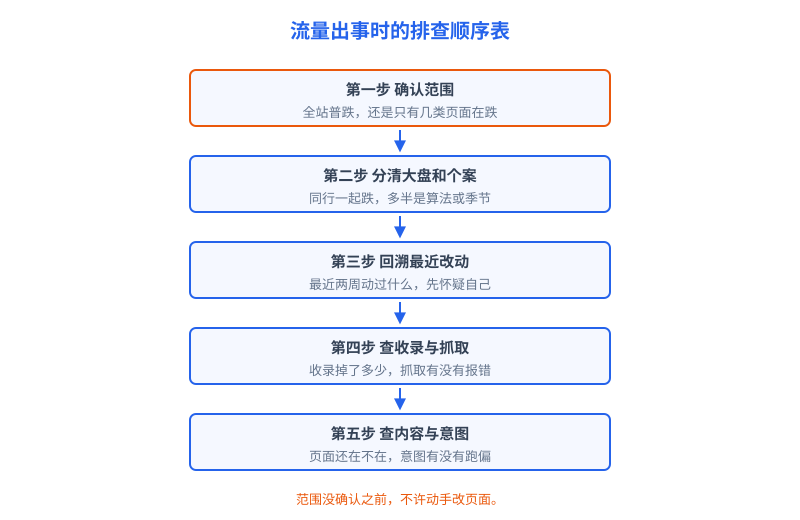
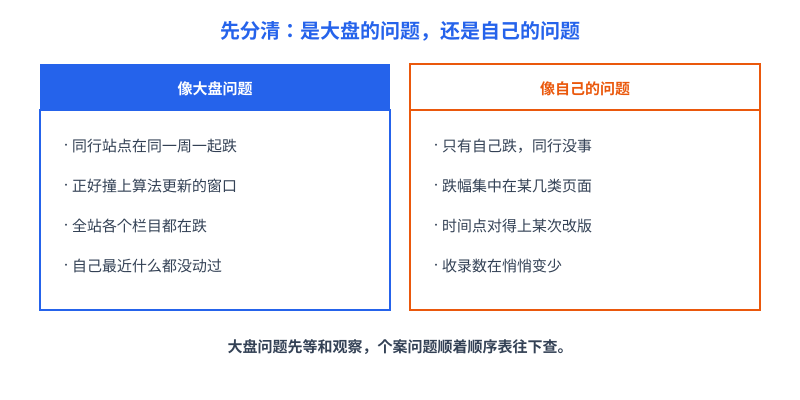

# 第 22 章 故障排查顺序表

## 白话讲解

流量出事，是每个站长都要过的关：轻则某类页面不收录，重则全站点击腰斩。人一慌，手就快，第一反应往往是改标题、删页面、换模板，一通操作之后，局面反而更糟：你既没找到病根，又把现场破坏了，日后想复盘都无从下手。这一章给你一张顺序表，它的全部价值就在于两个字：顺序。排查像医生看病，先量体温再开药，不能上来就做手术。

先把顺序表完整列出来，落地时照着逐项打勾：

1. **确认范围**：跌的是全站，还是某几类页面、某几个词、某个国家或某种设备？
2. **分清大盘和个案**：是整个行业都在跌（算法更新、季节、热点消退），还是只有你自己跌？
3. **回溯最近改动**：最近两周，你和你的团队动过什么？改版、迁移、换模板、改标题规则、动服务器，都算。
4. **查收录与抓取**：收录数有没有掉？抓取有没有报错？关键页面用网址检查工具看一眼实时状态。
5. **查内容与意图**：页面内容还在不在、够不够？用户搜这个词想要的东西，你的页面还给得出来吗？

为什么范围排第一？因为范围决定了后面所有动作的方向。全站齐跌和单个栏目跌，病因清单完全不同：前者先怀疑大盘和基础设施，后者先怀疑这一类页面自身的改动和质量。如果跳过这一步，直接对着某个页面改文案，很可能病灶在别处，你改的每一刀都是新的变量。

确认范围具体怎么做？在 GSC 的效果报告里，选出事前后两个时间段做对比，然后依次按网页、查询、国家、设备四个维度分组，看跌幅的分布。跌幅均匀地摊在全站，是一张脸；跌幅集中在排前面的二十个页面，是另一张脸；只有某个国家的流量没了，又是另一张脸，比如服务器或者域名在那个地区的解析出了问题。把这张分布图看出来，后面四步才有靶子。这一步通常花二十分钟，是整张表里性价比最高的二十分钟。

第二步分大盘和个案，方法不复杂：看看同类型的站点最近是不是一起跌（行业群、论坛、公开的流量监测帖都能问到），再看看时间点是否撞上谷歌官方确认的算法更新窗口，最后回想自己最近动没动过站。如图 22-2 所示，两边的典型特征很不一样，对一遍心里就有数了。大盘问题有个残酷的事实：多数时候你什么都不用做，也做不了什么。算法更新滚动期间排名剧烈波动是常态，通常一两周才尘埃落定，这期间大改页面，等于在地震的时候装修房子。

顺便说清算法更新怎么确认：谷歌有一个官方的搜索状态页面，会公布核心更新的开始和结束时间，业内媒体和站长社区也会在更新窗口期集中报告波动。你的下跌时间段和官方窗口对不上，就别急着往算法头上扣。另外，季节性是另一种大盘：工具站的流量跟着工作日走，内容站跟着话题热度走，年底年初和寒暑假的起伏都写在日历上。先拿去年同期的数据比一比，能排除掉一半的假警报。

第三步回溯改动，是整张表里命中率最高的一步。行业里有句老话：网站出问题，先假设是自己人干的。改版换了渲染方式、迁移漏了重定向、标题模板改错了一个变量、新装的插件给页面加了禁止索引的标记，这些事故全都长着同一张脸：某次改动之后，数据开始往下走。所以养成一个习惯：站里的每一次改动都记一笔日期和内容，出事时先把这本账翻出来对时间点。

常见的自家事故清单，不妨抄下来贴在手边：换服务器或者迁移域名、改动网址结构、调整标题和描述的生成模板、给某类页面批量加了禁止索引的标记、更新了 robots 文件、缓存和加速插件升级、域名证书过期。每一条单独看都无辜，叠在一起就是事故现场。对时间点的方法是把下跌开始那天定为圆心，把前后两周内发生的改动全部列出来，一条一条排除，不许凭印象说“那个应该没关系”。

第四步才轮到收录与抓取。用 GSC 的网页索引报告看收录数曲线，再用网址检查工具抽查几个关键页面：谷歌看到的页面内容全不全？返回的状态对不对？顺带看一眼抓取统计和服务器日志，有没有 5xx 报错或者抓取量突然归零。第五步是内容与意图：这一类页面是不是被自己改薄了？搜索这个词的用户想要的东西变了没有？对手是不是把内容做厚了一截，把你挤了下去？

第五步还有一层常被忽略：意图会漂移。同一个词，去年搜的人想找教程，今年可能想找现成的工具，因为搜索结果页的构成变了，排在前面的页面类型也会跟着变。你的页面内容没变、质量没降，但它回答的问题已经不是用户现在问的那个了，排名照样往下掉。这种情况的药方不在本章：回到第 2 章和第 14 章，重新看这个词现在的前十名都是什么页面，再决定改内容还是换形态。

如图 22-1 所示，五步是一条单行道：没走完前一步，不许跳到下一步动手。看可以随便看，动手必须按顺序。

最后一句嘱咐：排查期间管住手。除了已经确认的故障点，不要顺手优化别的页面。变量越少，恢复之后你越清楚到底是哪一处修复起了作用。

还要有一条时间纪律：给每一步留出观察期。谷歌重新抓取、重新评估一批页面，短则几天，长则几周。你今天修好了收录问题，明天就想看到流量回升，不现实，还容易因为等不及追加新改动，把变量搅成一团。正确的姿势是：改动落账，注明日期，然后按固定节奏复查，比如三天看一次收录，七天看一次点击。数据没到观察期，结论就只能写“待定”，这也是顺序表的一部分。

最后配一个小工具：事故时间线。出事当天就建一个简单文档，把每天的数据快照、你查了什么、改了什么、观察到什么，一行一行记下来。事故过去之后，这份时间线就是你手里很值钱的文档：下次再出事，先翻它；以后有了帮手，先给他看它。很多站长的排查能力，就是这么一份一份时间线攒出来的。

## 阿哲的站

阿哲在这张表上交过学费，也靠它自救过一次。他的工具站月访问量到了几万量级时，他动了一次改版：把工具页面的前端换成了浏览器端渲染，想着页面交互更顺滑，顺手把几个页面的结构也调整了。改版上线时他自己点了几遍，没问题，就没再管。

一周后他发现，来自搜索的点击比前一周掉了三成。他按顺序表往下走。第一步确认范围：他按页面类型拆开看，掉的全是工具页，博客文章那部分稳得很。范围锁定：局部问题，不是全站。第二步分大盘个案：同类的几个工具站朋友问了一圈，没人跌；时间点也对不上任何已知的算法更新。第三步回溯改动：改版上线的时间和下跌开始的时间只差了两三天，正好是谷歌重新抓取这批页面的节奏。第四步查收录与抓取：收录数从九千多掉到了六千多，没掉的工具页，用网址检查工具一看，谷歌抓到的页面正文大片空白：内容要等浏览器端脚本跑完才出现，抓取器拿到的只是个空壳。他当时还差一点犯第二个错误：想趁着改版，把几个工具页的标题也顺手优化一遍。顺序表把他按住了：故障没排除之前，任何顺手优化都是在给排查添乱。他把这个念头记进账本的待办里，等流量恢复之后才逐个小步验证。

病根清楚了，动作也就明确：他把工具页改回服务端直接输出完整内容，保留交互但不再依赖脚本渲染正文；然后在 GSC 里把受影响的重要页面逐个提交重新抓取，并更新了站点地图。接下来就是等：收录用了一周多爬回来，点击用了大约三周恢复到原来的九成。整个过程中他只动了渲染这一件事，其他页面一个字没改。事后他在自己的改动账本上补了一条：改版上线后，必须用网址检查工具抽查一遍抓取到的内容。这次事故还改了他的一个观念：以前他觉得数据下跌是运气问题，现在他认账，站越大，自己动手的机会越多，事故大概率是自找的。先查自己不丢人，查完自己再谈别的，这就是顺序表在他手里的用法。

## 翻车现场

另一位站长的故事更典型。一天早上他发现全站流量腰斩，第一反应是"被算法惩罚了"。他没有查范围，也没有回溯改动，当晚就组织全站整改：标题模板整体重写，自认为质量差的页面删掉了三分之一，还顺带换了主题。忙了两个星期，流量一点没回来，还在继续阴跌。直到他请一位同行帮忙看，对方打开抓取统计，五分钟就找到了原因：他用的内容分发服务在某次配置变更后，对谷歌抓取器大量返回 503 错误，抓取器进不了门，页面自然陆续掉出索引。所谓腰斩，从头到尾只是一个配置事故，三天能修好。

他的连环误操作让代价翻了几倍：标题全站重写，等于把原本积累的点击数据推倒重来；删掉的三分之一页面里有不少是带外链的老页面，权重跟着没了；等抓取修好、索引慢慢恢复，他还要再花几个月把自己删改的东西一点点补回来。一场三天的事故，被他亲手拖成了三个月的坑。错在哪？错在跳过了顺序表的前三步：范围没确认，大盘个案没分清，改动账没翻，就急着对内容开刀。记住一个比例：流量事故里，多数是自己或服务商的改动造成的，算法惩罚反而排在后面。先查自己，再怀疑谷歌。

还有一个细节值得记：那位站长整改期间没有留任何数据存档，等他想回头看腰斩当天的原始构成时，改过哪些页面、删过哪些，全凭记忆，谁也复原不了。排查之前先给关键报表截图存档，可以算作顺序表的第零步：它太朴素，常常被人跳过，本章替它补上。

## 要点回顾

- 排查顺序不能跳：确认范围、分清大盘个案、回溯改动、查收录与抓取、查内容与意图。
- 范围决定方向：全站跌和局部跌，病因清单完全不同，先拆维度看清楚。
- 大盘问题多半只能等：算法更新滚动期别大改页面，那是地震时装修。
- 流量事故先怀疑自己人：改版、迁移、配置，命中率远高于所谓惩罚。
- 排查期间只修已确认的故障点，不顺手优化，变量越少越容易复盘。
- 每次事故留一份时间线：数据快照、排查动作、改动记录，就是下次自救的地图。

## Kata

1. 给你自己的站建一本改动账：从今天起，每次改版、迁移、改模板、动服务器配置，都记一行日期和内容。把过去一个月你能想起来的改动先补记上。
2. 挑你站里一个历史波动（涨的跌的都行），用顺序表的五步完整复盘一遍，写下来：当时你最先怀疑的是什么，按顺序表走，最先该查的又是什么？
3. 现在就去检查三件保命的事：robots 文件有没有误拦重要目录，抓取统计里 5xx 的比例是否正常，站点地图能不能打开、最后更新时间是什么时候。
