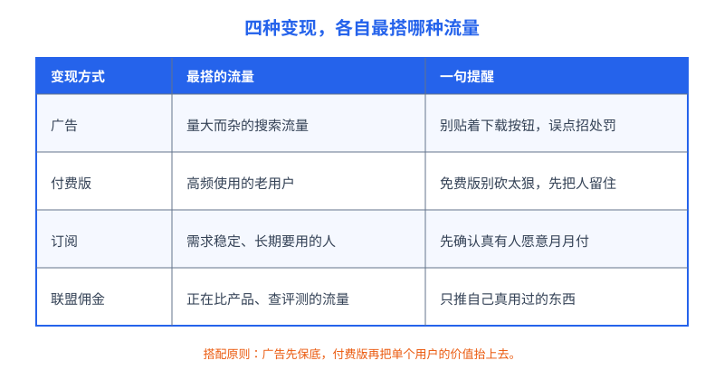
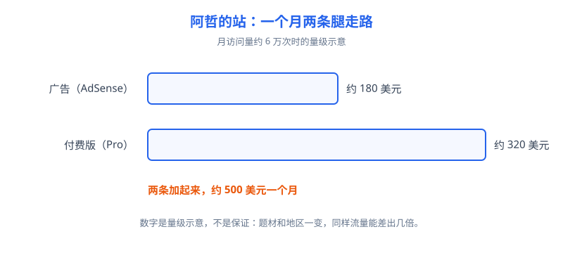

# 第 23 章 流量变现

## 白话讲解

流量做到几万一个月，下一个问题自然就是：这些人怎么变成钱？变现方式翻来覆去就四种：广告、付费版、订阅、联盟佣金。这一章不教你暴富，只算搭配账：哪种流量配哪种变现最顺手，哪种搭配是白费力气，还有每种方式各自的红线在哪。

先纠正一个常见误会：变现不是流量做完之后才想的事。页面怎么排版、功能怎么分层、用户的使用记录怎么留，从建站那天起，就决定了你将来能用哪种方式收钱。等流量起来才发现免费版把该收费的全送完了，或者页面排版根本没给广告留位置，再回头改，成本比一开始想清楚要高得多。这一章就算你眼下用不上，也值得先把账算明白。

先说**广告**，对工具站和内容站最常见的就是谷歌的 AdSense。原理很朴素：广告主出钱买你页面上的位置，按展示和点击计费，你拿到分成。衡量收入的常用口径叫页面 RPM：每一千次页面浏览，你能分到多少钱。这个数没有标准价，被三样东西决定：用户在哪个国家（欧美用户的广告单价通常明显高于其他地区）、你的题材（金融、软件这类题材贵，娱乐类便宜）、广告的位置和数量。所以同样十万流量，收入差出五倍十倍都正常，任何跟你保证单价的说法都别信。广告的红线必须说清，这是通行规则：不能点自己的广告，不能请朋友帮着点，不能在页面上写"点一下广告支持本站"这类诱导话术，广告更不能贴着下载按钮、播放按钮摆放去骗误点。谷歌对无效流量的处理很重：轻则限制广告展示，重则停掉账号，账上的余额还可能被扣回。对工具站来说，最后一条尤其要命：用户是来点按钮的，广告离按钮太近，误点率一高，系统先怀疑的是你。

广告还有一对天生的矛盾：广告越多，单个页面的收入不一定越高。位置堆得太密，用户停留变短、跳出变快，页面体验的口碑也会跟着受损，等于拿明天的流量换今天的钱。稳妥的做法是先放最克制的版本，只留两三个不打扰操作的位置，跑满一个月看真实的页面 RPM，再考虑加不加。用自己一个月的数据说话，比看别人的晒单靠谱得多。

再提醒一句结算的事：广告收入通常按月结算，还有最低付款门槛，小站头几个月可能攒不够门槛，钱要压上一阵子。现金流这么算下来，广告更适合当验证器：在不打扰用户的前提下，先确认这批流量确实有人愿意为它花钱。确认了，再往付费版上使劲。

再说**付费版**，也就是把一部分高级功能收费，免费版照常用。对工具站最自然的分法不是按功能砍，而是按"省时间"分：免费版一次处理一张图，付费版可以批量处理几百张；免费版有文件大小上限，付费版上限放大；免费版要排队，付费版优先处理。用户为效率买单，心甘情愿；你要是把基本功能砍到没法用才收费，那不叫付费版，叫赶人。

收费的形态也有两种。一种是一次性买断或者按次付费，适合低频但单次价值高的需求：比如一年只做几次大批量处理的用户，让他包月毫无道理。另一种就是下面要说的订阅。判断标准还是那句话：看用户来的频率。先把用户的使用次数分布拉出来，头部用户一周来几次，普通用户一个月来几次，分层分错了，价格定得再低也没人买。

第三种是**订阅**，按月或按年持续收费。订阅的前提是需求持续存在：用户每个月都要用，而且用你的比用别家省事。工具站里，只有高频、稳定的需求撑得起订阅，比如天天要处理图片的电商卖家、设计师。低频需求硬做订阅，用户第二个月就退订，还落一肚子怨气。判断方法很简单：看你的老用户里，有多少人是每个月都回来的，这个比例太低，先别碰订阅。

订阅还藏着两个成本，新手容易漏算。一是退订：每个月流失多少用户，决定了你要在获客上补回多少。二是预期管理：用户一旦开始按月付钱，对稳定性和更新速度的要求立刻上一个台阶。半夜服务出了故障，免费用户嘀咕两句就走，付费用户是要退钱的。所以订阅不是多收一种钱，是多签一份长期的活儿。

第四种是**联盟佣金**：在你的页面上推荐别人的产品，用户通过你的链接下单，你拿一笔佣金。它最适合正在做功课、比产品的流量：评测、对比、教程类内容。红线是两条：只推自己真用过、真觉得好的东西；在页面上把佣金关系说清楚，这是很多地区的硬性要求，也是长期信誉问题。乱推一通赚的是快钱，烧的是用户对你的信任，而信任恰恰是前面几章辛苦攒下的东西。

联盟还有个选品的土办法：只从你已经在用、并且愿意写出缺点的产品里挑。能写出缺点的推荐才像真话，用户也不傻，一页全是夸奖的测评，转化率反而低。佣金率给得高得离谱的产品尤其要留神：高佣金往往意味着产品本身不好卖，或者商家在透支口碑，你跟着推，透支的是你自己的。

如图 23-1 所示，四种方式各有最搭的流量类型。搭配错了，再努力也别扭：拿来得快去得快的工具流量去硬推订阅，转化低得可怜；拿高黏性的老用户只看广告，又白白浪费了他们愿意付费的意愿。

搭配的顺序也有讲究：一般先接广告保底，因为它不挑用户、见效最快；等你从数据里看清谁是重度用户，再上付费版把单个用户的价值抬上去；订阅和联盟视你的流量结构决定，有合适的再加。还有一个心态要摆正：变现方式会反过来影响流量。广告太密、付费墙太早，都会伤用户体验和口碑，搜索流量是靠体验和口碑攒的，为多挣一点把基本盘伤了，是最不划算的买卖。

最后教一个算总账的口径：单个访客价值。总收入除以总访问量，就是一个访客平均给你多少钱。这个数把四种变现捏在一起看：阿哲的站一个月六万次访问、约五百美元收入，一个访客大约值零点八美分。这个数最大的用处是横向比较：两个来源的流量哪个访客价值高，哪类页面的访客价值在涨。以后做任何取舍，先问这个数涨还是跌，比只盯着总流量清醒得多。

## 阿哲的站

阿哲的算账过程很能说明问题。他的工具站月访问量到了 6 万次上下时，他先接了 AdSense。广告位他放得很克制：页面顶部一条、工具下方一条，坚决不挨着上传和下载按钮。第一个完整月下来，广告收入约 180 美元。他的用户里欧美占比过半，帮了不小的忙，但也就这个量级，他对自己说：靠广告，这站养不活一个全职的人。

他其实先动过加广告位的念头，把广告数量翻了一倍，试了一周。收入只涨了两成，页面打开速度明显变慢，留言里还多了一条吐槽广告太多的。他把广告位撤回了原样。这次小实验让他认清一件事：他的用户是来干活的，不是来逛街的，广告的天花板就在那里，再挤也挤不出多少，真正的增量在别处。

真正的转机来自看数据：他发现有一小批用户每周都来，一次处理几十张图，反复手动操作。他给这批人上了一个 Pro 版：每月 5 美元，批量处理、更大的文件上限、不用排队、没有广告。免费版原有的功能一样没砍。第一个月，几十位用户订阅，一个月约 320 美元，超过了广告。两条加起来一个月约 500 美元，如图 23-2 所示。数字不大，但结构变了：广告跟着流量忽高忽低，订阅每个月稳稳到账，他第一次觉得这门生意能算得过来账。

他还有两条经验值得写下来。一是定价别拍脑袋：他先访谈了几个重度用户，问他们一个月愿意为省时间花多少，5 美元是多数人点头的数。二是付费版上线后，他没有把免费版改残：免费用户依然是外链、口碑和新用户的来源，砍免费版等于砍自己的流量入口。广告保底、付费版抬价、免费版养池子，三件事各就各位。

他也不是没遇到过诱惑：一个和图片处理毫不相干的产品找他做联盟推广，开出的佣金高得吓人，推一次大概能顶一个月的广告收入。他最后没接，理由写在自己的笔记里：用户信任他，是因为他只说图片处理这一件事，恰恰是这种克制，让重度用户愿意为 Pro 付钱。为一次佣金把定位说乱，是把长期的饭碗换一顿饱饭。

## 翻车现场

翻车的故事就发生在广告的红线上。一个做下载类工具的站长，嫌正常广告位收入太低，动起了心思：把广告紧贴着下载按钮摆放，还把广告的样式做得和站内按钮很像，用户点下载，十次里有两三次点到广告。头两个月收入翻了一倍多，他还挺得意，觉得找到了窍门。第三个月，AdSense 先是限制了他的广告展示，申诉没通过，接着账号被停用，原因是无效流量：点击里异常和误点的比例太高。账号里没结算的余额被扣回，他又试着用亲戚的信息注册新账号，很快也被关联识别，一并停掉。

他错在哪？错在把误点当成了收入。在广告平台的账本里，广告主花钱买的是真实的兴趣，误点对广告主毫无价值，平台必须替广告主把这部分钱追回来，顺带处理掉作弊的人。短期翻倍的收入，本质是提前支取了账号的命。代价是永久性的：这个收款主体基本告别了这个广告平台，而他的站除了广告没有第二条收入腿，流量还在，钱断了。教训反过来写就是本章的搭配账：误点换来的钱一分都不算钱，先把收入结构搭正，再谈多少。

还要注意，这种停用往往不是一家的事：广告平台之间会参考彼此的风控结果，一个主体在主要平台留下作弊记录，再想换一家正规的广告服务重新开始，也会处处碰壁。所以红线这一节不是道德说教，是资产保全：账号本身就是资产，值得像保护域名一样保护。

## 要点回顾

- 变现就四种：广告、付费版、订阅、联盟佣金，先看自己的流量类型，再谈搭配。
- 广告收入看页面 RPM，被国家、题材、位置决定，没人能给你保证单价。
- AdSense 红线：不点自己的、不诱导、不拿广告骗误点，无效流量会被停号扣款。
- 付费版按省时间分层，不按砍功能分层；订阅只适合持续、高频的需求。
- 上线顺序：广告保底，付费版抬单个用户价值，免费版始终是流量入口，不能砍残。

## Kata

1. 给你自己的站算一笔账：现在的月访问量是多少？如果接广告，按你的用户地区构成估一个保守的页面 RPM，月收入大概在什么量级？把假设写清楚。
2. 找出你站里最重度的那批用户（使用频次最高的前 5%），写一页纸：他们最耗时间的操作是什么？如果做付费版，你打算用哪个功能替他们省时间，定价多少，依据是什么？
3. 拿一张纸画你站的变现搭配表：第一行写流量入口，第二行写保底收入，第三行写抬价手段，检查一遍：有没有哪种搭配是逆着流量类型硬上的？
