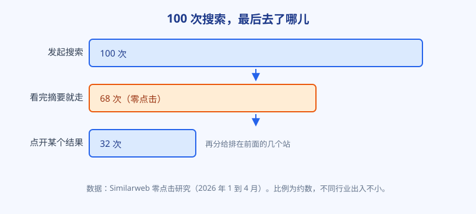
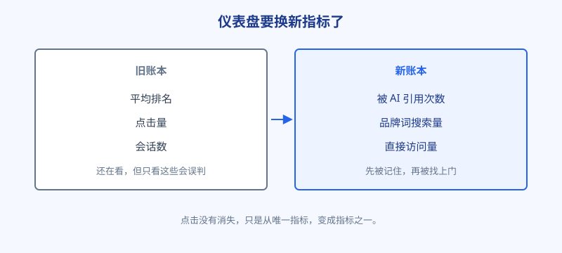

# 第 24 章 点击正在消失

## 白话讲解

先把结论放在前面：这一章要说的事，不是你的站出问题了，而是搜索这件事本身在变形。变的不是排名规则，而是用户拿到答案的方式。

打个比方。以前的搜索引擎像车站问讯处：你问一句"去市图书馆怎么走"，它告诉你"三号窗口"，你还得自己走过去。现在的搜索引擎像一位热心过头的同伴：你刚开口，他直接把路线、班次、步行时间一口气说完了。窗口还开着，手艺也没丢，只是排队的人少了一大半。

这个变化有个名字，叫零点击搜索：用户搜完，答案在结果页上就看齐活了，一个链接都没点。零点击不是新鲜事，天气、汇率、单位换算这类查询很早就被结果页直接答完了。选摘要、知识面板先吃掉一轮，近两年的 AI 摘要（英文里常叫 AI Overview）又吃掉更大一轮：它把好几页的内容揉成一段话，放在结果最顶上，用户看完就走。

这件事也不是一夜之间发生的。把时间线拉长看，点击是被一口一口吃掉的：早年间先是天气、汇率这类标准答案被做成答案框，直接钉在结果页上；后来精选摘要把"什么是 X""怎么做 Y"的第一段答案拎出来展示；再后来知识面板把机构、人物、产品的基本信息整页陈列。每一步，都有一个类型的查询不再需要点击。AI 摘要是这条线上的最新一口，而且是最大的一口：它不再限于标准答案，连需要归纳、比较、给步骤的复杂问题，也能当场拼出一段像样的回答。理解了这条线，就不会把今天的局面当成某次算法更新的意外，它是搜索产品演进的方向，退不回去了。

到底吃掉了多少？如图 24-1 所示，按 Similarweb 的统计，2026 年 1 到 4 月，约 68% 的谷歌搜索以零点击收尾。Pew Research 的研究则发现：AI 摘要出现的那批搜索里，点开传统结果的人大约减半；愿意点摘要里来源链接的人，就更少了。

图 24-1：零点击不是个别现象，而是多数搜索的常态。

不过，先别急着给自己的站写悼词。点击消失不是均匀消失的，不同类型的查询，命运完全不同：

- 查定义、查步骤、查常识的信息型查询，跌得最惨。答案就一两句话，AI 摘要说完，用户没有任何理由再点进来。
- 找工具、要下单、需要动手操作的交易型查询，相对稳得多。用户搜"在线压缩图片"，摘要讲得再清楚，他也得点进一个站，把图片传上去。工具是没法被一段文字替代的。
- 品牌词查询甚至可能逆势涨。用户在别处听说了你的名字，再回来搜你，这个动作不依赖排名，依赖的是你之前攒下的脸熟。

所以看到流量下滑，第一反应不该是慌，也不该是加倍产出内容，而应该先分清：我丢的到底是哪一类查询的点击。如果丢的是信息型查询，要承认这类内容的结算方式变了：以前是拿内容换点击，现在内容更多是在换另一件东西。

这里顺带解释一个很多人看不懂的现象：为什么会出现"展示涨、点击跌"这种背离？因为在 AI 摘要里露脸，也算一次展示。你的页面被引擎选进摘要的候选材料，或者出现在摘要的来源名单里，Search Console 都可能记你一次展示。于是就有了这种局面：引擎其实更频繁地"想起"你，用户却更少地点进你。只看展示，你会以为自己在上升；只看点击，你又会以为自己在坠落。两个数单看都骗人，必须摆在一起看点击率，再亲手去搜一遍，才知道真相。

那是不是说，内容可以不用做了？恰恰相反，只是内容的岗位变了。以前写教程，是站在搜索结果里钓点击；现在写教程，至少有三份新工作：一是在 AI 回答里争取被引用，让用户先认识你；二是给自家的工具页和产品页输血，用户读完教程顺着内链去用工具，这条路 AI 摘要截不断；三是沉淀成品牌，用户在三处不同的回答里都见到同一个名字，信任就是这么攒出来的。岗位变了，考核方式跟着变，仅此而已。

换的是什么？如图 24-2 所示，是一套新指标。排名和点击当然还要看，但光看它们会误判。新的仪表盘上，至少要再加三个数：

图 24-2：点击仍是硬通货，但不再是唯一的账。

第一，被 AI 引用的次数。你的页面出现在 AI 回答的来源名单里，等于 AI 当着用户的面替你报了一次名。第二，品牌词搜索量。用户在回答里看到你的名字，下次直接搜你的品牌，这个数会慢慢涨。第三，直接访问量。把网址记住了、收藏了、从聊天记录里翻出来直接打开的，都是直接访问。

背后的逻辑是：流量的路径从"搜到，点进来"变成了"先在 AI 回答里混个脸熟，再找上门"。点击没有消失，只是从唯一的结算方式，变成了几种结算方式之一。谷歌官方在谈生成式 AI 搜索时给过一句定心的话：为生成式 AI 搜索做优化，本质上仍然是 SEO。地基还是那套地基：能被收录、内容对得上意图、值得信任。变的主要是上层建筑：你不能再只盯着点击这一个数过日子了。

最后按站型速览一遍影响，心里好有个谱。纯内容站、教程站是重灾区，要最先换仪表盘；工具站表面稳，但教程内容那一半的打法要变；电商站的选购指南类页面会被截胡，产品页本身相对安全；本地服务类站点，用户最终要打电话、要到店，AI 摘要能截走科普，截不走交易。你的站落在哪一档，决定了这一章的紧迫程度排第几。

接下来三章，我们就顺着这条路往下走：AI 到底怎么挑答案，被挑中的内容长什么样，以及页面结构要怎么改。

<small>本章数据来源：Similarweb 零点击研究（2026 年 1–4 月）；Pew Research 关于 AI 摘要与点击行为的研究。</small>

## 阿哲的站

阿哲是先从数据里闻到味儿的。

接上一章的进度，他的工具站已经跑了大半年：教程内容带流量，工具页接广告和付费版，每个月访问量到了几万的量级，收入稳定在几百美元。他每周一雷打不动看一次 Search Console。那个周一，他盯着屏幕看了很久：过去 28 天，展示次数涨了快三成，点击只涨了 3%，还有几个核心教程词，点击结结实实跌了两成。

第一反应和所有站长一样：是不是被降权了？他按第 22 章那张排查顺序表一项项过：收录覆盖率正常，没有人工处置通知，抽查十个词，排名基本没动，服务器也没出故障。表走完了，结论是：站没病。

说句题外话，他差点在排查之前先犯个错误：看到教程词的点击跌，第一冲动是去改标题，往标题里塞更勾人的说法，把点击率先救回来。手都伸到后台了，他想起第 22 章的规矩：没定位问题之前不动页面。后来证明这一下忍住是对的：问题根本不在他的标题上，把标题改得再花哨，也拦不住用户在结果页就把答案看完。

那答案在哪？他干脆亲手去搜。把最重要的教程词"compress image without losing quality"输进谷歌，结果页顶部是一段 AI 摘要，把压缩的原理、步骤、注意事项讲得清清楚楚，底下挂着三个来源链接，没有他。他的页面排在自然结果第四位，纹丝没动，可用户在滚动到第四位之前，问题已经解决了。

他又花半小时，把站里的词分成两堆挨个验。一堆是教程词，比如"png 和 jpg 的区别""图片太大了怎么发邮件"，几乎个个顶着 AI 摘要，点击普遍在跌，但展示反而涨，因为他的页面进了摘要的候选池，露过脸就算一次展示。另一堆是工具词，比如"compress png online""resize image to 100kb"，点击基本稳住，用户要的是动手的地方，摘要替代不了。

当晚他在笔记里写了三句话，算是给自己换了仪表盘：

第一，教程页的目标改了，不再只看点击，还要看有没有被 AI 引用，哪怕暂时查不到，也先记着这笔账。

第二，工具页继续按老规矩冲排名、冲点击，这是眼下真金白银的来源，不能松。

第三，每周多记一个数：品牌词搜索量。他的站名开始有人直接搜了，哪怕一周只有几十次，那也是 AI 时代最抗跌的资产。

## 翻车现场

翻车的是阿哲的一位同行，做了五年消费电子教程站，内容扎实，口碑一直不错，我们叫他老陶。

去年有一阵，老陶发现自己站的展示次数涨了四成。他没多想，认定是赶上了平台红利期，连夜定下扩张计划：兼职写手从两人加到六人，选题产量翻了一倍多，专挑搜索量大的热门问题写。他的判断逻辑是老一套：展示涨，说明平台在推我；我多产出，点击自然跟着涨。

三个月后结算：广告收入跌了三成多。写手的钱已经按月发出去了，账面上进的少、出的多，他这才坐下来认真看数据。点击率从年初的一路下滑，明明白白写在报表里，他一次都没点开看过。更要命的是，他让写手新产出的那批选题，恰恰全是信息型问题，是被 AI 摘要吃得最干净的那一类。产量翻倍，等于往漏水的桶里加倍倒水。

老陶错在哪？他把展示当成了需求。其实那阵子展示上涨的原因，和他以为的正好相反：不是平台更爱他了，而是 AI 摘要把他的页面当成了候选材料，拿去展示的次数变多了，真正落到他站里的点击却在变少。他拿着旧仪表盘，读出了完全错误的结论，还在错误结论上押了六个人的工资。

救法也谈不上高明，就是笨办法回炉：停掉纯信息型选题，把写手转去做两类内容，一类是带实测数据的深度测评，摘要嚼不动；一类是工具配套页，给自家小工具引流。又用了小半年，收入才慢慢爬回原来的水平。那半年里最难受的还不是收入，是团队的信心：写手们一度怀疑是自己的文章质量出了问题，士气低迷。老陶后来跟他们把数据摊开讲了一次：不是文章变差了，是读者的阅读地点变了，从大家的站里，搬到了结果页上。这话把人心稳住了，但本可以更早说的。老陶后来在同行群里总结了一句话，被阿哲抄进了笔记本：大盘的口径变了，你的仪表盘要先变。他还做了个小小的补救仪式：把原来每周看的那张报表截图删了，换成新口径的五项：点击率、工具页点击、被引用抽查、品牌词搜索、直接访问。换报表不值钱，值钱的是换脑子：报表上没有的数，人是不会去想的。

## 要点回顾

- 零点击已是常态：约 68% 的搜索在结果页就结束，AI 摘要出现时，传统结果的点击大约减半。
- 点击消失不均匀：信息型查询跌得最惨，工具型和交易型相对稳，品牌词可能逆势涨。
- 展示涨、点击跌同时出现，先别查降权，先亲手搜一遍自己的核心词，看结果页长什么样。
- 仪表盘要扩容：在排名和点击之外，加上被 AI 引用次数、品牌词搜索量、直接访问量。
- 谷歌的官方口径是：为生成式 AI 搜索做优化，本质上仍然是 SEO，地基没变，结算方式变了。

## Kata

1. 打开 Search Console，对比最近 28 天和上一周期：展示、点击、点击率各变了多少？如果展示涨而点击率跌，先别下结论，把变化最大的十个查询词记下来。
2. 把这十个词逐个亲手搜一遍（记得用无痕窗口），记录每个词的结果页顶部有没有 AI 摘要，你的页面排在第几，有没有出现在摘要的来源里。
3. 给你的站列一张新仪表盘：除了排名、点击，再加上被引用（暂时没有工具就手工抽查）、品牌词搜索、直接访问三项，写下你打算从哪天开始每周记一次。
