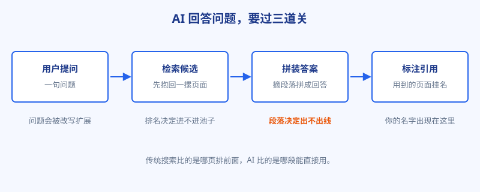
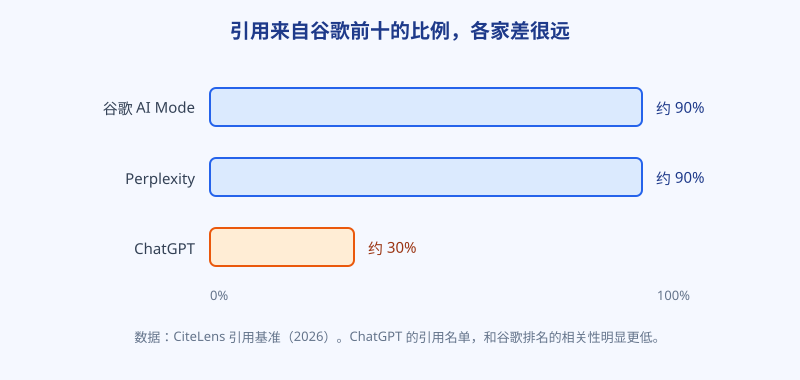

# 第 25 章 AI 怎么挑答案

## 白话讲解

上一章我们认了账：点击在消失，AI 摘要站在结果页的最前面。那接下来就得弄明白一件具体的事：AI 写那段摘要的时候，凭什么挑中这几页、没挑中你？这一章就拆它的工作流程。

把 AI 搜索引擎想成一位赶时间的编辑。它回答一个问题，大体要过三道关，如图 25-1 所示。

图 25-1：你的页面要先被检索到，再在拼装环节被摘中，最后才轮到挂名。

第一道关，检索。用户的问题先被改写、拆细，变成几个查法，引擎再拿着这些查法去自己的索引和网络里，抱回一摞候选页面。举个例子，用户问"出国旅游照片太多，手机存不下了怎么办"，引擎心里拆出来的可能是三四个小问题：照片怎么压缩、哪种格式更省空间、压缩会不会伤画质、有什么在线工具。它拿着这几个小问题分别去查，再把结果汇总。所以你的页面对上其中任何一个小问题，都有机会被抱回来；只对上用户那句原话的，反而未必。这一步的逻辑和传统搜索是近亲：页面先得被收录、被认为和问题相关，才有资格进候选池。排名在这里的作用，是决定你进不进池子、站在池子的前排还是后排。

第二道关，拼装。这是和传统搜索分道扬镳的地方。编辑不会把候选文章从头读到尾，他是拿着问题去文章里找段落：哪段话直接回答了这个问题，就把哪段摘出来，再把几家的说法理顺、拼成一段通顺的回答。注意，拼装的单位是段落，不是页面。你的文章写得再全，如果答案埋在第九段，或者每段都离不开上下文才看得懂，编辑翻两下就去摘别人家的了。

第三道关，引用。回答拼好之后，引擎把实际用到的页面挂在回答下方或行间，这就是引用名单。谁的材料被用上了，谁的名字就出现在这里。上一章说的"被引用次数"，数的就是这张名单。不同引擎挂名单的习惯不一样：有的在回答里给脚注编号，点开能看到对应页面；有的在回答末尾列一排来源卡片。形式不重要，重要的是同一件事：名单是按"实际用到了谁"生成的，不是按排名顺延的。排在后面的页面，只要段落被摘了，照样上名单；排第一的页面，段落要是没被用上，名单里照样没它。

拿同一个问题，对照看看两段文字的命运。问题是"压缩图片会不会变模糊"。甲页面里是这样写的："图片压缩是一个复杂的问题，涉及编码方式、质量参数、图像内容等多个方面，需要结合具体情况分析，本文将逐一展开讨论。"乙页面里是这样写的："会有轻微损失，但对手机照片来说，质量参数开到 80 以上，肉眼基本看不出差别；如果是截图和文字图，建议用无损格式，体积能小一半，清晰度一点不丢。"不用等引擎来判，你自己当编辑，也会摘乙、弃甲：甲说了等于没说，乙每句都是能直接搬进答案的现成材料。全书后面要讲的写法，拆开看都是在把甲改成乙。

把三道关连起来看，有一句话值得记住：排名决定你进不进池子，段落决定你出不出线。这也是后面两章的由来：第 26 章讲材料本身怎么写才可信，第 27 章讲段落怎么摆才好摘。

拼装环节还有一个细节，值得单独说：编辑拼稿时，会不自觉地做交叉验证。几个来源对同一件事的说法一致，他就放心大胆地写进回答；只有你一家这么说、还拿不出证据的说法，他多半会绕过去，省得担风险。这对小站是个提醒：你的结论可以和大站不一样，但必须把证据摆得比大站更足，否则在拼装环节，你的"不一样"会被当成"不靠谱"过滤掉。反过来，如果全网都在抄同一句错话，而你手里有实测能纠正它，那正是你被单独摘出来的机会。

还有一个实操层面的提醒：这张名单不是静止的。同一个问题，隔一周再问，引用名单可能换掉小半。这不是引擎善变，而是候选池一直在变：有新页面被收录，有旧页面更新，有同行也在按同样的规矩改自己的段落。所以被引用不是一次性荣誉，更像一个需要每月复查的在岗状态。某次检查没上名单，先别急着改版式，把趋势看够两三个月再下结论，这也是阿哲那张观察表要按月记的原因。

还有一层复杂性：每个引擎的脾气不一样。如图 25-2 所示，按 CiteLens 的引用基准统计，谷歌 AI Mode 和 Perplexity 引用的来源，约九成出自谷歌搜索结果的前十名；ChatGPT 只有约三成，剩下七成来自更宽的地方：百科、社区讨论、第三方测评、视频，等等。这意味着，对前面两个引擎，传统排名仍然是硬通货；对 ChatGPT，光有排名远远不够，它更像一个到处打听口碑的用户，谁在全网被提得多、被说好，它就倾向于信谁。第 28 章要讲的"别人嘴里的你"，根子就在这里。

图 25-2：同一个问题，换个引擎，引用名单可能完全是另一批人。

再补一组数，帮你把"排名等于被引用"这个念头彻底放下。《State of AI Search 2026》用一万两千条提示词做了实测：谷歌排第一的页面，被至少一个 AI 系统引用到的概率只有约 37%；整体看，排名位置和被引用之间的相关性约为 0.42。有相关，但也就是"有点相关"的程度。把全部精力押在冲第一名上，赌的是那 37%，输掉的是另外六成多的机会。

检索这一关还藏着一个常被忽略的点：引擎抱回候选页的速度是有限的，它不会为了一个问题去翻遍全网。页面能不能被快速抓到、打开，仍然算数。第 11 章讲的加载速度、站点稳定性，在传统搜索里影响排名，在 AI 搜索里还多了一层作用：影响你出现在候选池里的概率。抓取又慢又经常出错的站，编辑连你的材料面都见不着，后面的拼装和引用就都与你无关了。

所以这一章的结论很朴素：SEO 的老功夫还要练，它保你进池子；但从这一篇开始，你的目标函数变了，从"排得更靠前"变成"更容易被摘、被引、被提名"。

<small>本章数据来源：CiteLens 引用基准（2026）；《State of AI Search 2026》（12,000 条提示词实测）。</small>

## 阿哲的站

阿哲弄明白三道关之后，做的第一件事很笨，但很对：他花了一整个晚上，亲手做了一轮跨引擎实测。

他列了十个对自家站最重要的查询词，挨个在 ChatGPT、Perplexity 和谷歌 AI 摘要里问了一遍，建了张表：问题、每个引擎引了谁、有没有他、引用的是第几名的页面。问的时候他特意保持"小白问法"，直接打用户会打的那句话，不加任何引导。

还有两个小细节，他是踩了一遍才总结出来的。一是同一个问题要在不同时间问两遍：AI 的回答有随机性，今天引你、明天不引你，都属正常，单次结果当不了数，要看多次出现的频率。二是要把问法固定下来存档：多个词、换个语序，名单都可能变，只有问法不变，月与月之间的数据才比得起来。这两条听起来笨拙，却是后面所有 GEO 监测的地基，第 30 章会再回到这件事上。

结果有点扎心，又很有用：

Perplexity 引了他的页面，是一篇讲格式转换的指南。那篇在谷歌排第五，不算靠前，但胜在每节都先给结论，他后来回看才意识到，这正是拼装环节占了便宜。

AI 摘要一个都没引他。被引的全是谷歌前三名的页面，其中一家的内容其实不如他全，但每段都短、都直给。他的页面卡在检索和排名之间：进了池子，站位太靠后。

ChatGPT 的名单最出乎意料：一个论坛讨论帖、一个竞品、还有一个视频。他的站连候选都没进。这印证了图 25-2 的口径：这一路引擎看的不是排名，是全网的口碑分布。他在表上给 ChatGPT 那一列标了八个字：非一日之功，先记账上。

把十个词的结果汇总起来，是这么一幅图景：Perplexity 引了他的两篇，谷歌 AI 摘要零篇，ChatGPT 零篇；被引次数最多的页面，是一家内容不如他全、但结构清爽的同行。他对着这张汇总表看了很久，意识到一个排序问题：三个引擎里，他离出线最近的是 Perplexity，因为那一路基本按排名加结构挑人，他努努力就够得着；最远的是 ChatGPT，那一路得靠站外口碑，是以季度为单位的慢功夫。先易后难，他给三个引擎排了优先级，而不是眉毛胡子一把抓。

这一晚上的实测，给他换来了三件确定的事。第一，他的页面不是没人要，是"站位"和"段落"两个环节各输了一点，都有具体的改法，不是玄学。第二，不同引擎要分开看待，混在一起谈"AI 流量"没有意义。第三，他把这张表固定成了每月一次的例行检查，问法不变、词不变，这样每个月的数据才比得起来。那句话怎么说来着：量不了，就管不了。这是第 30 章的事，这里先埋个伏笔。

## 翻车现场

翻车的是一位做家居用品的站长，姓鲁，手里有个内容做得不错的选购指南站。

鲁站长是传统 SEO 的好学生：选词、内链、外链，一样没落下，硬是把站里的核心词做到了谷歌第一。他把排名截图发到同行群里，配了一句"第一了，AI 引用还不是顺手的事"。群里一片恭喜。

一个月后，他统计 AI 带来的访问：零。被引用的，是排第三的那家。

他百思不得其解，去翻第三名的页面，翻完沉默了。人家的页面不长，但每一节都是"先说结论，再给两条理由，最后一句提醒"，段落短、边界清，像切好的拼盘。回头看自己的第一名页面：为了显得全面，他把一篇文章写成了近万字的长卷，历史沿革、参数辨析、选购要点全塞在一起，关键答案散落在十几个段落里，有几处还要连着上下文才读得通。排名环节他赢了，拼装环节他输得干干净净：编辑赶时间，摘不动他的文章。

这件事在同行里传开后，有人总结得很损，但很准：你写的是给搜索引擎看的目录，人家写的是给 AI 编辑备的料。

鲁站长的救法，是先挑流量最大的三页做手术：拆长文、每节结论提到段首、每段自带主语和数字。具体怎么改，第 27 章会细说。改完两周，其中一页进了 Perplexity 的引用名单。他这才承认：第一名是入场券，不是保险箱；0.42 的相关性，中间隔着的全是手艺。后来有人在群里问他秘诀，他回了一句：以前我觉得内容是写给排名看的，现在才知道，是写给一位赶时间的编辑看的。

## 要点回顾

- AI 回答问题要过三道关：检索抱回候选页，拼装时摘段落成文，最后把用到的页面挂进引用名单。
- 排名决定进不进候选池，段落质量决定出不出线，两件事要分开优化。
- 各引擎脾气不同：AI Mode 与 Perplexity 约九成引用来自谷歌前十，ChatGPT 只有约三成，更看重全网口碑。
- 排名第一被任一 AI 系统引用的概率只有约 37%，排名与引用的相关性约为 0.42，别把排名当保险箱。
- 跨引擎实测要固定词、固定问法、定期重复，数据才有可比性。

## Kata

1. 建一张引用观察表：选你的 5 个核心查询词，分别在 ChatGPT、Perplexity、谷歌 AI 摘要里提问，记录每个引擎的引用名单和有没有你。
2. 算一算重合度：被引用的页面，有几成同时在谷歌前十？再看看你的页面在这些词下面排第几，判断你输在检索环节还是拼装环节。输在前者，先补排名和收录；输在后者，把精力放到第 26、27 章的材料与结构上，别用错了药。
3. 挑一篇被 AI 引用的竞品页面，逐段读，写下它"好摘"的三个具体特征，再对照你自己的对应页面，标出差距最大的那一条。
