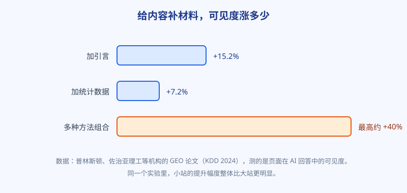
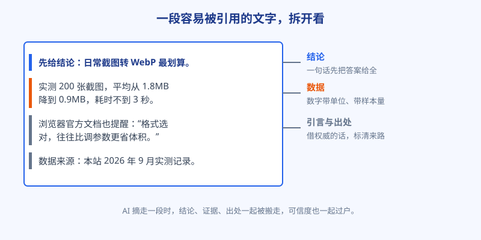

# 第 26 章 被引用的内容长什么样

## 白话讲解

前两章把局势和规矩讲清了，这一章落到最实的地方：你的页面，到底要长成什么样，AI 才愿意引用它？

先说一个好消息：这件事已经有人替我们做过实验了。2024 年的 KDD 会议上，普林斯顿大学、佐治亚理工等机构的研究者发表了一篇关于生成式引擎优化的论文，业内简称 GEO 论文。他们做的事情很直接：准备一批真实问题，再把每个问题下面的候选页面做不同的加工，有的加引言，有的加数据，有的只改措辞，然后把加工过的页面放回引擎里，看它们在 AI 回答里露脸的份额是涨是跌。涨跌都用数据说话。这一章的核心结论，就来自这项实验。

先提醒一句怎么读这组数据：实验测的是"可见度"，也就是页面在回答里被提及、被引用的分量，不是点击量，更不是收入。可见度涨四成，不等于收入涨四成，中间还隔着用户点不点、记住不记住好几步。把这一点分清，才不会拿着论文数据去做过高的指望。另外，实验是在受控条件下做的：改一个变量，看一次结果。现实里你改版往往是材料、结构、更新时间一起动，涨了跌了，很难精确归因到哪一条。这不妨碍它当指南针：方向是清楚的，剩下的是你自己的耐心活。

如图 26-1 所示，实验里效果最扎实的做法有三条：

第一，加引言。在内容里引用权威来源的原话，比如官方文档怎么说、标准怎么定、内行怎么讲，页面的可见度提升了 15.2%，是所有单项做法里最高的。

第二，加统计数据。把"效果不错"换成带具体数字的表述，可见度提升了 7.2%。

第三，组合使用。多种做法一起上，可见度最高能提升约 40%。而且实验里还有一个对小站特别友好的发现：体量越小的站，受益越明显。道理也不难懂：大站本来就天天被引，没多少上升空间；小站把材料备齐，等于把缺的那张入场券补上了。

图 26-1：补材料不是玄学，实验测出来的涨幅摆在这里。

如果手头时间只够先做一样，先补数据，再补引言。原因很实在：引言借的是别人的权威，同行明天也能把同一句话引到自己文章里；你亲手测出来的数据却是独一份，别人想用，只能引用你。独一份的材料，才是小站能攒下来的真资产。引言解决"这次被不被摘"，数据解决"以后会不会被当成源头"。

为什么偏偏是引言和数据管用？把 AI 想成第 25 章那位赶时间的编辑就顺了。他拼一篇回答，最怕两件事：一是说错，引用了不靠谱的说法，砸的是他自己的招牌；二是拼不顺，材料东一块西一块，他得花力气改写。你的页面如果把权威的原话摆好、把确切的数据算好、再把出处标清，他摘你的段落，等于连核实和注脚的工夫都省了。可信，又顺手，这样的材料没有编辑不爱。

举个小例子，看同一句话的两种命运。软话版是这样："这款工具压缩速度快，效果好，很多人都在用。"材料版是这样："我们拿 50 张手机照片实测，这款工具平均每张处理 0.8 秒，体积降到原来的四成左右；它的官方文档也提示，大批量处理时建议分批上传，避免浏览器内存不足。"前一句里没有一处能被转述：快是多少快，好是多好，很多人是多少人。后一句里，数字、出处、提醒一应俱全，编辑闭着眼都能摘。两句话的字数差不了多少，命运差得很多，差的不是文采，是材料。

所以"容易被引用的内容"可以拆成三个词：可摘、可信、可追溯。可摘，讲的是结构，下一章细说；可信，讲的是材料本身有分量；可追溯，讲的是每个说法都能顺着出处查回去。如图 26-2 所示，把一段好材料剖开看，无非这三层：结论给得干脆，证据带数字，引言和出处压阵。

图 26-2：AI 摘走一段时，结论、证据和出处是一起被搬走的。

还有一条使用说明：不要把这组数据读成"往文章里塞名人名言就能涨流量"。引言要引真正相关的权威，出处要给真实存在的原文，数据要经得起人去查。实验测的是"给编辑备好料"的收益，不是"摆出一个有料的样子"的收益。摆样子的下场，本章的翻车现场会讲。

顺着实验结论，再把两件手艺说细一点。

引言怎么引才算数，有三条。一是引对人：优先引官方文档、行业标准、一线从业者公开发表过的说法，别引另一篇和你一样的营销文，编辑分得清谁是谁的上游。二是引原话：用引号把原话框出来，别改写，改写过的"引言"在编辑眼里就是你自己的话，借不到权威。三是标来路：紧挨着引言给出处，链接也好、文献名也好，让人（和机器）顺手就能查。

数据怎么补才算数，也有三条。一是自己的实测优先，哪怕样本只有十几个，因为它全网独一份，别家抄不走。二是二手数据要交代年份和来源：三年前的数据和今年的数据，说服力完全两回事，写清了反而显得你严谨。三是给数字配上条件：平均数是在什么样本上算的、参数是怎么设的，条件越全，这个数字越敢被人引用。说到底，补材料补的不是装饰，而是让别人能放心转述你的话。

<small>本章数据来源：普林斯顿大学、佐治亚理工等机构的 GEO 论文（KDD 2024）。</small>

## 阿哲的站

阿哲拿自家最重要的那篇教程页开刀，就是第 24 章里被 AI 摘要截了胡的那篇，教用户无损压缩图片的长文。

先说原稿的毛病，很典型：通篇是"我觉得""一般来说""效果还不错"，没有一个具体数字，没有一处出处。站在用户的角度，它没说错什么；站在 AI 编辑的角度，它浑身都是没法直接用的软话。

他按实验结论改了三处：

第一处，补数据。他拿自己的工具当实验台，找了两百张真实图片：手机照片、电脑截图、设计插画各占一批，一张张过压缩，把每张的原始体积、压缩后体积、耗时都记下来，最后汇成一张小表放进文章：哪种图平均能省多少、哪种格式适合哪种图、参数开到多少开始伤画质。数据不大，但每一个数都是他亲手测的，方法也写在了旁边。

第二处，加引言。讲到格式原理的两节，他各引了一小段权威说法：一段来自浏览器厂商的开发者文档，讲各格式的设计取向；一段来自图像格式的公开说明，讲压缩方式的差别。引文不长，各两三句，都标了出处链接。

第三处，标出处。把全文的关键结论过了一遍：有出处的补上链接，是自己实测的就注明"本站实测"和测试日期，实在找不到依据的一句软话，干脆删掉。

这套改法做完一遍，他把它固化成了一张五项改稿清单，钉在显示器边上：每个关键结论有出处吗；全文有实测数据吗；引言引的是不是真权威；数字带没带条件和单位；有没有一句查无此据的软话可以删。之后每改一篇，先过这张清单再发布。他说这张清单最大的好处，是把"凭感觉写"变成了"照单子查"，手艺这东西，能列成清单，才算真的学会了。

插一句改稿中的小插曲。第一版他引文加得太勤，几乎每节都挂一段，朋友看完说像论文综述，读起来累。他认账，把引言砍到只剩最关键的两处：引言是给结论压阵的，不是用来凑字数的，满篇都是权威，等于没有权威。这一砍，反倒让他把实验结论理解得更实：加引言的收益，来自"在关键处有靠山"，不是来自"引得越多越好"。

改完之后，他没有等来立刻的变化。两周里，那篇页面在各引擎的引用名单里依然没露面。他没慌，把这次改版的时间点记进第 25 章那张观察表，备注了一句：材料备好了，还差结构。他的判断是，引擎重新抓取和评估需要时间，而且这一页的老毛病不止材料一项：开头三段全是背景铺垫，答案埋在中间。这正是下一章要动手术的地方。

## 翻车现场

翻车的是一位做软件测评的站长，内容手艺不差，坏就坏在一个"快"字上。

他比阿哲更早看到 GEO 实验的报道，结论记得门儿清：加数据、加引言能涨可见度。问题是他手里没有数据。从零实测一款软件要大半天，他觉得划不来，于是走了近路：把"提升明显"改写成"实测提升 30%"，把"很多人反馈"改写成"87% 的用户表示满意"，还在文末挂了一个根本不存在的"实验室年度报告"当出处。格式上，该有的数字、引号、出处一样不缺。

头一个月，效果真有：两篇文章先后被 AI 引擎引用，他还在同行群里分享了"经验"。得意没撑过第二个月。一位较真的用户在社区发帖，说自己被 AI 的回答安利了这款软件，想查一下那份年度报告的原文，结果全网搜不到，顺藤摸瓜，把文里几个数据的来历都问了一遍，一个都对不上。帖子热度不低，评论区很快有人把他站里其他文章的数据也抽查了一轮，又揪出两处编造。

后面的连锁反应，比没被引用惨得多：那几篇文章被引擎悄悄换下了引用名单，同类问题转引同行；更伤的是口碑，他站的品牌词搜索量一个月跌了四成，老用户在帖子里的评价就一句：他家的数字，我是不敢信了。

事后他做了补救：把编造的几处数据逐条删掉，换成老老实实的实测，又在原文顶部挂了更正说明。流量没有因为更正立刻回来，但帖子下面开始有人留言说"肯认错，还算厚道"。这是后话了：信任的修复以季度计，崩塌只要一帖。

这个跟头的账要算清：GEO 放大的是可信度。你备的是真材料，它把真材料放大；你备的是假数据，它连造假一起放大，而且放大的速度比你删帖的速度快。造假在传统 SEO 里尚且是慢性中毒，在 AI 时代是当场社死。没有数据，正确的动作只有一个：先去测。实测十张图、二十个样本，数据小一点都没关系，注明方法和样本量，它就是真材料。测不了的那个结论，就不要写。

## 要点回顾

- 普林斯顿 GEO 实验证明：加引言可见度 +15.2%，加统计数据 +7.2%，组合使用最高约 +40%，小站受益更大。
- AI 挑材料只看两件事：可不可信、用起来顺不顺手。引言借权威，数据可核查，出处可追溯。
- 容易被引用的内容有三层：结论干脆，证据带数字，引言和出处压阵。
- 自己的实测数据是最划算的材料：样本小没关系，注明方法和日期，它就是真数据，也是同行抄不走、只能反过来引用你的源头资产。
- 编造数据和虚假出处是 GEO 时代最贵的错误，放大效应会连品牌一起赔进去，省下的那点实测时间，事后要连本带利还回去。

## Kata

1. 挑出你站里最重要的一篇文章，把文中所有数字标出来，逐条核对：有没有出处？顺着出处查得回去吗？查不回去的，要么补测，要么删掉。
2. 给这篇文章补一段权威引言：找官方文档、标准或公认内行的原话，不超过三句，标明出处，并说明你为什么选这一段。
3. 做一次属于自己的小实测：用你的产品、工具或服务跑十个以上的真实样本，把结果整理成带方法、样本量和日期的小数据表，放进对应文章里。做完把表格链接存好，往后同行想用这组数据，就只能引用你，这就是"源头"的攒法。
