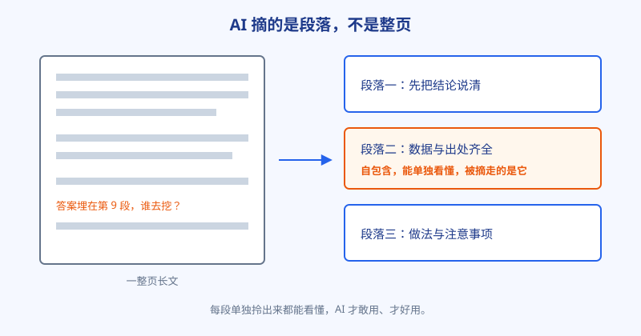
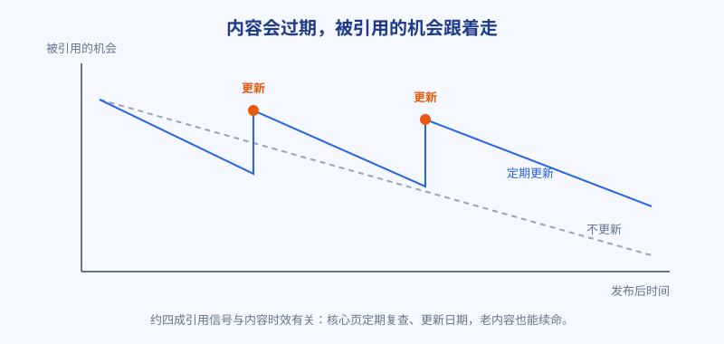

# 第 27 章 段落为王

## 白话讲解

上一章解决的是材料可不可信，这一章解决材料好不好摘。这两个问题分工明确：材料再真，摆得乱七八糟，赶时间的编辑照样绕道走。

先把第 25 章那句话再钉一遍：AI 拼装答案时，处理单位是段落，不是页面。它从候选页面里切出一段段文字，挑能直接回答问题的，拼进自己的回答。在 AI 眼里，你的页面不是一篇文章，而是一盘切好的菜，如图 27-1 所示，哪段能端走，哪段就是你的全部机会；端不走的，写得再好也是陪跑。

图 27-1：整页的完整，救不了单段的残缺。

先说清这一章和"把文章写短"的区别。段落为王，不是字数越少越好：该讲透的原理、该交代的步骤，一样都不能省。它改的是信息的摆放方式，不是信息的总量。一篇五千字的文章，完全可以同时做到内容扎实和段段可摘；一篇八百字的短文，如果段段都要靠上下文，也照样摘不动。长短是体量问题，结构是手艺问题，别把两个问题混成一个。

由这个画面，可以推出三条具体的写法，都是手艺活，不花钱。

第一条，结论先行。每一节的第一句，就把这一节的答案说清，后面再展开理由和细节。用户扫读时喜欢这样，AI 摘录时更喜欢：它要找的本来就是"能直接当答案的那句话"，这句话站在段首，被摘走的概率天然最高。反面教材是传统作文式写法：先讲背景，再摆形势，绕三段才进正题。这种文章里随便摘哪一段出来，都答非所问。

第二条，段落自包含。一段话单独拎出来，要能独立看懂。具体要求有三样：主语写全，不要用"它""这种方法"开头指代上文，读者（和 AI）跳过前文也能知道在说谁；对象写明，不要光说"效果很好"，要说"对手机照片效果很好"；数字带单位、带条件，不要说"能小很多"，要说"平均从 3MB 降到 1.2MB"。自包含有个土办法检验：把这一段复制下来，单独发给一位没看过全文的朋友，他能看懂、知道在说什么，就算过关；他要追问"这说的是啥"，这段就不合格。

顺带说说段落的长度。一段话只说一件事，三到六句为宜。短于三句，往往证据还没摆完就断了，摘出来立不住；长于六句，一段里塞了两三个意思，编辑要摘还得先替他做切分，赶时间的时候，他通常就不摘了。判断标准还是那句土话：这一段复制出来单独发人看，长度刚好、不缺上下文，就是合适的长度。

第三条，声明配证据。每个关键说法后面，紧跟它的支撑：数据、例子或出处，三样里至少有一样，而且别隔太远。AI 摘走你的结论时，会顺手把紧挨着的证据一起摘走，你的可信度是跟着结论一起过户的；要是证据在三段开外，它摘到的就是一句光秃秃的断言，和满网的软话没有区别。上一章讲的引言和数据，落点就在这里：它们不光要存在，还要贴在结论身边。

再补一条容易被漏掉的：小标题也是给 AI 看的路标。很多文章的小标题写得像文学标题，比如"一些需要注意的地方"，人和机器都猜不出这节要讲什么。换成结论句或者问题句，效果完全不同："压缩会不会让照片变模糊""结论：日常照片转 WebP 最划算"。编辑扫一眼标题就知道每节能摘什么，摘错地方的概率也低。改标题这件事成本几乎为零，值得和三条写法一起做。

除了结构，还有一条时间维度的规矩：新鲜度。如图 27-2 所示，内容是会过期的，引擎明显偏爱近期更新过的页面：综合 2026 年多家机构的观察，约四成引用信号与内容的时效有关。这里的"过期"不只是日期旧，还包括数据旧、版本号旧、价格旧、截图旧。应对办法不复杂，就三件：核心页面标上更新日期，让人和机器都看得见；数据定期复测，变了就改；教程里的时间敏感信息列成清单，按周期复查。常青内容从来不是写完就不管，而是要定期续命。

图 27-2：定期更新，等于定期把页面拉回候选池的前排。

最后提醒一个常见的过度修正：不要把文章改成电报。自包含不是每段都把主语全名重复三遍，结论先行也不是每段都喊口号。文章首先是给人读的，读起来别扭、像机器拼的，人留不住，AI 摘回去的段落也会显得生硬。把握一个度：指代词在段内可以省力，跨段就要写全；结论句要像人话，不像广告语。改完之后大声读一遍，顺耳，才算改对了。

把这一章和上一章合起来，就是 GEO 时代内容的基本功：每一段都当成一篇独立的小答案来写，结论站在段首，证据贴在身边，出处标在脚下，日期保持新鲜。页面是给人读的整体，段落是给 AI 摘的零件，两副担子都得挑。

<small>本章新鲜度口径：综合 2026 年 GEO 行业研究关于引用与内容时效的统计，约四成引用信号与内容新鲜度相关。</small>

## 阿哲的站

阿哲给那篇无损压缩长文动的第二刀，就是结构。

原稿是他的得意之作，写的时候颇有点作文情结：开头三段讲图片变大的时代背景，第四段才开始讲格式，真正的结论藏在文章过半的地方。他先给自己做了一次自包含检验：随机抽了五段发给一位做设计的朋友看，对方有三段都回了同一句："这段在说什么的前半句是不是在上面？"这一刀，扎得明明白白。

改法按本章三条来，一条一条对：

结论先行。他把全文的结论提炼成一句话，放到第一节第一行："先说结论：日常照片转 WebP 最划算，平均省一半体积，画质损失小到看不出。"后面每一节也照此办理，第一句先给判断，再讲为什么。

段落自包含。他通读全文，把"这种方法""它""上面说的参数"这类指代全改成了带全名的说法；每个数字补上对象和单位，比如把"快很多"改成"两百张图批量处理平均不到三秒"。

声明配证据。第 26 章补的那张实测表，他原先放在文末当附录，这次拆开，把相关行分别挪到对应结论的正下方。引文也一样处理，紧挨着它支撑的那句话。

最后是新鲜度。他给页面顶部加了一行"最近更新"的日期，把实测数据整个复测了一遍，其中两个数字和半年前已经对不上了，一并改掉，并在观察表里给这页定了三个月一次的复查提醒。做完这篇，他顺手把全站排得上号的五篇教程列了一张清单：每篇标上次更新时间、页里最容易过期的是哪几个数、下次复查定在哪个月。清单不长，却是他以前从来没建过的东西：以前他觉得文章发出去就完事了，现在他知道了，核心页面是需要领工资的资产，得定期盘点。

然后就是这一篇的小高潮。一周后的例行检查，他照例在谷歌里搜那个核心词。AI 摘要照常铺在最上面，他一条条往下看来源名单：第一条是老牌大站，第二条，挂着他自己站的名字。

他盯着那行小字看了半天，截了图，发到同行小群里，只配了三个字：上去了。

激动归激动，数据要照实记。接下来两周，这个词的品牌搜索涨了一截，注册页多了几条留言，明说是在 AI 的回答里看到这个站的。引荐过来的访问量并不大，两周加起来也就几百次的量级，和教程页巅峰时期的点击没法比。但阿哲在笔记里写得很清楚：路通了。以前是求搜索引擎把人带来，现在是先让 AI 愿意提你，人会自己找来。他给自己的下一阶段定了调：老老实实按"段落为王"的规矩，把站里排得上号的十篇教程挨个改一遍。节奏定得不贪：一周改一篇，改完记进观察表，看两周数据再改下一篇。他说以前总想找个一招制胜的办法，这一年最大的收获，是接受了流量这件事没有一招制胜，只有一段一段地改、一周一周地记。

## 翻车现场

翻车的主角是一位写户外装备的作者，笔头很硬，写了一篇近八千字的选购终极指南，自认为是全网同题材里最全的一篇。

这篇文章的结构是老派名家风范：先用两千字讲这个品类的发展史，再用一千字辨析几个容易混的概念，真正的选购答案从第六节才开始。他对这篇文章寄予厚望，推广没少投，排名也确实不差，常年挂在前五。可有一件事他想不通：同题材的好几个问题，AI 摘要引的都是同行那几篇不长的文章，他的终极指南一次都没上过名单。

他最初的判断，是引擎偏心：专挑大站、专挑新站。他拿这个结论去同行群里吐槽，被一位群友不客气地顶了回来：人家引的那几篇，有两篇的站比你的还小。这句话把他问住了，他才开始认真对比文章本身，而不是怪平台。这一段心路其实很常见：把结构问题误判成身份问题，最大的代价不是面子，是时间：在错误的方向上找原因，找多久都找不到。

后来他把文章投给一个 AI 工具，问了一句很直白的话：这篇为什么不被引用？得到的回复同样直白：找不到能独立成立的答案段。他的文章里，几乎每一段都要连着上下文读：结论藏在论证的末尾，数字散在举例当中，单独摘出任何一段，不是缺主语，就是缺结论。AI 编辑在他这篇文章里翻了半天，摘不出一段能直接用的，扭头去用了同行那种"一节一个结论、一段一个答案"的短文。

他后来的改法近乎壮士断腕：八千字砍到五千字，历史部分压缩成一个小框，每一节先给结论，每个关键数字都贴上适用条件。砍的时候他也心疼，那些历史考据是他查了两周资料写的。但数据不讲情面：改版后第一个月，这篇文章的自然点击还小涨了一截，用户其实也没有他以为的那么爱读长文。三个月里，这篇文章先后被两家引擎引用。他的教训值得每个写长文的人贴在桌上：在 AI 时代，长不等于强。结构松散的长文，等于把答案埋起来等人挖，可惜的是，用户不挖，AI 更不挖。

## 要点回顾

- AI 摘的是段落不是页面：每段都要当成一篇独立的小答案来写，整页的完整救不了单段的残缺。
- 结论先行：每节第一句先给判断，被摘走的往往就是这一句。
- 段落自包含：主语写全、对象写明、数字带单位和条件；检验法是把单段发给没看过全文的人看。
- 声明配证据：数据、例子、出处要紧贴结论，AI 摘结论时会连证据一起搬走。
- 新鲜度是硬指标：约四成引用信号与时效有关，核心页要标更新日期、定期复测数据，把复查写进日历，而不是等流量跌了才想起来。

## Kata

1. 自包含检验：从你的核心页面随机抽三段，分别发给一位没读过全文的人（或者一个 AI 工具），问他每段在讲什么、有没有看不懂的地方，把暴露的问题逐段改掉。检验时别给任何提示，你越忍不住想补充说明，越说明那段离自包含差得远。
2. 结论先行改造：挑一篇文章，只做一件事：把每一节的第一句改写成结论句，其他段落一个字不动，先上线这一版，观察两周引用和点击的变化。
3. 建一张复查日历：列出全站最重要的五页，逐页标上上次更新日期、文中数据的时间、约定的复查周期，把过期风险最高的那页排在第一个处理。
