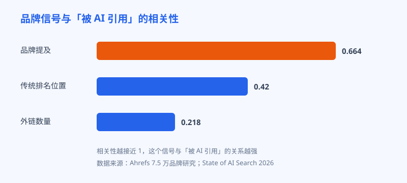
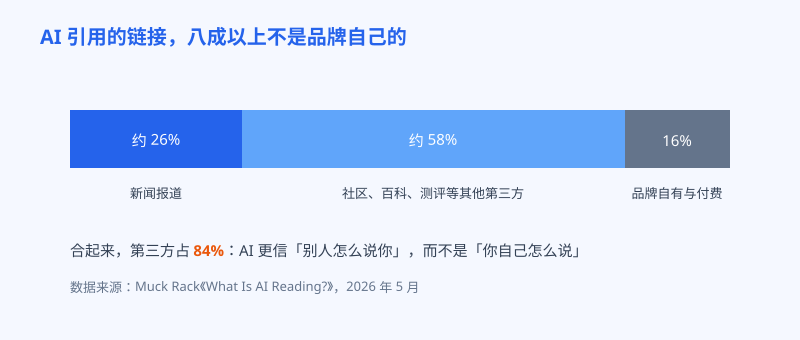

# 第 28 章 别人嘴里的你

## 白话讲解

先做个换位思考。假设你打开 ChatGPT，问它：有什么好用的免费图片压缩工具？它会怎么回答？它不会把每个工具的官网打开，挨个读一遍各家的自我介绍。官网上的话都是自夸，哪个站不说自己速度快、效果好、免费又安全？AI 拼凑答案时，更看重的是另一类材料：全网其他人是怎么评价这些工具的。测评文章里提过谁，社区讨论里夸过谁，视频里演示过谁，这些才是它判断谁值得推荐的依据。

这里的主角概念叫**品牌提及**。说白了，就是别人在网上提到了你的名字。注意，提的时候带不带链接都可以。以前做 SEO，我们只认带链接的那一种，也就是外链，因为链接是能数出来、能传递权重的。到了 AI 时代，不带链接的提及也被听见了：一段测评文字里写了一句这个工具不错，一条社区回复里说我一直用它，一个视频里露了三秒你的界面，这些在搜索引擎眼里慢慢变成了另一种选票。

打个比方你就明白了。传统搜索像一场按票数排座次的选举，外链就是选票，没链接的话说再多也不算数。AI 搜索更像在开一场评审会：评委不只数票，还会翻遍会议记录、媒体报道和观众留言，听听大家平时都是怎么议论每个候选人的。选票还在，但窃窃私语也进了档案。你以前只需要经营选票，现在还要经营议论。

这不是感觉，是有数据撑着的。Ahrefs 做过一项覆盖 7.5 万个品牌的研究，想看看哪些信号和被 AI 引用这件事走得最近。结果排第一的不是外链，是品牌提及：它与品牌出现在 AI Overview 中的相关性达到 0.664；作为对比，外链数量的相关性只有 0.218。连传统搜索排名和被 AI 引用的相关性，也只有约 0.42，是另一项研究给出的数字。到了 2026 年的更新数据里，和被引用相关性最高的信号变成了 YouTube 提及：人们在视频里真实演示、真实吐槽一个产品，这类内容成了 AI 眼里分量最重的口碑证据。

如图 28-1 所示，三个信号摆在一起高下立判：品牌提及 0.664 一骑绝尘，传统排名 0.42 居中，外链数量 0.218 垫底。这张图想说的不是外链没用了，而是权重表换了：AI 时代的第一名，是别人愿不愿意提你。

提及是怎么钻进 AI 脑子里的？有两条路。第一条是训练：大模型读过海量网页，谁和谁总是一起出现，它心里就有数。某个工具的名字反复和图片压缩、批量处理这些词出现在同一批文章、帖子和字幕里，模型就会把它们绑在一起，下次有人问这类问题，它顺嘴就把这个名字带出来了。第二条是实时检索：现在主流的 AI 搜索回答问题前会先去网上搜一圈，把搜到的页面拼进答案里。测评文章提了你，社区帖子夸了你，这些页面被搜到的那一刻，你的名字就进了候选名单。所以你会发现，提及这件事一半是长期工程，攒的是模型对你的印象；另一半是临门一脚，攒的是检索时能被捞起来的第三方页面。两条路指向同一件事：你得真实地存在于别人的内容里。

还有一句丑话要说在前面：0.664 是相关性，不是因果保证。大品牌本来就提及多、内容多、年头久，样样都强，提及和被引用一起高涨，背后可能有共同的原因。所以正确的读法是：多项独立研究指向同一个方向，提及是目前已知和被引用关系最紧的信号，值得你把力气往这儿放；但它不是开关，没有谁能保证提了三十次，下周 AI 就一定推荐你。把方向当方向，把保证当骗局，这个态度在后面几章还会反复用到。

为什么 AI 这么看重第三方的话？道理和人一样：你判断一家餐馆好不好，不会只听老板的，你会去看食客的评价。Muck Rack 在 2026 年 5 月发布的分析里数过 AI 引用链接的出身：84% 来自品牌既不拥有、也不付费的第三方来源，其中光新闻报道就占了 25% 到 27%，剩下的大头是社区讨论、百科、测评这类内容。品牌自家的官网和软文，在引用名单里只占一小角。

如图 28-2 所示，第三方占了 84%，品牌自有与付费内容只有 16%。这意味着你在自己站里把话说得再漂亮，对 AI 推荐名单的影响也有限；真正决定你上不上榜的，是站外那 84% 的世界里有没有你的名字。

另外要知道，提及和提及之间，身价差得很远。一篇测评在正文里认认真真用了一段话介绍你的工具，附带真实截图和使用场景，这叫高质量提及；论坛里随手一句我用过，还行，分量要轻得多；而在骂声里被点名，提是提了，方向却是反的。AI 读内容时读的是完整语境，它分得清推荐和吐槽。所以攒提及不能只数次数，还要看三件事：出现在什么类型的内容里、说的是好话还是坏话、有没有具体的使用细节。十次带细节的好评，胜过一百次干巴巴的名字露出。反过来这也解释了一个现象：有些站提及量看着不少，AI 就是不推荐它，多半是提及的语境和细节撑不起来。

这类靠挣来的曝光，行业里有个词叫 earned media，翻译过来就是挣来的媒体。挣，意味着不能买、不能刷，只能靠做了值得被提的事情，再让它自然发生。具体就四条路。第一，做值得被提的东西：免费好用的工具、公开的数据报告、别人写文章时愿意引用的统计。第二，在社区里真实地待着：去用户聚集的论坛和社群回答问题，分享你做产品踩过的坑，名字在签名里露着就行，不要逢帖必贴链接，那叫广告，不叫提及。第三，把视频做起来：录演示、做对比、讲教程，YouTube 提及既然排到了第一，这块阵地就值得认真经营。视频有个别处比不了的优势：一个人对着镜头把你的工具从头用到尾，夸什么、卡在哪，全是明摆着的，AI 抓到的字幕文本里，这就是一份带细节的第三方证词。第四，给报道你的人省事：记者和博主都缺素材，你把数据、截图、试用账号打包备好，被提到的概率会高很多。

提及攒起来之后，还有一个看得见的副产品：品牌搜索会涨。用户在 AI 的回答里、测评里、视频里反复看到你的名字，哪怕当时没点进来，过几天真要用的时候，他会直接在搜索引擎里敲你的名字找你。这批流量在数据上特别金贵：它不依赖任何平台的推荐，是用户点名要你。后面第 30 章讲监测时你会看到，阿哲每个月都要单独看一眼品牌词的搜索量，那就是他口碑的体温计。

最后提醒一句：提及的前提是真。买来的提及、刷出来的好评，短期看数字涨了，长期是给自己埋雷，下一节的翻车现场就讲这个。本章数据来源：Ahrefs 2026 年 7.5 万品牌提及研究；Muck Rack《What Is AI Reading?》（2026 年 5 月）；State of AI Search 2026。

## 阿哲的站

阿哲以前是个典型的闷头型选手：站内文章写了几十篇，外链也攒了一些，可站外世界里，几乎没人提过他的工具。看完上面这组数据，他改了打法，给自己定了个笨规矩：每周拿出半天，不做站，只出去说话。

他做了三件事。第一，去 Reddit 和几个独立开发者社区回答问题，专挑和图片处理有关的：为什么 WebP 转回 PNG 体积会变大、电商产品图到底该压到多少 KB。他只解决问题，签名里留一行站名，从不贴推广链接。有些回答被顶到前面，成了那个问题下的经典回复，之后很长一段时间，AI 回答同类问题时引用的就是这些帖子。第二，他把站里攒了很久的一份数据公开了：二十种常见图片格式在五种尺寸下的体积对比，做成一页人人能引用的报告。陆续有三四篇测评文章引用了这页数据，顺手提了他的站名。第三，他学着录视频：一共只录了三条，一条讲怎么给网店商品图批量压缩，一条做 PNG 和 WebP 的画质对比，一条演示手机照片批量改尺寸。录得粗糙，但内容是真演示，评论区有人留言说照着做了。

这半天也不是一帆风顺。他第一次给一位做工具测评的博主发邮件，写了满满三屏产品介绍，对方回都没回。后来他学乖了：邮件只写三行，我是谁、我有一份你能直接用的数据、账号已经开好放在链接里。他把格式对比报告、演示视频、截图和试用账号打成一个素材包，谁想写，拿走就能写。第二封邮件发出去，对方当周就出了测评。阿哲后来说，给别人省时间，就是给自己挣提及，这话糙理不糙。

三个月下来，变化是慢的那种，没有爆点：品牌词的搜索量从每月个位数涨到两三百；两个测评视频带来的访问里，直接转成了十几单付费；最让他意外的是，有一天他在自己的提示词监测表里（第 30 章会讲这张表怎么搭），第一次看到 ChatGPT 在回答里写出了他的工具名。那一刻他说，比排名第一次进前十还高兴。

## 翻车现场

阿哲的同行老周（化名）做简历模板站，性子急，听说提及重要，扭头就买了一个品牌提及套餐：服务商承诺一个月内让他的品牌出现在几百个页面上。交付的东西是什么呢？几百篇东拼西凑的软文，铺在内容农场站里，再加一批语气雷同的假测评。第一个月，数字确实好看，提及量翻了几倍，AI 也真的开始引用了。问题在于，AI 引用的正是软文里的内容：一个根本不存在的功能、一个早就过期的价格。用户顺着 AI 的推荐找上门，发现货不对板，在评论区骂他虚假宣传。到了第二个月，平台清理了一批农场站，软文大面积消失，提及量跌回原形，钱打了水漂。更麻烦的是后遗症：AI 记住的错误价格和功能，过了很久还会在回答里冒出来，他花了不少工夫到处更正。后来的收拾工作更狼狈：他挨个联系农场站删稿，一多半联系不上人；又在自己官网专门做了一页正确信息，把功能清单和现行价格列得清清楚楚，指望 AI 下次检索时先看到这一页；那家卖套餐的服务商呢，钱收完就换了个名字继续营业，退款是不可能的。老周的教训很朴素：提及这东西，真的能攒一辈子，假的能坑你一整年。想靠买提及走捷径，等于亲手给 AI 喂关于你自己的假消息。

## 要点回顾

- AI 挑推荐对象时，更信第三方怎么说你，而不是你自己怎么说自己。
- 品牌提及与被 AI 引用的相关性达 0.664，明显高于外链数量的 0.218；2026 年 YouTube 提及升至第一。
- AI 引用的链接 84% 来自品牌不拥有也不付费的第三方，新闻报道占约四分之一。
- 挣提及的正道只有四条：做值得被提的东西、在社区真实参与、认真做视频、给报道者备好素材。
- 提及攒够了，品牌搜索会跟着涨，那是用户在点名找你，是口碑最直观的体温计。
- 提及必须真：买来的提及会把错误信息喂给 AI，后患比没提及更大。

## Kata

1. 现在就动手：分别在 Reddit、YouTube 和一个你所在行业的社区里搜自己的品牌名，记录每个平台被提到的次数和语气，给自己的站外口碑建一条基线。
2. 列一份值得被提清单：盘点你的站里有没有可以公开的数据、可以免费开放的小工具、可以被别人引用的结论，挑出最有分量的一件，写出把它推出去的三步动作。
3. 录一条三分钟的演示视频：不露脸也行，完整演示你的产品解决一个具体问题的过程，发布到 YouTube，一个月后回看它带来了多少访问和提及。
