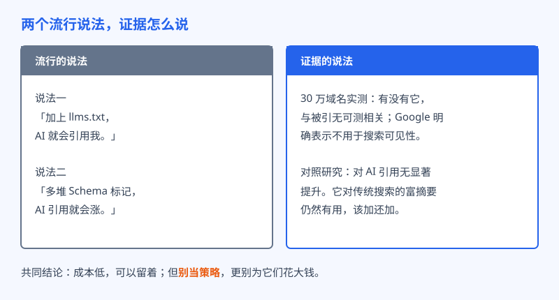
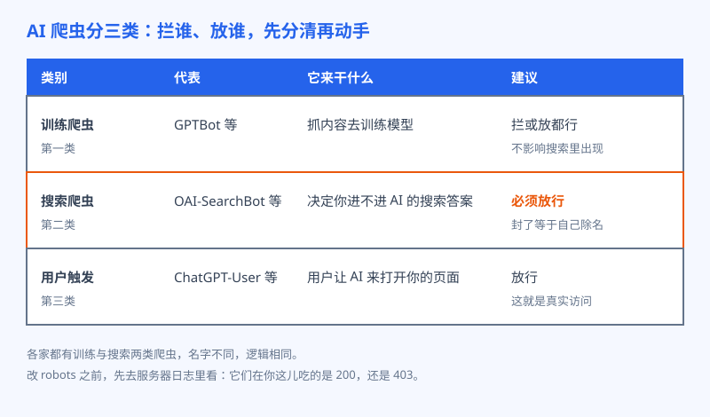

# 第 29 章 机器可读的迷信与真相

## 白话讲解

每逢搜索规则有风吹草动，市场上总会冒出一批卖新概念的人。这一轮的新宠叫 llms.txt。它的来历不复杂：有人提议，网站在根目录放一个纯文本文件，用最朴素的格式把全站要点列一遍，相当于给来访的 AI 递一张说明书，让它不用啃复杂的网页代码，就能快速弄清这个站是做什么的、有哪些重要页面。这个设想听起来很美，传播得也快，快到不少人把它当成了 AI 时代的入场券：没有这个文件，AI 就看不见你；有了这个文件，引用就会来。本章的任务，就是把这类说法放到证据面前过一遍秤。

先说结论：llms.txt 和被 AI 引用之间，目前没有证据表明有关系。SE Ranking 做过一项覆盖 30 万个域名的研究，把有没有这个文件和被 AI 引用的情况放在一起比，结果是无可测的相关：有文件的站没有更容易被引，没文件的站也没有吃亏。Google 官方的态度更直接，明确表示不会把 llms.txt 用在搜索可见性上，它的 AI 功能读的就是正常网页。用大白话说：主流 AI 搜索在挑引用时，看的是你的正文写得怎么样、别人怎么评价你，没人去翻你递的那张说明书。

那它是不是纯粹的智商税？也不是。它有一个正当且设计之初就想好的用途：给编程 Agent 喂文档。你让编程助手接入某个库的文档站时，它如果能拿到一份干净的纯文本说明，确实比解析一堆网页要省事得多。在教程站、技术文档站这类场景里，放一份是合理的。但请注意，这是给写代码的 AI 当参考资料，和让搜索型 AI 引用你，完全是两回事。把这两件事混为一谈，正是迷信的来源。

顺便说一句这类迷信为什么传得这么快，三个原因。第一，焦虑是现成的：AI 搜索一来，老打法眼看着晃动，人人都怕掉队，这时候有个动作明确、十分钟能做完的新招数出现，谁不想先做了再说。第二，它长得像当年的成功经验：robots.txt 是真有用的，sitemap 是真有用的，一个同样躺在根目录、同样以 txt 结尾的文件，很容易借到前辈的信用。第三，传播它的人有账算：写教程的需要新选题，卖课的需要新卖点，说它没用的人，反而没什么可卖的。看清这三点，你以后再遇到任何新鲜出炉的必备文件、必备标签，第一反应都应该是同一句：证据呢？

如图 29-1 所示，两个流行说法在证据面前的结局一致：说法很热闹，数据很冷淡。这里要立一条全书通用的口径：这类东西成本低，放一份、留一份都没关系，错的不是文件本身，错的是把它当成策略，甚至花大钱去买围绕它的服务。你接下来会看到，第二个说法也是同一个道理。

第二个说法的主角是 Schema，也就是网页里的结构化数据标记。它在传统搜索里是有真本事的：标好了，搜索结果里能多出评分、价格、常见问题这些花样，点击率实打实会受益，所以该加的还要加。但它对 AI 引用有没有帮助呢？Ahrefs 做过对照研究，比较了加结构化数据的页面和没加的页面，结论是 AI 引用的变化在噪声范围内，没有显著提升。道理也不难想：AI 读的是你的正文内容，标记只是给内容贴的标签，标签贴得再工整，内容本身不行，引用不会凭空来。指望靠标记把引用骗出来，就像把菜单印得再漂亮，也变不出好吃的菜。所以顺序永远是这样：先把内容做到值得引，再回头把标记补齐；标记是给好内容办的证件，不是替身。

在讲爬虫之前，还要澄清一个容易被带偏的词：机器可读。卖迷信的人会让你以为，机器可读是一套新机关，装上才算接通 AI。其实真正管用的机器可读非常朴素，就是老 SEO 里那些基本功：正文是实打实的文字，而不是全塞在图片里或者靠脚本现场渲染出来；标题层级清楚，一眼能分出哪句是结论、哪段是展开；页面打开不用绕十几道弯，链接关系明明白白。这些事做好了，人读着顺，机器摘着也顺，这正是第 27 章讲段落时的同一套逻辑。换句话说，与其给机器另开一桌小灶，不如把正席的菜做好，机器吃的本来就是这一桌。

迷信讲完，讲真相。这一章真正要紧的事朴素得多：AI 的爬虫到底进不进得来你的站。很多人把 AI 爬虫当成一类东西，一拦全拦、一放全放，这是灾难的源头。其实它们至少分三类，拦错一类，后果完全不同。

如图 29-2 所示：第一类是**训练爬虫**，以 GPTBot 为代表，它来抓你的内容回去训练模型。拦它，只是让你的内容不参与训练，不影响你在 AI 搜索里出现与否，这是个立场选择题，拦或放都有道理。第二类是**搜索爬虫**，以 OAI-SearchBot 为代表，它负责把网页收进 AI 搜索的答案库。这一类要是被你封了，效果立竿见影：ChatGPT 回答问题时根本找不到你，等于你自己把名字从候选名单上划掉。第三类是**用户触发型**，以 ChatGPT-User 为代表，用户在对话里让 AI 打开某个链接时，它才来访问，这就是一次真实的读者来访，没有理由拦。其他几家也是同样的分法：Claude、Perplexity 这些平台都有自己的训练与搜索爬虫，名字各不相同，分工逻辑一致，先分清它是哪一类，再决定拦还是放。

知道了分类，还要有排查的顺序。第一步，打开你站点的 robots.txt，逐行看有没有把搜索爬虫写进禁止名单，很多模板和插件会自作主张帮你拦。第二步，看 CDN 和 WAF 的机器人防护规则，不少安全设置里有一项拦截已知机器人，勾上之后是一刀切的，搜索引擎的正牌爬虫都可能被误伤，AI 搜索爬虫更不在话下。第三步，去服务器日志里搜爬虫的名字，看它最近来的时候吃到的是 200 还是 403。日志不会说谎，它比你脑子里以为的配置更可信。这三步走完，你才真正知道自己的门是开着还是锁着。

关于训练爬虫，还要多说一句，因为这是三类里唯一没有标准答案的。拦它保的是版权立场：你辛辛苦苦写的东西，凭什么白白拿去训练？这个想法完全正当，尤其对靠内容本身吃饭的站点。放它图的是品牌机会：模型在训练里见过你，将来回答问题时才更容易想起你。这个取舍没有对错，只有合不合你的生意。但无论选哪边，都要避开一种最常见的误伤：图省事写一条大规则，把某家公司的全部爬虫一锅端，训练的拦住了，搜索的也陪绑了。名单一定要按单个爬虫逐个列，这点耐心省不得。

本章最后把 Google 的一句官方口径放在这儿：为生成式 AI 搜索做优化，本质上仍是 SEO。没有神秘的新文件，没有暗门，先把门打开、把内容写好，这就是真相的全部。本章数据来源：SE Ranking llms.txt 相关性研究（30 万域名）；Google Search Central 官方说明；Ahrefs 结构化数据对照研究。

## 阿哲的站

阿哲也没能免俗。他刷到一堆讲 llms.txt 的帖子，连夜给自己的站写了一份，写得还挺认真：站点介绍、核心功能页、教程目录，全列上了，前后花了不到一个小时。接下来的一个月，他每次打开自己的监测记录，都要多看两眼引用数。结果一个月过去，提及率和引用数纹丝不动，该是多少还是多少。

他没死心，决定查一查 AI 爬虫到底有没有来过他的站。这一查，查出了真正的问题：他用的 CDN 安全服务里，有一项拦截高风险机器人的规则被默认打开，OAI-SearchBot 每次来都吃 403，已经持续了不知道多少个礼拜。换句话说，这段时间里 ChatGPT 压根进不了他的站，他在监测表里等引用，等于守着一扇锁着的门等客人。

修复动作很简单：他把 robots.txt 和 CDN 规则按三类爬虫重新列了一遍。搜索爬虫全部放行；用户触发型放行；训练爬虫他想了想，也放行了，理由是他的工具需要先被模型认识，才谈得上被推荐，他愿意用内容换这个认识。需要说明的是，这是他个人的选择，特别看重内容版权的人完全可以只拦训练爬虫，关键在于搜索爬虫不能拦。复盘的时候他还顺带解开了一个小谜团：那条一刀切的 CDN 规则，除了 AI 爬虫，还捎带拦过两个小众搜索引擎的正牌爬虫，难怪有阵子他总觉得传统搜索的抓取量莫名其妙少了一截，修完之后也慢慢回来了。一条图省事的规则，暗地里漏了多少流量，平时根本看不见，只能靠查日志对账。改完大概两周，他的监测表里第一次出现了 ChatGPT 的引用，引的正是他那篇带格式对比数据的教程页。至于 llms.txt，他留着没删，成本是零，万一哪天派上用场呢。只是从那以后，它在阿哲心里的定位从策略降级成了顺手：可以做，别指望。

## 翻车现场

翻车的是一家做在线课程的小团队。他们派运营负责人去听了两天课，回来花两万多块买了套 AI 搜索全套优化：llms.txt 按最高规格写、每种 Schema 都堆满、还额外做了一套所谓的 AI 专用站点地图。验收的时候报告做得漂漂亮亮，老板很满意。三个月过去，后台里来自 AI 的访问还是个位数。团队里的工程师觉得不对劲，自己动手查日志，半小时就找到了病根：公司的 WAF 上线时图省事，把所有名字里带 Bot 的访问一律拦截，市面上几个 AI 搜索爬虫全在名单里，一个都进不来。也就是说，那三个月里他们花大价钱装修了店面，而大门从外面一直锁着，客人连门把手都摸不到。最后的解决办法只花了十分钟：改一条 WAF 规则。规则改完的第二周，工程师在日志里看到几个 AI 搜索爬虫的状态码齐齐从 403 变回了 200，又过了阵子，后台里终于出现了来自 AI 的访问。复盘会上，那位运营负责人说了句大实话：两万多块买到的最有价值的东西，是知道了门在哪儿。团队后来把先查门写进了每次改版的上线检查单，第一项就是逐个核对爬虫的放行状态。这件事给所有人的教训都一样：碰到新概念，先别急着买装修，先花十分钟确认三件事，robots 里拦了谁、安全规则拦了谁、日志里爬虫吃的是什么状态码。门确认是开的，再谈屋里怎么布置，一点都不晚。

## 要点回顾

- llms.txt 与被 AI 引用无可测相关（30 万域名实测），Google 明确表示不用于搜索可见性；成本低可保留，但别当策略。
- llms.txt 的正当用途是给编程 Agent 喂文档，那是它的设计初衷，和被搜索型 AI 引用是两回事。
- Schema 对传统搜索的富摘要有用，该加还加；但对 AI 引用无显著提升，别指望靠标记换引用。
- AI 爬虫分三类：训练爬虫拦放自便，搜索爬虫（如 OAI-SearchBot）误封等于自己除名，用户触发型就是真实访问。
- 动手顺序永远是先查门：robots、CDN 与 WAF 规则、服务器日志，三步确认爬虫能进来，再谈优化。
- 今后再遇到任何必备文件、必备标签式的新说法，第一反应先问一句：证据呢？

## Kata

1. 现在就查你的站：打开 robots.txt，逐行找出所有针对 AI 爬虫的规则，把每个爬虫名归入训练、搜索、用户触发三类，写下它现在的待遇是拦还是放。
2. 去服务器日志里搜 GPTBot、OAI-SearchBot、ClaudeBot、PerplexityBot 这几个名字，各取最近一次访问，记录返回的状态码；如果全是 403，你已经找到比 llms.txt 重要一百倍的问题了。
3. 给你的站列一份放行清单：每个 AI 爬虫一行，写明拦或放和理由，贴在你能看到的地方。顺手把 llms.txt 写了也行，但要在清单最后注明：此文件只为将来可能用到而保留，不计入任何增长预期。
