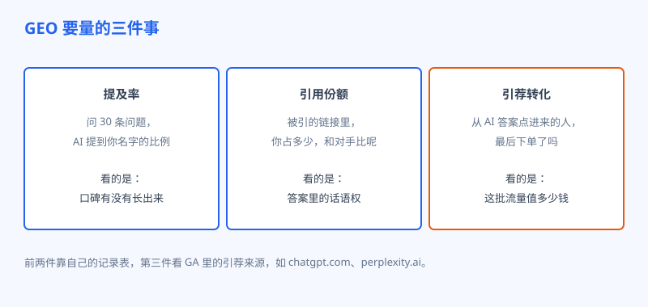
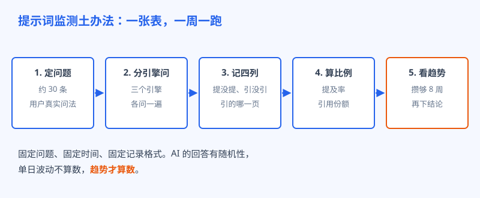

# 第 30 章 量不了就管不了

## 白话讲解

做传统 SEO 的人是幸福的，因为有一本明账：Search Console 把展示、点击、排名、收录写得清清楚楚，你今天改了什么，下个月数字往哪边走，一目了然。到了 GEO 这边，账突然没了。没有任何一个官方后台会告诉你：你的品牌本周在 AI 回答里被提了多少次、引了哪些页面、排在第几个被推荐。AI 平台把答案给了用户，却没打算给站长发成绩单。

没有成绩单，不等于没法过日子。办法是自己搭一套监测。先说清楚到底要量什么，一共三件事。第一件叫**提及率**：准备一组用户真会问的问题，挨个拿去问 AI，看你的品牌名出现在回答里的比例。三十条问题里有九条提到了你，提及率就是三成。它量的是口碑：你的名字，长没长在 AI 的脑子里。第二件叫**引用份额**：统计这些回答一共引了多少个链接，其中你的占几成，再顺手把主要对手的份额也记下来。它量的是话语权：到了摆证据的环节，你在不在桌上。第三件是**引荐转化**：在 GA 这类统计工具里看引荐来源，从 chatgpt.com、perplexity.ai 这些地方点进来的访问有多少、停留多久、最后下没下单。它量的是钱：AI 带来的这批人，到底值不值钱。

如图 30-1 所示，三件事各管一段：提及率看口碑，引用份额看话语权，引荐转化看商业价值。只看其中任何一件都会偏：提及多转化差，说明名气没落在能赚钱的问题上；转化好但提及率趴着不动，说明盘子太小，要先去攒口碑。

知道了量什么，接下来是怎么量。专业工具后面再说，先讲一套谁都能立刻上手的土办法，材料只要一张电子表格。第一步，定问题清单：三十条左右，多了跑不动，少了看不出趋势。问题要用用户的真实问法，不要用你自己的产品话术。最重要的一条原则是，清单里绝大多数问题不能带你的品牌名，因为你测的是在用户还没想起你的时候，AI 会不会主动把你端出来。第二步，分引擎跑：选三家主流 AI 就够，每周固定一个时间，挨个把清单问一遍。第三步，记录格式要狠：每条问题只记四列，提没提我、引没引我、引的是哪一页、顺带记下引了哪几个对手。多一列都是负担，负担大了就坚持不下去。第四步，算比例：把本周的提及率和引用份额算出来，和上周、上个月放一起。第五步，看趋势再说话：至少攒够八周，再讨论规律和动作。

如图 30-2 所示，这个流程的灵魂不在复杂，在固定：固定的问题、固定在每周同一个时间跑、固定的记录格式。中间任何一环随手变，攒出来的数字就没法纵向比，监测就白搭了。

问题清单这三十条，也不是随便凑的。用户向 AI 提问，大致逃不出四种问法，清单里最好四种都有。第一种是品类问法：最好用的免费图片压缩工具是哪几个，问的是整个货架。第二种是场景问法：我要给网店上传两百张产品图，怎么批量处理，问的是具体干活的办法，这类问题最容易带出引用，因为 AI 需要拿页面的步骤和数据来拼答案。第三种是对比问法：甲工具和乙工具哪个好，问的是取舍，这类问题里被提名的，就是进了用户决赛圈的名单。第四种是价格问法：这类工具有没有免费的、收费的多少钱，问的是下单前最后一公里。四种问法的提及率要分开看：品类和场景问法测的是陌生人市场，对比和价格问法测的是临门一脚，混成一个总数，你会不知道劲该往哪儿使。

还有一个记录时的小心机：把 AI 每次引用的页面地址原样存下来。攒上两个月你会发现，被引的高度集中在少数几页上。这几页就是你的样板间，它们的共同写法，就是你接下来批量复制的内容模板。监测记到这个份上，就已经不是记账，而是在给内容策略递小抄了。

为什么要这么强调趋势、看不起单点？因为 AI 的回答天生带随机性。同一个问题，你今天问和明天问，它检索到的页面、组织答案的顺序都可能不一样，今天引了你，不代表明天还引；今天没引你，也不代表你退步了。把单日数字当成绩单，必然被随机性牵着鼻子走：涨了就飘，跌了就慌，慌了就乱改页面，正好掉进下一节翻车现场那个坑里。正确的姿势是看滑动起来的曲线，八周里提及率从一成爬到两成半，这种变化才值得你为它做决策。

再说工具。市场上已经长出了一整个新品类：专门监测 AI 可见度的平台，它们帮你批量跑问题清单、统计各引擎的提及和引用、盯着竞品的份额，省的是人力。如果你的问题清单有几百条、要同时盯十来个对手，买工具是划算的。但个人站长和小团队，表格起步完全够，甚至更好：你亲手问过的每一遍，都会加深你对 AI 怎么说话的理解，这是工具报表给不了的。对工具给的那个综合可见度分数要留个心眼：那是人家自家算法揉出来的数，能看，别供着。事实是提及和引用，分数只是加工品。

还有个容易忽略的动作：监测不只是记录数字，还要顺手把 AI 夸你和夸对手的话存下来。它在回答里怎么介绍你，一句一句都是免费的用户调研；它推荐对手时给的理由，往往就是你下一轮要补的产品和内容短板。量，是为了知道往哪儿用力，这才是这一章标题的后半句。

频率上也给个具体建议：一周一次是甜点区。每天跑，你会被随机波动淹没，天天提心吊胆；每月跑，样本又太稀，真出了问题要迟到很久才发现。一周一次，一年就是五十二个点，足够画出一条能看的曲线，又不至于把人跑烦。当然，新站上线、大改版之后这种关键节点，可以临时加密到连跑三天取平均，把基线先钉住，再回到一周一次的常态。本章的提及率、引用份额均为行业通行的监测口径，具体跑法是作者的实践做法，供你照着改。

## 阿哲的站

阿哲的监测就是一张在线表格，朴素得有点寒酸。三十条问题是他从站内搜索记录、用户邮件和社区帖子里捞出来的，全是真人问法，比如产品图压到多少 KB 才不糊、手机照片怎么批量改成统一尺寸这类。他给自己定的规矩是每周一上午跑一遍，三个引擎，ChatGPT、Perplexity 和 Google 的 AI 模式，一个问题一个问题地问，记四列，大概花四十分钟。跑之前先冲杯咖啡，因为这活儿有个副作用：容易边跑边刷手机，所以他把手机扣在桌上。

这套办法他也不是一开始就跑顺的。第一版清单他贪多，列了六十条问题，第一个周一跑了将近三个小时，跑到后半程只想把表格关了。第二个礼拜他就把清单砍到三十条，又把记录从六列精简到四列，单次时间压进四十分钟，这才坚持下来。他后来的体会是：监测的第一美德是能活过第二个月，设计得再科学，坚持不下去等于零。

第一个月的数据很平静：提及率在一成上下晃，引用基本集中在两页上，就是他那篇格式对比报告和一篇带详细步骤的教程。第三个月，他把两个规律看清楚了。第一，被引的几乎全是带具体数据和操作步骤的教程页，写得再用心的产品首页，一次都没被引过。第二，三个引擎脾气不同：Perplexity 引他最勤，ChatGPT 次之，另一个引擎几乎不提他。他先去查了第三家的爬虫放行，确认门是开的，才把原因归到内容覆盖不够上，而不是瞎猜平台针对他。

动作随之而来：他把教程页的写法，也就是结论先行、每段配一个具体数字、步骤编号列清，复制到另外六个主题上，又给一直缺席的那个引擎常问的问题类型补了两篇内容。两个月后回看曲线，提及率升到了三成上下，引用他的页面从两页变成了七页。GA 那边，他把 chatgpt.com 的引荐单独拎出来看：量不大，一个月几百次访问，但付费转化率是全站平均的两倍还多。他很清醒，这是他一家的小样本，只能说明一个方向：从 AI 答案里点进来的人，多半已经在答案里想清楚了要解决什么问题，来的目的性更强。这个发现让他把 AI 引荐列进了每周必看的数字里，和传统搜索的点击并排站着。

## 翻车现场

翻车的是阿哲在站长群里认识的一位朋友，做家居收纳用品的独立站。他比阿哲下手早，已经买了专业监测工具，每天的可见度分数推送到手机。有一周，分数连着掉了六分，他坐不住了，判断是首页的产品介绍写得不符合 AI 的口味，连夜拉着外包把首页大改：把原来那段用户评价堆出来的产品对比删了，换成一套更时髦的话术。改完他还挺得意。结果下个月复盘，引用直接归零。工程师帮他对了旧快照才发现：被他删掉的那段对比，恰好是过去两个月里唯一被 AI 引用过的段落；分数那六分的波动，事后看就是模型回答的正常随机性，和改版一点关系都没有。他用自己的手，把家里唯一值钱的东西当问题处理掉了。这个故事里有三笔账要算清：第一，单周的分数波动不是信号，至少攒够一个月的趋势才配叫信号；第二，动手改版之前，先确认哪些页面和段落正在被引，把它们的现状留好快照，这叫保护资产；第三，工具分数是别人的算法，你的提及和引用记录才是你自己的事实。挽回的过程也不轻松：那段被删掉的对比文字，他是靠网页快照和一份旧备份拼回来大半的，有几句用户原话再也找不回来了，只能重新攒。从那以后他立了条死规矩：任何正在被引的页面，改版前先整页存档，改完再拿监测表验收，引用掉了立刻回滚。朋友后来把推送关了，改成每月看一次趋势，世界清净了，引用也慢慢回来了。

## 要点回顾

- GEO 没有官方成绩单，提及率、引用份额、引荐转化这三笔账，要自己搭台子来记。
- 监测土办法五步：定问题清单、分引擎跑、狠记四列、算比例、看趋势；清单里绝大多数问题不要带品牌名。
- AI 的回答带随机性，单日和单周的波动不说明问题，至少攒够八周，曲线才配指导决策。
- 专业监测工具省人力，值得时可以买；但它揉出来的综合分数是加工品，提及与引用的原始记录才是事实。
- 改版之前先给正在被引的页面和段落留快照，动什么都不能先动正在产引用的资产。
- 监测的频率一周一次最好：密了被噪声淹没，疏了问题发现得太迟；关键节点可以临时连跑三天取平均。
- 问题清单分四种问法分别看：品类和场景测的是陌生人市场，对比和价格测的是临门一脚。

## Kata

1. 列你的问题清单：从站内搜索、用户咨询、社区帖子里捞 20 到 30 条真实问法，写进表格，其中带品牌名的问题最多留两条，再把品类、场景、对比、价格四种问法各标出来，方便日后分开统计。
2. 跑一轮基线：今天就把清单在 ChatGPT、Perplexity 和 Google 的 AI 模式各问一遍，按提没提、引没引、引哪页、引了谁四列记录，存档，这是你所有趋势的起点。
3. 在 GA 里新建一个引荐来源的细分，只看 chatgpt.com、perplexity.ai 等 AI 来源，观察一周：记下访问量、停留和转化，和全站平均并排写下来，你对 AI 流量的价值会有自己的判断。
