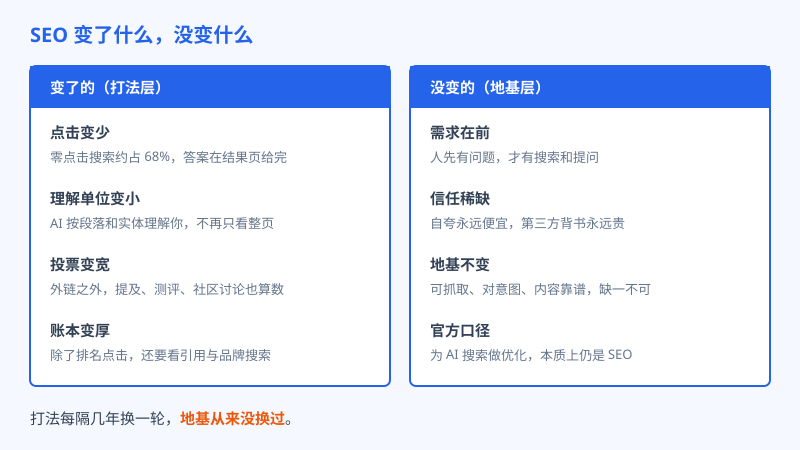
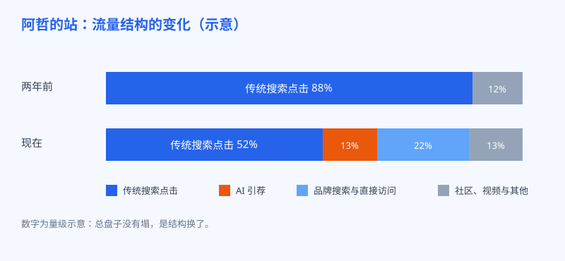

# 第 31 章 SEO 死了吗

## 白话讲解

每隔几年，SEO 已死就会被宣布一次。社交网络最火的时候，有人说大家都泡在信息流里了，谁还搜索；手机应用最盛的时候，有人说流量都进了各家的围墙花园，网页要完；短视频起来的时候，又有人说年轻人连字都不想读了。这一轮是 AI：答案直接写在结果页上，点击被截走大半，那 SEO 是不是终于死透了？这一章是全书的最后一章，我们把这笔账算清楚：到底什么变了，什么没变，结论是哪句。

回头看这几轮死亡宣告，有个规律挺有意思：每次真正死掉的，都不是 SEO 本身，而是它身上的一层皮。社交那一轮，死的是靠买门户广告位过日子的玩法；移动那一轮，死的是只伺候桌面端大屏幕的页面；内容农场那一轮，死的是批量采集拼凑的站群。每一层皮都曾经很赚钱，所以每次蜕皮都很疼，疼到当事人以为天塌了。但蜕完皮你会发现，里头那个核没动过：人有问题要解决，他会去找，他更信别人验证过的东西。这一轮 AI 蜕的皮，是把排名换成点击的单一变现方式，皮照样疼，核照样在。看懂这个规律的人，面对下一轮宣告会淡定很多：先问一句，这次死的是皮还是核。

先看变了的，变化是真的，而且不小。第一变，点击变少了。如今零点击搜索约占 68%，用户问完问题，答案就在眼前，看完就走，不再点进任何网站；前面的章节里我们也说过，AI 摘要出现时，传统结果的点击大约减半。靠纯点击过日子的站，日子是实打实变难了。第二变，理解的单位变小了。过去搜索引擎按整页给你贴标签，现在 AI 按段落和实体来理解你：它摘走的是你文中最好的一段，记住的是你这个品牌和什么概念绑在一起。整页平均用力的写法吃亏了，段段有干货的写法占便宜。第三变，投票变宽了。以前选票只有外链一种，现在测评、提及、社区讨论、视频演示，全都进了计票箱，第 28 章的相关性数据就是证据。第四变，账本变厚了。只看排名和点击的老账本解释不了今天的流量：被引用、品牌搜索、直接访问，这些过去不起眼的科目，如今加起来能顶半边天。

如图 31-1 所示，左边是打法层，四样都在变；右边是地基层，四样纹丝不动。分清这两栏，是这一章的全部用意：打法当然要跟着改，但谁要是慌到去拆地基，改得越勤，倒得越快。

再看没变的，条条都是根。第一，需求在前。人永远是先有了问题，才去搜索、去提问。问题从哪儿问出口在变，问题本身不会消失，所以第二篇那套挖需求的手艺不过时，反而更值钱了：AI 时代的问题清单，就是从真实需求里长出来的。第二，信任稀缺。自夸永远便宜，第三方的背书永远贵，这条从报纸时代到 AI 时代没有变过，只是背书的形式从链接变成了提及和引用。第三，地基不变。能被抓到、内容对得上意图、站点本身靠谱，这三样是搜索引擎的老规矩，Google 把它写进了官方说明里：为生成式 AI 搜索做优化，本质上仍是 SEO。这句话是官方给的定心丸，也是对一切神秘新玩法的最好回应。

所以结论可以下了：SEO 没死，死的是把 SEO 等于排名加点击的旧账本。新账本有三列：被找到，传统搜索仍然给你流量，只是份额在缩；被引用，AI 的答案里有你的名字和链接，这是新增的一列；被记住，用户绕过所有平台，直接搜你的品牌名来找你，这是最抗震的一列。三列此消彼长，总盘子并没有塌。第 24 章我们算过点击消失的账，这一章把话说圆：流量不是消失了，是换了入境通道。谁守着旧账本，谁就只能看见衰退；谁把三列一起看，谁就能看见自己其实在长。

举个具体的例子，你就知道新账本为什么重要。还是一篇教程页，在旧账本里，它值多少只看一件事：排第几，每月带来多少点击。到了新账本里，同一篇文章可能排名悄悄滑了几位，点击少了两成，看旧账本的人已经在考虑删掉它了；可三列合并一算，它被 AI 摘走了三段内容，每周稳定出现在答案里，它被两篇测评引用过，它让一批用户记住了你的站名，下次直接搜品牌词进来。它的总价值不降反升。反过来也成立：一篇靠标题技巧骗点击的文章，排名和点击都好看，被引用是零，品牌贡献是零，算法一换它就归零。同一篇文章，在两本账上是两个命运，这就是为什么这一章要花这么多话讲账本：你用什么账本看自己的站，就会做出完全不同的动作。

给读到这里的你留一个配比上的建议，算不上公式，只是经验：把八成力气放在不变的事情上，内容对意图、结构清楚、口碑真实；剩下两成，跟着变化走，用在 GEO 的监测、新渠道的尝试上。反过来配比的人，每一轮变化都要伤筋动骨；配比对了的人，变化来了，改的只是两成打法，地基稳稳当当。这一节的数据来源：零点击占比，Similarweb 2026 年 1 至 4 月统计；官方口径，Google Search Central 生成式 AI 搜索说明。

## 阿哲的站

故事讲到最后一章，给阿哲的站做个盘点。站还在跑，就是你从第 4 章看着他挖词、第 9 章看着他搭起来的那个图片工具站。月访问量在三万上下，结构和两年前已经很不一样了。

如图 31-2 所示：两年前，他的流量八成八靠传统搜索点击，来源单一，平台脸色就是他的天气。现在传统搜索点击占五成出头，AI 引荐一成多，品牌搜索和直接访问合起来两成多，剩下的是社区和视频带来的。单看传统搜索这一列，他是退步的；三列合起来看，总量比两年前还高，而且抗风险的能力完全不是一回事：某个引擎的算法抖一下，再也抖不掉他的全部身家。收入这边，广告加上付费版，每月四五百美元，谈不上体面，更谈不上暴富，但已经连续一年多稳定在这个量级，覆盖他投入的时间还有富余。这些数字都不性感，可它们是真的，经得起第二个月、第三个月重复。

他现在的日子过得很有节奏。每周一上午，先看三列账，再跑一遍提示词监测，雷打不动；每周留半天去社区答题、录视频，攒他的提及；剩下的时间回到产品本身，修用户反馈里排在最前面的毛病。他几乎不再刷排名工具了，问他原因，他说排名只是三列账里的一列，天天盯着它，就像只盯着体重秤过日子，焦虑有余，判断不足。倒是那张监测表，他说会一直记下去：那是他亲眼看着自己的名字一点一点长进 AI 回答里的全过程，比任何报告都有说服力。

盘点里他最看重的，其实不是数字。有一次他在用户反馈里看到这样一句留言：是 ChatGPT 推荐我来试这个的，果然好用。他把这句话截了图，存了下来。还有一个变化他自己都没想到：品牌词的搜索量涨到了每月一千多次，意味着每个月有一千多人，是在搜索框里直接敲他的站名找上门的。被搜索引擎排上去，是平台给的位置，平台能给也能收；被人记在脑子里点名来找，是用户给的位置，谁也收不走。他的工具站从一个排在结果页里的链接，慢慢变成了一个会被人说出口的名字。这件事，就是这本书最后想交到你手里的东西。

## 翻车现场

最后一章的翻车现场，留给一位曾经做得很好的老站长。他做家居工具站有六七年，内容扎实，排名稳定，是圈里公认的模范生。AI 搜索的浪潮一来，他慌了：先是听了一圈课，把全站的文章批量改写成所谓的 AI 偏好格式，句子切得极短，段段重复结论；接着跟风盘点资产，把一批被判定不够新的老页面删了个干净，其中包括三篇给他带来过最多外链和提及的经典教程，那是早年他一篇一篇手写、被无数同行引用过的文章。三个月后复盘：传统流量腰斩，因为删掉的老页面原本都排在不错的位置上；新引用却没来，因为改写后的文章只剩下正确的废话，没有任何值得摘走的细节。他坐在电脑前想了很久，最后说了一句：变化来了，我第一个动作是拆自己的地基。这个故事不是笑他跟风，他比绝大多数人都勤快。问题出在顺序：浪潮打过来的时候，正确的动作是先站稳，确认什么在给你挣钱，再小步试新打法；他反过来，先把挣钱的东西拆了，再去追没影的新机会。他的恢复之路走了小半年：从备份里把删掉的三篇教程捞回来，批量改写的文章一篇篇退回原来的写法，被摘走的外链和提及慢慢又续上了，流量回来大半。剩下的那一小半，他认了账，说是给自己交的学费。这一课，值得放在全书的最后一章，因为它和技术无关，只和心态有关：越是变化大的时候，越要先护住不变的东西。

## 要点回顾

- SEO 没死，死的是只有排名和点击一列的旧账本；新账本是三列：被找到、被引用、被记住。
- 变了的是打法层：点击变少、理解单位变小、投票变宽、账本变厚。
- 没变的是地基层：需求在前、信任稀缺、可抓取加对意图加内容靠谱，官方原话是为 AI 搜索做优化本质仍是 SEO。
- 力气的配比建议：八成放在不变的事情上，两成跟着变化调整，别让每一轮浪潮都伤到你的地基。
- 变化来临时的动作顺序：先盘点什么在挣钱并保护它，再小步试新打法，永远不要先拆地基。
- 历史规律摆在那里：每一轮被宣布死掉的都是 SEO 的一层皮，而不是它的核，核是人的需求和对信任的渴望。

## Kata

1. 给你的站算三本账：拉出最近一个月的流量，按被找到（传统搜索）、被引用（AI 引荐）、被记住（品牌搜索与直接访问）分成三列，写下各自的占比，和一年前的自己比一比。哪一列现在是零，也如实写零，那一列就是你明年的增长空间所在。
2. 给地基打分：可抓取、内容对意图、站点速度与稳定、站外口碑，四项各打十分，找出最弱的一环，那就是你接下来一个季度唯一的主攻方向。
3. 列一张不再追的清单：写下三个你今年决定不追的新名词、新玩法，并各写一句理由。把这张清单贴在显示器边上，提醒自己：注意力是最贵的预算，要花在能复利的事情上。

## 尾声

阿哲的故事到这里就讲完了。从第 4 章他在搜索框里挖到第一个词开始，到今天他的站被 ChatGPT 写进答案、被一千多个用户每月点名来找，他没有暴富，没有逆袭成什么大人物，收入还是每月几百美元的样子。但你回头看这条路，会发现他真正挣到的东西比钱沉：他把流量这件曾经看起来全靠运气和玄学的事，做成了一门能重复、能复盘、能教给别人的手艺。词是他挖的，站是他搭的，口碑是他一周一周攒的，账是他一格一格记的。平台换了算法，答案换了形态，这门手艺一样都没有浪费。

这本书想留给你的，其实就是一句话：搜索引擎还会变，AI 还会变，答案出现的地方还会变，但做值得被推荐的东西，然后让世界容易找到它，这件事不会变。把这件事做好，排名也好，引用也好，提及也好，都是它的影子。影子会随着光线移动，本体站稳了，人就不慌。

剩下的，交给你的站了。祝你的产品，值得被说出口。
